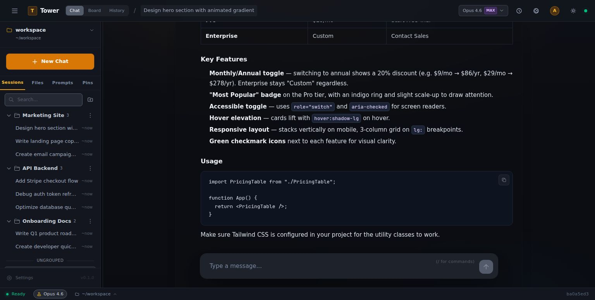
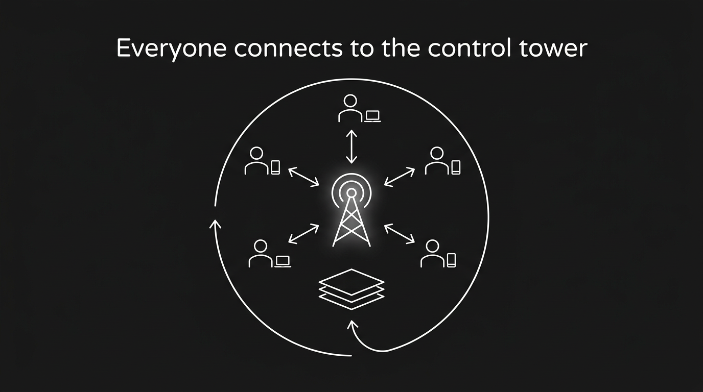
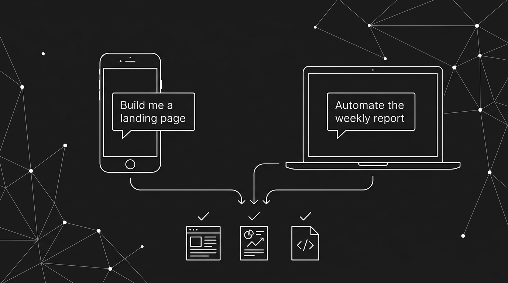
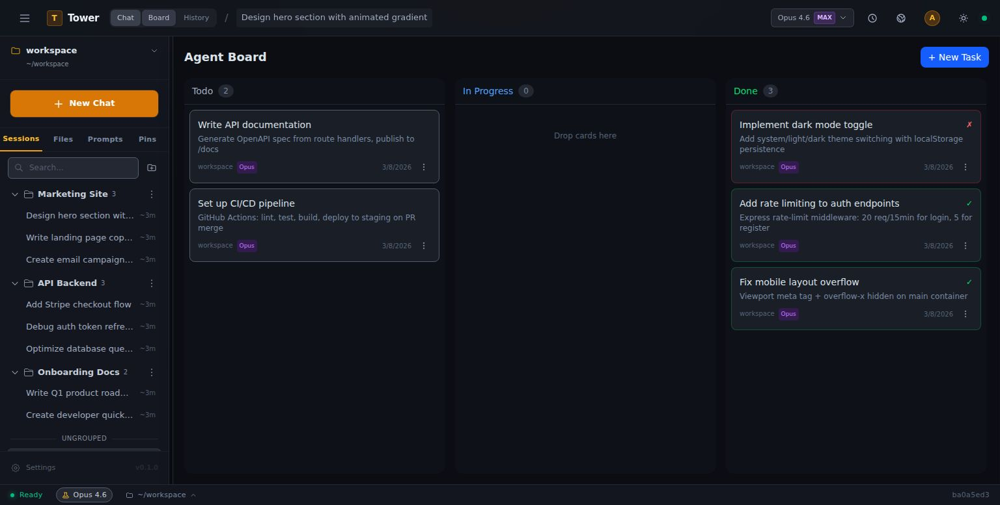
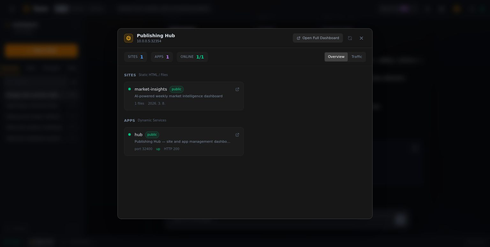
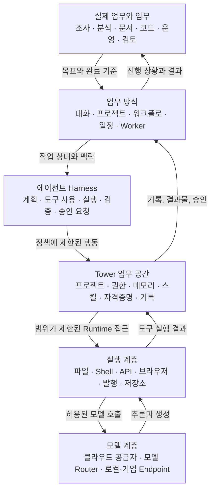

# Tower

> **Tower는 개발자만을 위한 Agent Harness가 아니라, 기업인이 AI와 함께 모든 업무를 운영하기 위한 Business OS입니다.**

에이전트를 만들고, 각 에이전트에 독립적인 컴퓨팅을 제공하고, 직원·고객·외부 사용자에게 배포하십시오. 조사, 문서, 데이터, 영업, 운영, 발행, 자동화까지 하나의 셀프호스트형 업무 공간에서 이어갈 수 있습니다.

지난 5개월간 실제 고객사와 함께 일하며 현장에서 필요한 작은 디테일을 하나씩 다듬었습니다. Tower가 모든 기업이 자체 Agent Harness를 처음부터 설계하고 구축하는 과정을 건너뛰고, 곧바로 자신만의 AI 운영체제를 시작하는 기반이 되기를 바랍니다.

[](LICENSE)
[]()
[](package.json)

🌐 [English](README.md) · [한국어](README.ko.md) · [설치 가이드](INSTALL.md) · [아키텍처](docs/tower-guide/architecture.md)

<p align="center">
  
</p>

---

## 에이전트를 만들고, 컴퓨터를 주고, 실제 업무에 배치하세요

Tower는 다음 네 가지 능력을 하나로 연결합니다.

### AI 에이전트를 만들고 배포하세요

에이전트의 역할, 약속, 운영 지침, 도구, 권한, 첫 임무를 정의하십시오. 사내 AI 동료, 고객용 AI 서비스, 외부 협업자를 위한 제한된 서비스로 배포할 수 있습니다. 사용자는 브라우저에서 에이전트를 사용하고, 운영자는 에이전트의 행동과 자원을 계속 통제합니다.

### 에이전트마다 독립적인 컴퓨팅을 제공하세요

진정한 에이전트에는 채팅창 이상의 환경이 필요합니다. Tower의 각 에이전트는 프로젝트 파일, 실행 환경, 메모리, 도구, 자격증명, 권한 정책을 갖춘 독립적인 업무 공간에서 작동합니다. 에이전트끼리 운영 맥락을 뒤섞지 않으면서 파일을 만들고, 명령을 실행하고, 연결된 서비스를 사용하고, 여러 세션에 걸쳐 업무를 이어갈 수 있습니다.

### 자신의 컴퓨터나 서버에 직접 구축하세요

Tower를 개인 컴퓨터, 업무용 Workstation 또는 조직 서버에 설치할 수 있습니다. 프로젝트 파일, 실행환경, 자격증명, 운영 기록을 자신이 통제하는 인프라 안에 보관하십시오. 로컬에서 시작하고, 팀이 준비되면 전용 서버로 옮길 수 있습니다.

### 원하는 LLM을 연결하세요

Tower는 하나의 모델 공급자에 종속되지 않습니다. 지원되는 클라우드 공급자, 모델 Router, OpenAI 호환 Endpoint 또는 조직 내부에서 제공하는 모델을 연결할 수 있습니다. 에이전트의 업무, 비용, 개인정보 보호, 안정성 요구에 맞는 모델 경로를 선택하십시오.

---

## 목차

- [에이전트를 만들고, 컴퓨터를 주고, 실제 업무에 배치하세요](#에이전트를-만들고-컴퓨터를-주고-실제-업무에-배치하세요)
- [개발자용 Harness에서 기업의 Business OS로](#개발자용-harness에서-기업의-business-os로)
- [Tower가 필요한 이유](#tower가-필요한-이유)
- [Tower란 무엇인가](#tower란-무엇인가)
- [누구에게 적합한가](#누구에게-적합한가)
- [Tower가 팀에 제공하는 것](#tower가-팀에-제공하는-것)
- [내가 Tower를 만든 이유](#내가-tower를-만든-이유)
- [Tower의 차이](#tower의-차이)
- [아키텍처 개요](#아키텍처-개요)
- [기능 지도](#기능-지도)
- [기술 스택](#기술-스택)
- [빠른 시작](#빠른-시작)
- [저장소 구조](#저장소-구조)
- [현재 상태](#현재-상태)
- [기여하기](#기여하기)
- [라이선스](#라이선스)

---

## 개발자용 Harness에서 기업의 Business OS로

강력한 Coding Agent는 개발자의 일하는 방식을 바꿨습니다. 파일을 읽고, 명령을 실행하고, 도구를 연결하고, 결과를 검증하는 자유도 높은 Harness는 단순한 채팅보다 훨씬 많은 일을 해낼 수 있었습니다.

하지만 기업의 업무는 코드만으로 이루어지지 않습니다.

```text
시장과 고객 조사
+ 제안서와 보고서
+ 데이터와 스프레드시트
+ 영업과 고객 대응
+ 회의와 후속 업무
+ 콘텐츠와 발행
+ 운영 점검과 반복 자동화
```

기업인이 이 모든 업무에 AI를 사용하려면 강력한 Harness만으로는 부족합니다. 비개발자도 웹과 모바일에서 쉽게 접근해야 하고, 파일과 대화가 업무별로 이어져야 하며, 에이전트마다 독립적인 실행환경이 필요합니다. Credential과 권한을 안전하게 연결하고, 중요한 행동은 사람이 승인하며, 결과를 조직의 기록과 재사용 가능한 Skill로 남길 수 있어야 합니다.

Tower는 이 전체를 하나의 Business OS로 묶기 위해 만들어졌습니다.

```text
자유도 높은 Agent Harness
→ 기업의 모든 업무를 다루는 Workspace
→ 독립적으로 실행하는 AI Teammate
→ 조직의 권한·기록·자동화 체계
→ 기업이 직접 소유하는 AI 운영체제
```

---

## Tower가 필요한 이유

기업이 자체 Agent Harness를 구축하려면 모델 API를 연결하는 것보다 훨씬 많은 기반이 필요합니다.

- 에이전트와 프로젝트의 Workspace를 어떻게 나눌 것인가?
- 실제 Computer와 Runtime을 어떻게 안전하게 제공할 것인가?
- 직원이 Web과 Mobile에서 어떻게 접근하게 할 것인가?
- File, Credential, Tool, 권한, 승인 경계를 어떻게 관리할 것인가?
- 반복되는 업무를 어떻게 Skill과 Automation으로 만들 것인가?
- 생성된 결과와 결정, 실패와 후속 작업을 어디에 남길 것인가?
- 내부 Agent와 고객용 AI Service를 어떻게 함께 운영할 것인가?

이 질문들은 데모에서는 작아 보이지만, AI가 실제 업무에 들어가는 순간 제품의 성패를 결정합니다.

지난 5개월간 Tower를 실제 고객사 업무에 적용하며 이런 세부사항을 하나씩 발견하고 다듬었습니다. 문서를 만드는 일부터 회의를 준비하고, 파일을 전달하고, 권한을 확인하고, 작업을 이어받고, 외부 Service로 배포하는 과정까지 — 일선에서 반복해서 부딪히는 작은 마찰을 제품의 기능과 운영 규칙으로 바꿔왔습니다.

> **Tower의 목표는 모든 기업이 이 기반을 다시 만드는 것이 아니라, 검증된 출발점 위에서 곧바로 자기 조직의 AI Teammate와 Automation을 구축하게 하는 것입니다.**

---

## Tower란 무엇인가

**Tower는 독립적인 컴퓨팅 환경을 갖춘 AI 에이전트를 만들고, 운영하고, 배포하는 셀프호스트형 플랫폼입니다.**

에이전트를 만들고 역할과 운영 정책을 정하고, 필요한 모델과 서비스를 연결하고, 실제 업무를 실행할 독립적인 Workspace를 제공하십시오. 그런 다음 에이전트의 파일, 메모리, 권한, 감사 기록을 유지하면서 내부 팀, 고객 또는 외부 사용자에게 배포할 수 있습니다.

> **모든 일을 직접 하는 방식에서, 팀과 함께 AI 동료를 지휘하는 방식으로.**

Tower는 모델 제공업체도, 터미널을 감싼 인터페이스도, 범용 채팅 UI도 아닙니다. Tower는 AI 업무를 둘러싼 조직 운영 레이어입니다.

- 이 에이전트는 누구인가?
- 무엇을 책임지는가?
- 어떤 프로젝트 맥락을 사용하는가?
- 어떤 파일과 도구에 접근할 수 있는가?
- 어떤 행동 전에 사람의 승인을 받아야 하는가?
- 업무 결과와 결정은 어디에 기록되는가?
- 성공한 업무 방식은 어떻게 재사용되는가?

Tower에서 에이전트는 단순한 이름이나 프롬프트가 아니라 하나의 업무 시스템입니다.

```text
역할과 약속
+ 운영 지침
+ 프로젝트 파일과 자료
+ 도구와 자격증명
+ 실행 환경
+ 권한과 승인 정책
+ 메모리, 세션, 결정, 결과물
+ 재사용 가능한 스킬과 자동화
```

---

## 누구에게 적합한가

Tower는 개발 도구를 만드는 것이 목적이 아니라, AI를 회사의 실제 운영체계로 만들려는 사람들을 위한 제품입니다.

잘 맞는 사용자와 팀:

- 조사, 영업, 문서, 데이터, 운영, 콘텐츠를 AI와 함께 수행하려는 1인 기업과 기업인
- 작은 인원으로 여러 기능을 동시에 운영해야 하는 스타트업과 소규모 팀
- 여러 부서가 함께 사용할 내부 AI Teammate와 Automation 기반이 필요한 기업
- 자체 Agent Harness를 처음부터 개발하는 대신 검증된 기반 위에서 빠르게 시작하려는 AI 전환팀
- 파일, Credential, 실행환경, 감사 기록을 직접 통제하려는 셀프호스트 조직
- 내부 업무용 Agent와 고객에게 제공할 AI Service를 같은 운영체계에서 관리하려는 팀

단순한 챗봇만 필요하거나, 한 명이 쓰는 코딩 도구만 필요하거나, 직접 운영할 필요가 없는 완전 관리형 SaaS를 원하는 경우에는 Tower가 첫 선택이 아닐 수 있습니다.

---

## Tower가 팀에 제공하는 것

### 1. 에이전트를 내부 직원·고객·외부 사용자에게 배포

Tower에서 만든 에이전트는 만든 사람의 개인 세션 안에 머물 필요가 없습니다. 내부 팀의 AI 동료가 될 수도 있고, 고객이 사용하는 AI 서비스가 될 수도 있으며, 외부 협업자가 브라우저에서 접근하는 제한된 업무 환경이 될 수도 있습니다.

- 각 에이전트의 정체성, 책임, 운영 약속 정의
- 버전이 기록된 에이전트 프로필과 승인된 기능을 배포에 연결
- 사용자가 보고, 업로드하고, 요청하고, 실행할 수 있는 범위 설정
- 과거 버전의 기록을 잃지 않고 새 행동 방식 배포
- 외부 사용자 화면과 비공개 운영 Workspace 분리

### 2. 에이전트마다 독립적인 컴퓨팅

모든 에이전트가 하나의 구분 없는 채팅 맥락을 공유하는 대신, 각 에이전트가 자신이 책임지는 독립적인 업무 환경을 가질 수 있습니다.

- 전용 프로젝트 파일과 생성 결과물
- 명령, 코드, 문서, 데이터를 처리하는 Runtime
- 에이전트별 메모리, 세션, 운영 지침, 결정
- 범위가 제한된 도구, Connection, Credential, 승인 규칙
- 여러 세션에 걸쳐 업무를 이어가고 결과를 보고하는 지속형 실행

이 경계가 있어야 에이전트가 실질적인 업무를 수행하면서도 책임과 접근 범위를 이해할 수 있습니다.

### 3. 공동 AI 업무 공간

각 프로젝트는 고유한 파일, 대화, 운영 지침, 결과물, AI 맥락을 가집니다. 프로젝트는 부서, 고객 업무, 제품, 연구 주제 또는 한 명의 Primary AI 동료가 책임지는 업무 공간이 될 수 있습니다.

- 개인에게 갇히지 않는 프로젝트 세션
- 프로젝트 파일과 생성된 결과물을 한곳에서 관리
- `AGENTS.md`를 통한 프로젝트별 운영 지침
- 검색 가능한 대화와 작업 기록
- 사용자, 프로젝트, 경로, 역할에 따른 권한 경계

<p align="center">
  
</p>

### 4. 대화에 그치지 않는 실제 실행

Tower의 에이전트는 실제 프로젝트 작업 공간에서 일합니다. 파일을 읽고 쓰고, 명령을 실행하고, 데이터를 분석하고, 보고서를 만들고, 사이트를 구축하고, PDF와 스프레드시트를 검토하고, 작업 결과를 직접 확인할 수 있습니다.

마케팅 담당자는 랜딩 페이지를 요청하고, 운영 담당자는 반복 보고서를 만들고, 엔지니어는 코드 변경을 맡길 수 있습니다. 모두 같은 브라우저 기반 업무 공간에서 진행됩니다.

<p align="center">
  
</p>

### 5. 에이전트 중심 프로젝트 모델

Tower는 프로젝트 안에 AI 채팅을 추가하는 방식에서 더 나아가 **책임 있는 AI 동료와 그 동료가 맡는 업무 공간**을 중심으로 발전하고 있습니다.

각 Primary AI 동료는 다음을 가질 수 있습니다.

- 이름, 역할, 약속, 운영 지침이 담긴 프로필
- 권한과 도구 정책
- Harness와 실행환경 연결
- 첫 임무와 기대 성과
- 버전이 기록되는 프로필 변경
- 과거 행동 조건을 보존하는 세션 스냅샷

에이전트를 만드는 일은 설정창을 채우는 것이 아니라 역할을 채용하는 일에 가깝습니다. 무엇을 책임질지, 무엇에 접근할지, 언제 사람에게 승인을 요청할지, 첫 번째 유용한 임무가 무엇인지부터 정합니다.

### 6. 팀의 업무 방식을 보존하는 스킬

좋은 AI 업무 방식은 세션이 끝날 때 사라져서는 안 됩니다. Tower의 스킬 시스템은 반복되는 워크플로를 재사용 가능한 플레이북으로 전환합니다.

예시:

- “우리 팀의 최고 영업 담당자 관점으로 이 제안서를 검토해줘.”
- “이 Markdown 문서를 출판 품질 PDF로 만들어줘.”
- “관련 파일과 과거 기록을 읽고 이번 회의를 준비해줘.”
- “이 스프레드시트의 위험, 수식, 합계를 분석해줘.”
- “프론트엔드 컴포넌트를 만들고 흔한 AI 디자인 흔적을 제거해줘.”

스킬은 조직, 프로젝트 또는 사용자 범위로 제공할 수 있습니다. 자격증명이 필요한 스킬은 모델에게 비밀값을 보여주는 대신 Tower의 Connection을 통해 권한을 연결합니다.

### 7. 비밀값을 노출하지 않는 Credentials와 Connections

에이전트는 Google Workspace, GitHub, API, 발행 대상, 내부 서비스 같은 실제 시스템에 접근해야 할 수 있습니다. Tower는 사용자가 보는 Connection과 그 뒤의 비밀 자격증명을 분리합니다.

- 자격증명은 Vault 기반 흐름에서 관리
- 허용된 Runtime 명령에만 비밀값 주입
- AI는 원문 값 대신 연결 상태와 사용 가능 여부만 확인
- 프로젝트 허용, Runtime 주입, 공급자 인증 상태를 구분해 추적
- 외부 또는 고위험 행동에 사람의 승인 요구 가능

### 8. 자동화와 지속형 AI Worker

Tower는 일회성 세션뿐 아니라 반복 일정, 채널형 상호작용, 문맥을 유지하는 지속형 AI Worker를 지원합니다.

활용 예시:

- 매일 또는 매주 생성하는 브리핑
- 시장·시스템 모니터링
- 장시간 조사 업무
- 이전 맥락을 이어가는 후속 작업
- 상위 세션에 결과를 보고하는 지원 에이전트

<p align="center">
  
</p>

### 9. 업무 공간에서 바로 발행

AI 업무의 결과는 사람들이 실제로 열어볼 수 있는 형태가 되어야 합니다. 정적 페이지, 보고서, 대시보드, 제안서, 생성된 파일을 별도의 복잡한 배포 과정 없이 공유할 수 있도록 Tower는 업무 공간과 연결된 발행 경로를 제공합니다.

<p align="center">
  
</p>

---

## 내가 Tower를 만든 이유

Tower는 개인적으로 가장 강력한 에이전트 환경을 만들려는 시도에서 시작했습니다.

Pi coding agent를 토대로 모델, 도구, 프롬프트, 스킬, 실행 방식까지 자유롭게 구성하는 Harness를 직접 설정해 사용하고 싶었습니다. 단순한 채팅이나 정해진 Agent Builder가 아니라, 필요하면 코드와 파일을 다루고 도구를 추가하며 업무에 맞게 계속 진화시킬 수 있는 환경이었습니다. 이 높은 자유도가 에이전트의 실제 성능을 끌어낸다고 느꼈습니다.

하지만 혼자 강력하게 사용하는 것만으로는 충분하지 않았습니다. **내가 만든 최고의 Harness를 팀원들도 별도 개발환경 없이 웹과 모바일에서 함께 사용하기를 원했습니다.** 한 명의 터미널과 한 대의 노트북에 묶인 도구가 아니라, 팀이 공동 맥락과 운영 규칙을 유지하면서 어디서든 AI 동료에게 일을 맡기는 구조가 필요했습니다.

그리고 에이전트에게 단순한 채팅 세션이 아니라 **실제로 독립된 컴퓨터를 함께 주고 싶었습니다.** 에이전트마다 파일과 Runtime, 도구와 자격증명, 메모리와 권한 경계를 갖추고, 조사·문서·코드·발행·모니터링·반복 업무처럼 비즈니스에 필요한 수많은 자동화를 지속적으로 실행하게 하는 것입니다.

여기서 제품의 형태가 분명해졌습니다.

```text
자유도 높은 Agent Harness
+ 팀이 함께 쓰는 Web·Mobile Workspace
+ Agent마다 독립된 Computer와 업무 맥락
+ 원하는 Model·Tool·Credential 연결
+ Business Automation과 지속적인 실행
= Tower
```

기존 AI 제품들은 이 경험의 일부를 매우 잘 해결합니다.

- **채팅 제품**은 누구나 모델을 쉽게 사용하게 하지만, 에이전트 Harness를 깊게 구성하거나 독립된 실행환경에서 지속적인 업무를 맡기기는 어렵습니다.
- **에이전트 Builder**는 프롬프트와 도구를 조립하고 배포하기 쉽게 하지만, 정해진 추상화 바깥까지 Harness를 바꾸거나 에이전트에게 완전한 업무용 컴퓨팅 환경을 제공하는 자유도는 제품마다 다릅니다.
- **코딩 에이전트**는 강력한 도구 사용과 컴퓨터 접근을 제공하지만, 대개 한 명의 기술 사용자와 그 사람의 로컬 환경을 중심으로 설계됩니다.
- **업무 자동화 도구**는 정해진 흐름을 안정적으로 반복하지만, 에이전트가 맥락을 이해하고 도구를 선택하며 예외에 대응하는 폭넓은 업무에는 별도의 Agent Layer가 필요합니다.
- **관리형 AI 서비스**는 운영 부담을 줄여주지만, 조직이 다른 회사의 인프라, 모델 선택, 통제 경계를 받아들여야 합니다.

Tower는 이 장점들을 하나의 팀용 구조로 연결하려는 플랫폼입니다. 강력하고 자유로운 Harness를 포기하지 않으면서, 그것을 웹과 모바일에서 함께 사용하고, 각 에이전트에 독립적인 컴퓨팅을 제공하고, 자신이 선택한 인프라와 모델 위에서 운영하는 것입니다.

목표는 거대한 조직만 AI 전환의 이점을 누리게 하는 것이 아닙니다. **1인 기업도 소규모 팀도 자신만의 AI 팀과 자동화 기반을 구축해, 이전에는 훨씬 큰 조직만 가능했던 속도로 실행하고 앞서나가게 하는 것**입니다.

Tower가 만들고자 하는 차이는 바로 이것입니다.

---

## Tower의 차이

| 기능 | Tower | 채팅 UI | 에이전트 Builder | 코딩 에이전트 CLI |
|---|:---:|:---:|:---:|
| 팀이 함께 보는 AI 업무 기록 | ✓ | 일부 | 일부 | — |
| 프로젝트 파일과 결과물 | ✓ | 제한적 | 제품별 상이 | 로컬 중심 |
| 실제 명령과 Runtime 실행 | ✓ | — | 제한적·제품별 상이 | ✓ |
| 팀 전체의 브라우저 접근 | ✓ | ✓ | ✓ | — |
| 프로젝트별 운영 지침 | ✓ | 제한적 | ✓ | ✓ |
| Credential과 Connection 거버넌스 | ✓ | 제한적 | 제품별 상이 | 로컬·수동 |
| 외부 행동에 대한 사람의 승인 | ✓ | 제한적 | 제품별 상이 | 수동 |
| 재사용 가능한 스킬과 플레이북 | ✓ | 일부 | ✓ | 로컬·수동 |
| 지속형 Worker와 반복 일정 | ✓ | 제한적 | 제품별 상이 | — |
| 생성 결과물 발행 | ✓ | — | 제품별 상이 | 수동 |
| 하나의 에이전트를 내부·외부 사용자에게 배포 | ✓ | 제한적 | ✓ | 수동 |
| 에이전트별 독립 Workspace와 Runtime | ✓ | — | 제한적·제품별 상이 | 수동 |
| 사용자가 선택한 모델 Endpoint 연결 | ✓ | 제품별 상이 | 제품별 상이 | 제품별 상이 |
| 셀프호스트형 조직 경계 | ✓ | 제품별 상이 | 드묾 | ✓ |

**한 줄 요약:** 채팅 제품은 모델을 쉽게 사용하게 하고, 에이전트 도구는 모델이 더 많은 일을 하게 합니다. Tower는 그 실행 능력을 조직이 함께 사용하고, 통제하고, 축적하게 합니다.

---

## 아키텍처 개요

개발을 시작할 때는 [문서 인덱스](docs/index.md) → [코드 변경 지도](docs/architecture/code-map.md) → 담당 모듈과 테스트 순서로 확인하십시오.

Tower는 팀의 실제 업무와 모델 계층 사이에 위치합니다. 단순한 프롬프트 UI도, 단순한 실행 Sandbox도 아닙니다. 업무 맥락, 에이전트 Harness, 권한, Runtime, 자격증명, 기록을 연결하는 운영 레이어입니다.



### 실행 개념

**Workstation**은 에이전트가 업무에 사용하는 영속 실행환경이고, **Worker**는 배정된 명령·파일 작업을 수행하는 실행 서비스입니다. **Project workspace**는 파일·맥락·접근 권한의 경계이며, 별도 VM이나 OS 계정을 자동으로 보장하는 말은 아닙니다.

코드의 `runtime-box/`, `workbench-*`에는 호환 이름이 남아 있습니다. 새 제품 설명을 Runtime Box 중심으로 확장하지 않지만, 문서 명칭 정비가 호환 구현 삭제나 운영 전환을 뜻하지는 않습니다. Workbench는 특정 작성·관리 UI의 이름으로도 사용됩니다. 정확한 구분과 코드 검색 alias는 [실행 개념 정본](docs/architecture/execution-terminology.md)을 확인하십시오.

### 핵심 구성요소

| 계층 | 역할 |
|---|---|
| **Frontend** | 대화, 프로젝트, 관리자 기능, 파일, 스킬, 사용량, 발행, 에이전트 화면을 제공하는 브라우저 업무 공간 |
| **Backend API** | 인증, 프로젝트·세션 관리, 에이전트 오케스트레이션, 자동화, 발행, 자격증명을 담당하는 Express·TypeScript 서비스 |
| **Project workspace** | 파일, 결과물, 운영 지침, 결정, 프로젝트별 Runtime 맥락 |
| **Agent runtime** | 정책 검사, Credential 주입, 결과 수집, 검증을 포함하는 Shell·도구 실행 계층 |
| **Memory and records** | 세션 기록, 프로젝트 맥락, 결정, 요약, 작업 실행, 일정, 감사 관련 이벤트 |
| **Skills** | 프로젝트·조직 범위와 도구별 실행 계약을 갖는 재사용 가능한 업무 지침 |
| **Connections** | Vault가 관리하는 자격증명과 공급자 인증 상태를 연결하는 사용자용 통합 인터페이스 |

---

## 기능 지도

### 협업

- 프로젝트별 세션
- 공유 가능한 대화 기록
- 실제 파일로 보존되는 결과물
- 채널형 AI 상호작용
- 사용자 역할과 프로젝트 멤버십
- `AGENTS.md`를 통한 프로젝트별 운영 지침

### 에이전트 운영

- Primary AI 동료 프로필
- 지속형 지원 에이전트
- 상위 세션에 보고하는 Worker
- 승인을 인식하는 도구 정책
- Runtime과 Harness 연결
- 과거 행동 조건을 보존하는 세션 스냅샷

### Runtime과 도구

- 프로젝트 Shell 실행
- 파일 읽기·쓰기·수정
- PDF, 스프레드시트, CAD, 이미지 분석
- 웹 검색·페이지 읽기·웹 캡처
- 발행과 PDF Export Pipeline
- Workspace Viewer를 통한 결과물 확인

### 지식과 재사용

- 스킬 Registry와 Materialization
- 대화와 Memory 검색
- 프로젝트 결정문서와 인계 산출물
- 보고서, 슬라이드, PDF, DOCX, 스프레드시트, 조사 업무 워크플로

### 거버넌스

- JWT 인증과 역할 검사
- 프로젝트와 경로 경계
- Credential Vault와 Connections
- Runtime Credential 주입 상태 검사
- 민감한 행동에 대한 사람의 승인
- 공개 Export와 Secret 검사 도구

---

## 기술 스택

| 영역 | 기술 |
|---|---|
| Frontend | React 18 · TypeScript · Vite · Zustand · Tailwind CSS |
| Backend | Node.js · Express · TypeScript · WebSocket |
| Database | PostgreSQL · 검색 Index · 구조화된 서비스 Table |
| Agent engines | 클라우드, 모델 Router, OpenAI 호환 경로를 지원하는 교체 가능한 Agent Runtime |
| Runtime | 프로젝트 Workspace · Shell 실행 · File Tool · Publishing/PDF/Browser Helper |
| Testing | Vitest · Playwright · TypeScript Typecheck · Source-contract Test |
| Packaging | npm Workspaces · 프로덕션형 설치를 위한 Nix 지원 |

---

## 빠른 시작

> Tower는 Research Alpha 단계입니다. 깨끗한 Ubuntu 22.04 또는 24.04 서버에서 시작하고, Runtime과 권한 모델을 이해하기 전에는 운영 자격증명을 연결하지 마십시오.

### Ubuntu 서버에 설치

설치기가 Node.js, 필요한 확장이 포함된 PostgreSQL, Tower 시스템 서비스, nginx, 로컬 비밀값과 최종 상태 점검을 한 번에 구성합니다.

빈 Ubuntu 서버에서는 공개 bootstrap 진입점을 사용합니다.

```bash
sudo apt-get update && sudo apt-get install -y curl ca-certificates
curl -fsSL https://raw.githubusercontent.com/moatai-io/towersource/main/scripts/oss/bootstrap.sh -o /tmp/tower-bootstrap.sh
sudo bash /tmp/tower-bootstrap.sh --public-url http://서버_IP
```

Git이 이미 설치되어 있다면 공개 저장소를 직접 clone할 수도 있습니다.

```bash
git clone https://github.com/moatai-io/towersource.git tower
cd tower
sudo bash scripts/oss/install.sh --public-url http://서버_IP
```

설치가 끝나면 `http://서버_IP`를 열어 첫 관리자 계정을 만드십시오. 모델 호출이 필요할 때 **설정 → Connections**에서 AI 공급자를 연결하면 됩니다.

외부 능력은 선택 사항입니다. 실시간 웹 검색은 현재 Firecrawl을 사용하며, Google Workspace와 이미지 생성은 각각 별도 Connection이 필요합니다. Tower의 기본 Workspace 사용을 막지 않고 나중에 연결할 수 있습니다.

도메인이 이미 서버를 가리킨다면 같은 명령에서 HTTPS까지 구성할 수 있습니다.

```bash
sudo bash scripts/oss/install.sh \
  --domain tower.example.com \
  --email admin@example.com
```

도메인 경로는 nginx 설정, Let's Encrypt 인증서 발급, 자동 갱신, HTTP→HTTPS 전환을 함께 처리합니다.

언제든 다음 명령으로 상태를 확인할 수 있습니다.

```bash
sudo bash /opt/tower/scripts/oss/doctor.sh --url http://서버_IP
sudo systemctl status tower
sudo journalctl -u tower -f
```

로컬 개발과 고급 배포 방식은 [INSTALL.md](INSTALL.md)를 참고하십시오.

---

## 저장소 구조

```text
packages/
  backend/      # API, 서비스, 에이전트 오케스트레이션, Runtime, Credential, Publishing
  frontend/     # React 기반 업무 공간 UI
  shared/       # 공용 Type과 Utility
skills/         # 관리형·프로젝트 공개형 Skill 정의
scripts/        # 개발, 검증, 셀프호스트 Helper
docs/           # Architecture와 Guide 문서
```

프로젝트 Workspace와 Runtime이 생성하는 파일은 추적되는 Source Tree 밖이나 Git에서 제외된 경로에 두어야 합니다. 자격증명, 실제 고객 데이터, 생성된 Runtime 상태, 로컬 환경 파일을 커밋하지 마십시오.

---

## 현재 상태

Tower는 **Research Alpha** 단계입니다. 사람과 AI 동료가 함께 일하는 셀프호스트형 업무 공간을 향해 빠르게 발전하고 있습니다.

현재 탐색하기에 충분한 영역:

- 프로젝트와 세션을 공유하는 업무 공간
- 실제 파일로 남는 AI 업무
- 스킬과 재사용 가능한 Workflow
- 에이전트 오케스트레이션
- Guardrail이 적용된 Runtime 실행
- 발행과 결과물 생성
- Credential과 Connection의 분리

주의해서 사용해야 하는 영역:

- 프로덕션 Hardening
- 조직별 Security Review
- 외부 행동과 Credential Grant
- 장시간 Worker 동작
- Multi-tenant 배포 가정
- 공개 인터넷 노출

Tower는 코드를 실행하고 파일에 접근할 수 있는 애플리케이션입니다. 실제로 배포할 때는 조직의 일반적인 보안·운영 통제 아래에 두십시오.

---

## 기여하기

다음 영역의 기여를 환영합니다.

- 더 안전하고 단순한 Self-host 설치 경로
- Runtime 격리와 권한 강화
- 더 명확한 Agent·Skill 작성 흐름
- 관리자 기능과 관측 가능성 개선
- 실제 팀 활용 사례를 보여주는 문서와 예제
- 안전과 Source Contract를 보존하는 테스트

기여하기 전에:

1. 저장소의 안전 규칙과 공개 Source 경계는 [AGENTS.md](AGENTS.md)를 확인하십시오.
2. 관련 테스트와 `npm run typecheck`를 실행하십시오.
3. 비밀값, 실제 배포 정보, 고객 기록, 생성된 상태, 로컬 Workspace 산출물을 커밋하지 마십시오.

---

## 라이선스

Tower는 [Apache License 2.0](LICENSE)에 따라 제공됩니다.
