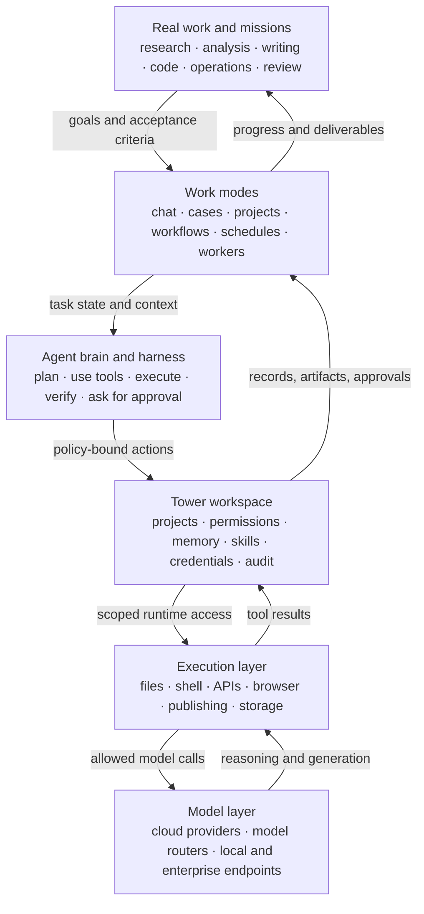

# Tower

> **Build the AI operating system your whole company can use — and own.**

Tower is an open-source **multiplayer agent harness with persistent compute access**, wrapped in a business-friendly workspace. Multiple people can direct AI teammates, continue their work, share what they learn, and keep every project inside a clear operating boundary.

Every AI teammate gets a real computer, a persistent workspace, memory, tools, credentials, and clear authority. Your people work with them from the web and mobile across research, sales, documents, data, operations, publishing, and customer service.

The goal is not another clever assistant in another private chat. It is a company-wide learning loop: work becomes shared context, successful methods become reusable skills, and every project makes the system more useful to the next person.

Run it on infrastructure you control. Choose the models and services that fit each job. Keep the operating knowledge your company creates.

**We are open-sourcing the product foundation we use to build Tower, run our own work, and support real customer operations. Tower was built with Tower — one experiment, failure, automation, and reusable system at a time.**

This is a seed, not a finished idea of how your company should work. Make it yours. Let your knowledge accumulate inside it, change the code, bring in new open-source tools, and keep incorporating what the community builds next.

[](LICENSE)
[]()
[](package.json)

🌐 [English](README.md) · [한국어](README.ko.md) · [Install](INSTALL.md) · [Architecture](docs/tower-guide/architecture.md)

<p align="center">
  
</p>

---

## Build an agent. Give it a computer. Put it to work.

An agent becomes useful when the system around it is ready for real work. Tower brings four parts of that system together:

### Create and deploy AI agents

Define an agent’s role, promise, instructions, tools, authority, and first mission. Deploy it as an internal AI teammate, a customer-facing AI service, or a controlled experience for external collaborators. Users can access the agent through the browser while you retain control over its behavior and resources.

### Give every agent independent computing

Every agent gets a computer, a workspace, a memory, and a job to own. Each Tower agent operates with its own project files, execution context, tools, credentials, and policy boundaries. It can produce artifacts, run commands, use connected services, and continue work across sessions without mixing one agent’s operating context with another’s.

### Run Tower on your own infrastructure

Your agents. Your infrastructure. Your models. Your operating rules. Install Tower on your computer, workstation, or organization server, and keep project files, execution, credentials, and operating records inside infrastructure you control.

### Connect the LLMs you choose

Tower is not tied to one model vendor. Connect supported cloud providers, model routers, OpenAI-compatible endpoints, or models served inside your own environment. Choose the model path that fits each agent’s work, cost, privacy, and reliability requirements.

---

## Contents

- [Build an agent. Give it a computer. Put it to work.](#build-an-agent-give-it-a-computer-put-it-to-work)
- [From a developer harness to a Business OS](#from-a-developer-harness-to-a-business-os)
- [Why Tower exists](#why-tower-exists)
- [What Tower is](#what-tower-is)
- [Who should try Tower](#who-should-try-tower)
- [What Tower gives a team](#what-tower-gives-a-team)
- [Why we are opening Tower](#why-we-are-opening-tower)
- [How Tower is different](#how-tower-is-different)
- [Architecture at a glance](#architecture-at-a-glance)
- [Feature map](#feature-map)
- [Tech stack](#tech-stack)
- [Quick start](#quick-start)
- [Repository layout](#repository-layout)
- [Status](#status)
- [Contributing](#contributing)
- [License](#license)

---

## From a developer harness to a Business OS

Powerful coding agents changed how developers work. A high-agency harness that can read files, run commands, connect tools, and verify results can do far more than a chat window.

But a business is made of more than code.

```text
market and customer research
+ proposals and reports
+ data and spreadsheets
+ sales and customer operations
+ meetings and follow-through
+ content and publishing
+ operational checks and recurring automation
```

To use AI across all of this work, business users need more than a powerful harness. People must be able to work from the web and mobile. Files and conversations must continue within the right work context. Every agent needs independent execution. Credentials and authority need safe boundaries, important actions need human approval, and successful work needs to become organizational records and reusable skills.

Tower was built to bring that entire system together as a Business OS.

```text
a high-agency agent harness
→ a workspace for every part of the business
→ independently executing AI teammates
→ organizational authority, records, and automation
→ an AI operating system the business owns
```

---

## Why Tower exists

Building an internal agent harness requires far more than connecting a model API.

- How should workspaces be separated across agents and projects?
- How can each agent receive a real computer and runtime safely?
- How should employees access it from the web and mobile?
- How should files, credentials, tools, authority, and approvals be governed?
- How do repeated operations become skills and automations?
- Where should results, decisions, failures, and follow-up work be recorded?
- How can internal agents and customer-facing AI services run in the same system?

These questions look small in a demo. They determine whether AI can survive contact with real operations.

Over the last five months, Tower has been applied to real customer work and refined around these details. Creating documents, preparing meetings, handing off files, checking authority, continuing interrupted work, and deploying external services repeatedly exposed small points of friction. Those points became product capabilities and operating rules.

> **Tower exists so every business does not have to rebuild this foundation. Start from a field-tested base and move directly to creating the AI teammates and automations your organization needs.**

---

## What Tower is

**Tower is a self-hosted, multiplayer agent harness for creating, operating, and deploying AI agents with persistent access to accountable computing environments.**

“Multiplayer” means AI work is not trapped in one operator's terminal or private chat. Authorized teammates can direct agents, continue sessions, inspect files and artifacts, and build on shared operating knowledge. Each agent can retain its own workspace and compute context across work instead of starting from an empty conversation every time.

Create an agent, assign its role and operating policy, connect the models and services it needs, and give it an independent workspace where it can execute real work. Then deploy it to your internal team, a customer, or an external audience while preserving the agent’s files, memory, authority, and audit trail.

> **Move from doing every task yourself to directing AI teammates — together.**

Tower is not a model provider, a terminal wrapper, or another general-purpose chat UI. It is the organizational layer around AI work: who an agent is, what it is responsible for, what it can access, when it must ask for approval, where its work is recorded, and how a successful workflow becomes reusable.

Tower does not treat an agent as a mascot or a thin prompt wrapper. In Tower, an agent is a work system:

```text
role and promise
+ operating instructions
+ project files and sources
+ tools and credentials
+ runtime execution environment
+ approval and authority policy
+ memory, sessions, decisions, and artifacts
+ reusable skills and automations
```

---

## Who should try Tower

Tower is not primarily a developer tool. It is for people who want AI to become part of how a business actually operates.

Good fits:

- Solo business owners and operators using AI across research, sales, documents, data, operations, and content
- Startups and small teams that must operate many business functions with few people
- Organizations that need shared internal AI teammates and an automation foundation across departments
- AI transformation teams that want to begin from a field-tested base instead of developing an internal agent harness from scratch
- Self-hosted organizations that need control over files, credentials, runtime, and audit records
- Teams that want to operate internal agents and customer-facing AI services in the same system

Tower is probably not the right first tool if you only need a simple chatbot, a single-user coding CLI, or a fully managed SaaS with no self-hosting responsibility.

---

## What Tower gives a team

### 1. Deploy agents to employees, customers, and external users

An agent built in Tower does not have to remain inside its creator’s private session. It can serve an internal team, become a customer-facing AI service, or support external collaborators through a controlled browser experience.

- Give each agent a clear identity, responsibility, and operating promise
- Bind deployment to a versioned agent profile and approved capabilities
- Choose what users can see, upload, request, or invoke
- Publish updated behavior without losing the record of earlier versions
- Keep external access separate from the private operator workspace

### 2. Independent computing for every agent

Each agent can have its own accountable work environment rather than sharing one undifferentiated chat context.

- Dedicated project files and generated artifacts
- Runtime execution for commands, code, documents, and data
- Agent-specific memory, sessions, instructions, and decisions
- Scoped tools, Connections, credentials, and approval rules
- Persistent work that can continue and report back across sessions

This isolation is what lets an agent do substantive work while keeping its responsibility and access boundaries understandable.

### 3. Shared AI workspaces

Every project has its own files, conversations, instructions, artifacts, and AI context. A project can represent a department, client, product, research area, or one primary AI teammate’s workcell.

- Shared sessions instead of isolated personal chats
- Project files and generated artifacts in one place
- `AGENTS.md` for project-specific instructions
- Searchable conversation and work history
- Permission boundaries for users, projects, paths, and roles

<p align="center">
  
</p>

### 4. Real execution, not just chat

Tower agents can work against an actual project workspace. They can read and write files, run commands, analyze data, generate reports, build sites, inspect PDFs, create slides, and validate their own work.

That means a marketing lead can ask for a landing page, an operator can ask for a recurring report, and an engineer can ask for a code change — all through the same browser-based workspace.

<p align="center">
  
</p>

### 5. Agent-first project model

Tower is moving from “AI chats inside projects” toward **AI teammates with accountable workspaces**.

Each primary agent can have:

- A visible profile: name, role, promise, and operating instruction
- Authority and tool policy
- Harness/runtime binding
- First mission and ROI expectations
- Versioned profile updates
- Session snapshots that preserve historical behavior

This makes agent creation feel less like filling out settings and more like staffing a role: What is this agent responsible for? What can it access? What should it ask a human to approve? What is the first useful mission?

### 6. Skills that preserve how the team works

A good AI interaction should not disappear after the session ends. Tower’s skill system lets teams turn repeated workflows into reusable playbooks.

Examples:

- “Review this proposal like our best sales operator”
- “Convert Markdown to a publication-grade PDF”
- “Prepare for this meeting using the relevant files and prior notes”
- “Analyze this spreadsheet and surface risks, formulas, and totals”
- “Generate a frontend component and remove the usual AI-design artifacts”

Skills can be scoped to the organization, a project, or a user. When a skill needs a credential, Tower routes that through Connections instead of asking the model to see secrets.

### 7. Credentials and Connections without leaking secrets

Agents often need access to real systems: Google Workspace, GitHub, APIs, publishing targets, or internal services. Tower separates the user-facing Connection from the secret material behind it.

- Credentials live in a vault-backed flow
- Secrets are injected only into eligible runtime commands
- The AI sees status and capability, not raw values
- Project grants, runtime materialization, and provider verification are tracked separately
- High-risk or external actions can require human approval

### 8. Automations and persistent workers

Tower supports one-off sessions, recurring schedules, channel-style interactions, and persistent AI workers.

Use it for:

- Daily or weekly briefings
- Market or system monitoring
- Long-running research
- Follow-up tasks that keep context
- Agent workers that report back to a supervisor session

<p align="center">
  
</p>

### 9. Publishing from the workspace

AI work often ends as something people need to open: a static page, report, dashboard, proposal, or generated artifact. Tower includes a publishing path so generated outputs can move from workspace files to shareable URLs without a separate deployment ritual.

<p align="center">
  
</p>

---

## Why we are opening Tower

Several projects showed important parts of the future before Tower.

[OpenClaw](https://github.com/openclaw/openclaw) made the open-source personal assistant tangible: an agent on your own machine, available through the channels you already use. But the moment we tried to extend the personal-assistant model across a company, the operating burden moved to the humans. Someone still had to keep countless projects and sessions understandable, separate credentials and authority, protect customer work, and make the result safely shareable.

[Grok Bot](https://docs.x.ai/grok-bot/teams-and-enterprises) recognized another essential fact: a useful AI coworker needs persistent compute, not just a chat window. Its managed approach makes that compute convenient for teams. The tradeoff is that the model, infrastructure, economics, and customization boundary remain largely the provider's. That can be a good choice for many teams; it is a difficult foundation for organizations that need long-term self-hosting, on-premise control, or freedom to assemble their own model stack.

Y Combinator's [QM](https://github.com/yc-software/qm) deserves particular credit for open-sourcing a multiplayer agent harness it uses internally. It is a strong expression of what highly technical teams can build when agents receive isolated workspaces and real tools. To us, it still feels closest to organizations already comfortable with developer workflows.

We believe there is another path for owner-led companies and non-IT teams: preserve the agency of a developer-grade harness, but wrap it in a business-friendly system the whole company can operate. Projects and sessions should remain understandable. Files, credentials, approvals, and authority should have explicit homes. Every AI teammate should have accountable compute. And the organization should remain independent of any single model or infrastructure vendor.

The most important asset is not the answer from today's best model. Models will change. **The durable asset is the learning loop the company owns:** the context it preserves, the decisions it records, the skills it refines, the automations it trusts, and the ability for one person's successful work to improve how everyone works next time.

That is why we are publishing the source we use ourselves and have shaped through real customer work. Tower was built with Tower. We used it to inspect its own code, design features, prepare releases, create documents, test new workflows, recover from failed experiments, and turn repeated work into automation. Building this way convinced us that an open, adaptable system is the best environment for trying many new things every day without throwing away what you learn.

Tower is a seed. As you use it, your organization's knowledge should accumulate inside it. You should be able to change the code, incorporate improvements from the community, apply new open-source models and tools, and grow a system that increasingly reflects how your own company works.

**Our hope is that Tower becomes a shorter path to building your own AI-operated company — business-friendly enough for the whole team, open enough to keep changing, and independent enough to remain yours.**

---

## How Tower is different

| Capability | Tower | Chat UI only | Agent builder | Coding agent CLI |
|---|:---:|:---:|:---:|
| Team-visible AI work history | ✓ | partial | partial | — |
| Project files and artifacts | ✓ | limited | varies | local only |
| Real command and runtime execution | ✓ | — | limited/varies | ✓ |
| Browser access for the whole team | ✓ | ✓ | ✓ | — |
| Project-specific operating instructions | ✓ | limited | ✓ | ✓ |
| Credential and Connection governance | ✓ | limited | varies | local/manual |
| Human approval points for external actions | ✓ | limited | varies | manual |
| Reusable skills/playbooks | ✓ | partial | ✓ | local/manual |
| Persistent workers and scheduled AI jobs | ✓ | limited | varies | — |
| Publishing generated artifacts | ✓ | — | varies | manual |
| Deploy one agent to internal or external users | ✓ | limited | ✓ | manual |
| Independent workspace and runtime per agent | ✓ | — | limited/varies | manual |
| Bring your own model endpoints | ✓ | varies | varies | varies |
| Self-hosted organizational boundary | ✓ | varies | uncommon | ✓ |

**Short version:** chat products make models accessible and agent tools make them capable. Tower turns that capability into a multiplayer system with persistent compute — shared, governable, and cumulative for an organization.

---

## Architecture at a glance

Tower sits between the team’s real work and the model layer. It is not just a prompt UI and not just an execution sandbox; it is the operating layer that connects work context, agent harnesses, permissions, runtime, credentials, and records.



### Core building blocks

| Layer | What it does |
|---|---|
| **Frontend** | Browser workspace for chat, projects, admin, files, skills, usage, publishing, and agent surfaces |
| **Backend API** | Express/TypeScript services, auth, project/session management, agent orchestration, automations, publishing, credentials |
| **Project workspace** | Files, generated artifacts, instructions, decisions, and project-local runtime context |
| **Agent runtime** | Shell/tool execution with policy checks, credential materialization, output capture, and validation loops |
| **Memory and records** | Session history, project context, decisions, summaries, task runs, schedules, and audit-relevant events |
| **Skills** | Reusable workflow instructions with project/organization visibility and tool-specific contracts |
| **Connections** | User-facing service integrations backed by vault-managed credentials and provider verification |

---

## Feature map

### Collaboration

- Project-scoped sessions
- Shared conversation history
- File-backed artifacts
- Channel-style AI interactions
- User roles and project membership
- Project-local instructions through `AGENTS.md`

### Agent operations

- Primary agent profiles
- Persistent support agents
- Worker/task reports back to supervisor sessions
- Approval-aware tool policies
- Runtime and harness binding
- Session snapshots for stable historical behavior

### Runtime and tools

- Project shell execution
- File read/write/edit operations
- PDF, spreadsheet, CAD, and image-aware analysis tools
- Web search/fetch and web capture flows
- Publishing and PDF export pipelines
- Static artifact presentation in the workspace viewer

### Knowledge and reuse

- Skills registry and skill materialization
- Conversation and memory search
- Project decisions and handoff artifacts
- Reusable report, slide, PDF, DOCX, spreadsheet, and research workflows

### Governance

- JWT auth and role checks
- Project and path boundaries
- Credential Vault and Connections
- Runtime credential materialization checks
- Human approval for sensitive actions
- OSS export and secret-scanning helpers

---

## Tech stack

| Area | Technology |
|---|---|
| Frontend | React 18 · TypeScript · Vite · Zustand · Tailwind CSS |
| Backend | Node.js · Express · TypeScript · WebSocket |
| Database | PostgreSQL with search-oriented indexes and structured service tables |
| Agent engines | Pluggable agent runtimes with cloud, routed, and OpenAI-compatible model paths |
| Runtime | Project workspaces, shell execution, file tools, publishing/PDF/browser helpers |
| Testing | Vitest · Playwright · TypeScript typechecks · source-contract tests |
| Packaging | npm workspaces · Nix deployment support for production-like installs |

---

## Quick start

> Tower is research-alpha software. Start on a fresh Ubuntu 22.04 or 24.04 server and do not connect production credentials until you understand the runtime and permission model.

### Install on an Ubuntu server

Tower's installer configures Node.js, PostgreSQL with the required extensions, the Tower system service, nginx, secure local secrets, and a final readiness check.

On a blank Ubuntu server, use the public bootstrap entry point:

```bash
sudo apt-get update && sudo apt-get install -y curl ca-certificates
curl -fsSL https://raw.githubusercontent.com/moatai-io/towersource/main/scripts/oss/bootstrap.sh -o /tmp/tower-bootstrap.sh
sudo bash /tmp/tower-bootstrap.sh --public-url http://YOUR_SERVER_IP
```

If Git is already installed, you can clone the public repository instead:

```bash
git clone https://github.com/moatai-io/towersource.git tower
cd tower
sudo bash scripts/oss/install.sh --public-url http://YOUR_SERVER_IP
```

Then open `http://YOUR_SERVER_IP` and create the first administrator account. Connect an AI provider from **Settings → Connections** when you are ready to run model calls.

External capabilities are optional: live web search currently uses Firecrawl, while Google Workspace and image generation require their own Connections. You can add them later without blocking the core Tower workspace.

If a domain already points to the server, install HTTPS in the same command:

```bash
sudo bash scripts/oss/install.sh \
  --domain tower.example.com \
  --email admin@example.com
```

The domain path configures nginx, obtains a Let's Encrypt certificate, enables renewal, and redirects HTTP to HTTPS.

Verify or troubleshoot at any time:

```bash
sudo bash /opt/tower/scripts/oss/doctor.sh --url http://YOUR_SERVER_IP
sudo systemctl status tower
sudo journalctl -u tower -f
```

For local development and advanced deployment options, see [INSTALL.md](INSTALL.md).

---

## Repository layout

```text
packages/
  backend/      # API, services, agent orchestration, runtime, credentials, publishing
  frontend/     # React workspace UI
  shared/       # shared types and utilities
skills/         # managed and project-visible skill definitions
scripts/        # development, validation, and self-host helpers
docs/           # architecture and guide materials
```

Project workspaces and runtime-generated files should live outside the tracked source tree or in ignored workspace paths. Do not commit credentials, customer data, generated runtime state, or local environment files.

---

## Status

Tower is in **research alpha**. The product is actively evolving toward an agent-first self-hosted workspace for teams.

What is solid enough to explore:

- Shared project/session workspace
- File-backed AI work
- Skills and reusable workflows
- Agent orchestration patterns
- Runtime execution with guardrails
- Publishing and artifact generation
- Credential/Connection separation

What should be treated carefully:

- Production hardening
- Organization-specific security review
- External actions and credential grants
- Long-running worker behavior
- Multi-tenant deployment assumptions
- Public internet exposure

If you deploy Tower, treat it like an application that can run code and touch files. Put it behind your organization’s normal controls.

---

## Contributing

Contributions are welcome, especially in these areas:

- Safer self-host installation paths
- Runtime isolation and permission hardening
- Clearer agent/skill authoring workflows
- Better admin and observability surfaces
- Documentation and examples for real team use cases
- Tests that capture safety and source-contract expectations

Before contributing:

1. Read [AGENTS.md](AGENTS.md) for repository safety and public-source boundaries.
2. Run the relevant tests and `npm run typecheck`.
3. Avoid committing secrets, private deployment details, real customer records, generated state, or local workspace artifacts.

---

## License

Tower is licensed under the [Apache License 2.0](LICENSE).
