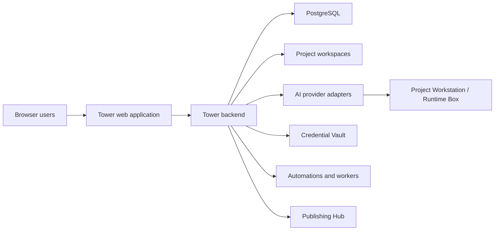
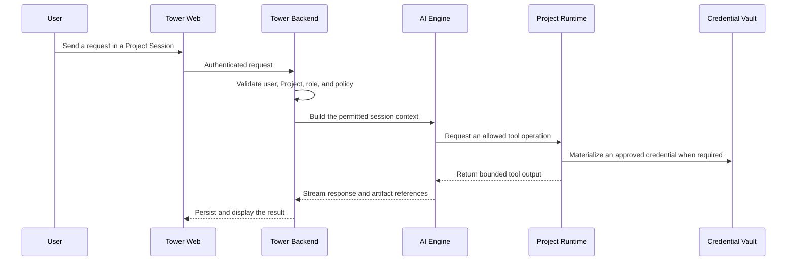

# Tower architecture

Tower is a self-hosted AI workspace for teams. It combines a web application, durable project workspaces, AI execution, credentials, skills, automations, and publishing behind one permission model.

This document describes the public product architecture. Environment-specific deployment, customer fleet operations, signing, backup, and private release procedures are intentionally outside this repository.

## System overview



## Core concepts

### Project

A Project is Tower's technical boundary for files, conversations, members, credentials, and runtime policy. In the product, a Project can be presented as the workspace owned by a Primary AI teammate.

A Project contains or references:

- project files and generated artifacts;
- sessions and searchable conversation history;
- project instructions such as `AGENTS.md`;
- member and role assignments;
- skills available to the project;
- permitted credentials and external connections;
- execution and approval policies.

Projects should be treated as durable workspaces, not temporary chat folders.

### Session

A Session is a conversation and execution history inside a Project. It preserves messages, selected model and engine information, generated artifacts, work progress, and resumable AI context.

Sessions are scoped by Project permissions. A user who cannot access the Project must not gain access through a Session URL or generated artifact reference.

### Primary AI teammate and Helper Agents

A Primary AI teammate is the user-facing owner of a Project workspace. Its profile can define a role, promise, operating instruction, authority, and tool policy.

Helper Agents are delegated specialists. They do not acquire broader Project or Credential authority merely because they were created by another agent.

### Workstation and Runtime Box

Tower can execute AI work against a real project filesystem.

- The **Project Workstation** is the assigned environment for commands, builds, tests, and file operations.
- A **Runtime Box** is an isolated execution boundary used when a task or provider path requires controlled runtime materialization.
- Runtime execution receives only the Project, path, tool, and credential authority granted for that run.

The browser never becomes the authority source for filesystem or runtime access. The backend validates the current user, Project, role, path, and operation.

## Request and execution flow



## Context model

Tower builds AI context from explicit, bounded sources. The exact provider payload can differ by engine, but the product contract is consistent.

1. **Tower system policy** — shared safety, collaboration, artifact, and permission behavior.
2. **Runtime context** — current user, role, Project, Session, filesystem boundary, and available tools.
3. **Project instructions** — the Project's `AGENTS.md` and other explicitly loaded project context.
4. **Skills and runtime guides** — specialized instructions loaded only when relevant and available to the Project.
5. **Conversation continuity** — persisted Session messages and authorized memory/search results.

Provider-specific compatibility files are not the product-level source of truth. `AGENTS.md` is the canonical project instruction file.

## Data and storage boundaries

Tower separates several kinds of durable state.

| Data | Boundary | Typical storage |
|---|---|---|
| Users, Projects, Sessions, permissions | Tower server | PostgreSQL |
| Project files and artifacts | Project | configured workspace storage |
| Personal files and notes | individual user | Personal Space storage |
| Credential metadata and encrypted values | user, Project, or organization grant | Credential Vault |
| Runtime logs and transient execution state | one execution environment | runtime-specific state directories |
| Published static outputs | published site and access policy | Publishing Hub storage |

A file being present on the same server does not imply that every user or Project may access it.

## Credentials and external services

Credentials are operational secrets, not project files.

- Secret values are not stored in `AGENTS.md`, skills, source code, or reusable documents.
- A Connection describes which provider account may be used and by which Project or principal.
- Runtime materialization is separate from Connection configuration.
- Provider authentication success is separate from both configuration and materialization.

This separation prevents a provider error from being misdiagnosed as a missing or deleted credential.

## Skills and runtime guides

Skills are reusable, task-specific operating instructions. Projects can have their own skills and can receive organization-managed skills through a materialized runtime copy.

Runtime guides describe shared tool contracts such as PDF analysis, publishing, visualization, Git, or agent orchestration. They are packaged with the application because runtime code resolves them by path.

See [Skills](./skills.md) for the current source and materialization model.

## Automations and persistent work

Tower supports work that outlives a single response:

- scheduled AI prompts and recurring briefings;
- persistent Helper Agents that retain their own session context;
- auditable work steps and execution history;
- explicit approval before protected external or destructive actions.

An automation does not bypass Project permissions. Each run is evaluated under a defined Project and user/owner authority.

## Publishing

Publishing turns a project-local static output into a controlled URL through Tower's Publishing Hub.

The publish operation validates the current user and Project, copies an explicit output directory, records visibility, and returns the URL only after successful publication. Direct writes into server publishing directories are not part of the public contract.

## Public source and private operations

The OSS repository is the source of truth for product code, migrations, public build definitions, public tests, and self-hosting documentation.

Private operations may use a separate repository for deployment orchestration, fleet registries, signing, backups, rollback procedures, and environment-specific policy. Private operations should reference an immutable OSS commit or release; they should not maintain a second copy of product source or overwrite OSS-controlled product paths.

## Development entry points

```bash
npm install
npm run dev
npm run typecheck
npm test
npm run build
```

Default development ports are documented in the root `AGENTS.md` and package scripts. Installation and production setup are covered in [`INSTALL.md`](../../INSTALL.md).
