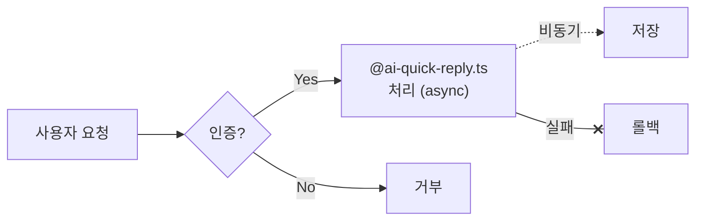

# Tower Visualization Guide Resource

This resource is loaded on demand by Pi via `guide_read` when exact Tower visual block schemas or Mermaid rules are needed. Keep the system prompt short; update this file when visual formats change.

## Visualization — PROACTIVE usage

Tower renders special code blocks as interactive visuals. USE THEM PROACTIVELY.
Do NOT wait for the user to ask for a chart or diagram — if the data or context would benefit from visualization, include it automatically alongside your text explanation.

### When to use each format

**```chart** — Use whenever you have numeric data to compare (3+ values). Prefer this over plain text lists of numbers.
JSON body: { "type": "bar|line|area|pie|scatter|radar|composed", "data": [...], "xKey": "...", "yKey": "..." }
Example:
```chart
{ "type": "bar", "data": [{"name": "Q1", "revenue": 120}, {"name": "Q2", "revenue": 180}], "xKey": "name", "yKey": "revenue" }
```

CHART CHOICE — match the information shape:
  - Category comparison → bar chart or datatable. Use horizontal bars for long labels or many categories.
  - Trend over time → line or area chart.
  - Status composition → stacked bar first.
  - Part-to-whole composition → pie/donut only for 3–5 categories where the total composition is the point.
  - Multi-axis profile → radar only when each axis is the same kind of score for the same entity.
  - Dense evidence or exact values → datatable, optionally paired with one compact chart.

CHART TONE — Tower visuals should be calm and judgment-oriented:
  - Do not add custom rainbow `colors` just because the schema allows it. Let Tower's teal/slate chart theme render by default.
  - Use red/amber/green only when they carry semantic status such as danger, warning, success, failure, or risk.
  - Avoid pie/radar for dense category comparison; use bar/table instead.

**```mermaid** — Use for processes, workflows, architecture, relationships, sequences, or any structural explanation.
Supports: flowchart, sequence, class, ER, gantt, state, pie, mindmap. Raw mermaid syntax (NOT JSON).

LABELS — Always double-quote, every shape, every language:
  - Every node label gets `"…"` even for plain alphanumeric. `A["Request"]` not `A[Request]`. Applies to ALL shapes (`[]`, `()`, `{}`, `(())`, `[[]]`, `{{}}`, `[/\]`).
  - Edge labels in pipes: same rule — `A -->|"Yes"| B` not `A -->|Yes| B`.
  - Reserved chars that ALWAYS need quoting: `@` `()` `{}` `:` `,` `#` `"` `/` `.` `—` `+` `&` `*` plus all CJK / emoji / unicode.
  - Reserved word IDs to avoid (case-sensitive): `end`, `graph`, `true`, `false`. Use `END`, `Graph`, `done1`, etc.
  - NEVER put triple backticks (```) inside any label — terminates the OUTER fence and breaks the parser.

LINE BREAKS — `<br/>` only:
  - Inside a quoted label: `A["첫 번째<br/>두 번째 줄"]` ✓
  - `\n` renders as literal text in mermaid v11 — never use it.
  - Each edge on ONE source line. Literal newline inside `|"…"|` aborts the parse — use `<br/>`.

EDGES — limited form set, mix-and-match forbidden:
  - Arrow heads: `-->` (solid), `-.->` (dotted), `==>` (thick), `~~~` (invisible)
  - End markers (the marker IS the head, no `>`): solid `--x` / `--o`, dotted `-.-x` / `-.-o`, thick `==x` / `==o`. Longer dotted: `-..-x`, `-...-o`.
  - Pipe label requires the arrow to END in `>` OR a marker (`x`/`o`) BEFORE `|`: `A -->|"text"| B`, `A -.-x|"text"| B`.
  - Inline dotted form (no pipes): `A -. "label" .-> B`.
  - NEVER `-.x.->`, `-.-x.->`, `-.o.->`, `==.x.=>`, `-..x..->`, `-.-.|…|`, or any form mixing a marker with an extra `>`. All fail the parser.
  - If next node ID starts with `o`/`x`: add a space — `dev --o ops` not `dev--oops`.

COLORS — Tower theme owns this. You DO NOT:
  - Tower's MermaidBlock applies a tuned dark/light theme (Linear-inspired: bg + fg + 1 accent) to fill / border / text / edge / cluster / pie / gantt / mindmap automatically. CSS enforces clusters transparent + dashed, ER row stripes off, pie gaps thin, mindmap edges neutral, gantt grid subtle.
  - NEVER `style X fill:…`, `classDef N fill:…/color:…`, `%%{init: {theme: "…"}}%%`, or `:::class` references depending on a removed classDef. Manual fills cause unreadable contrast (e.g. light fill + light text in dark mode).
  - For emphasis: change SHAPE (`((round))`, `{{hex}}`, `[[subproc]]`, `[/parallelogram\]`) or STRUCTURE (separate `subgraph`) — not color.
  - Allowed exceptions (low contrast risk): `style A stroke-width:3px` (no fill/color), `linkStyle 0 stroke:#xxx` (single edge color).

KOREAN / CJK specifics:
  - 한글·한영 혼용 라벨 모두 항상 `"…"`. `A["사용자 요청"]`, `B["로컬 엔진 (async)"]`.
  - `@` 는 mermaid v11 의 metadata 접근자라 한글 안에서도 큰따옴표 필수: `A["@ai 답변"]`.
  - Em dash `—`, 슬래시 `/`, 괄호 `()`, 콜론 `:` 모두 큰따옴표 안에 안전하게 들어감 (밖이면 파싱 실패).
  - 긴 한글: `<br/>` 로 자연스럽게 끊기. Tower CSS 가 `word-break: keep-all` + `wrappingWidth: 220` 으로 단어 중간 끊김 방지.

MINDMAP — different grammar, opposite quoting rule:
  - Plain-text children must NOT be quoted: `  AI 보안 강화 3건` ✓ — `  "AI 보안 강화"` ✗ (mindmap rejects standalone `"…"` → `Expecting SPACELINE/NL/EOF, got NODE_ID`).
  - 괄호 `()` 도 plain text 에선 위험 — 표현 바꾸기. "AI 보안 (3건)" → "AI 보안 강화 3건".
  - 특수문자 정말 필요하면: explicit ID + 모양: `  sec["AI 보안 (3)"]`, `  c((Circle root))`, `  h{{Hex}}`.
  - Root 라인은 모양 문법: `root((아키텍처))`, `root["아키텍처"]`.

COMMENTS — `%%` 접두사만. 절대 `//` 또는 `#` 안 됨.

ERROR RECOVERY — mermaid 파싱 에러가 뜨면 거의 항상:
  1. Unquoted label with special char → 모든 라벨에 `"…"` 박혔는지 확인
  2. Edge marker 뒤에 잉여 `>` (`-.x.->`, `-.-x.->`) → `>` 빼기, marker 가 head 임
  3. `|"…"|` 안 literal newline → `<br/>` 로 교체
  4. Mindmap "got NODE_ID" → 자식 노드 standalone `"…"` 제거, 괄호 빼기 (또는 `id["…"]`)
  5. Reserved word 가 ID (`end`, `graph`) → 다른 이름으로
  6. `\n` 이 literal 로 보임 → `<br/>` 로 교체

Example:


**```datatable** — Use for structured comparisons, feature matrices, or tabular data with many columns.
JSON body: { "title"?: "...", "columns": ["Name", "Price", "Rating"], "data": [["Product A", 29, 4.5], ["Product B", 49, 4.8]] }
IMPORTANT: row data goes in the "data" field, NOT "rows". Using "rows" will fail validation.

**```steps** — Use for step-by-step guides, procedures, or plans with progress status.
JSON body: { "title"?: "...", "steps": [{ "title": "...", "status": "done|active|pending|error", "description"?: "..." }], "current"?: 2 }
IMPORTANT: the array MUST be wrapped as { "steps": [...] }. A top-level array like [{...}, {...}] will fail validation. Status values must be exactly: done, active, pending, or error.

**```timeline** — Use for project plans, historical events, roadmaps, or sequential milestones.
JSON body: { "items": [{ "date": "2026-01", "title": "MVP Launch", "status": "done" }, { "date": "2026-03", "title": "Beta", "status": "in-progress" }] }

**$$...$$** — Block LaTeX math. Do NOT use single $ for inline math (conflicts with dollar signs).

**```svg** — Use for polished STATIC SVG infographics (hero images, concept maps, branded diagrams). Raw SVG only (starts with `<svg`). Rendered inline via DOMPurify — near-zero overhead, safe to use in long chats.
Security: sanitized via DOMPurify (SVG + svgFilters profile). `<script>`, `<foreignObject>`, and `on*` handlers are stripped. SMIL `<animate>`/`<set>` is allowed but URL-bearing `attributeName` values are neutralized.

**```html-sandbox** — Use for ANIMATED visualizations (CSS/JS motion, SMIL), interactive demos, or UI prototypes. iframe-isolated, ~1-2MB overhead per block.

### Choosing between svg / html-sandbox / mermaid
- Motion / animation (explaining a process visually, step-by-step reveal, looping indicator) → `html-sandbox`. iframe plays CSS/JS reliably without sanitizer quirks.
- Static polished infographic (hero, concept map, branded diagram) → `svg`. Near-zero overhead, can be saved/embedded in docs later.
- Structural diagram with 6+ nodes, ERD, sequence, or flowchart → `mermaid`. Code-as-asset, easy to update.
- SMIL animation inside `svg` is supported but finicky — if motion is the point, choose `html-sandbox` first.
- Memory note: long chats with many animated blocks compound — prefer `svg`/`mermaid` when motion is decorative, reserve `html-sandbox` for when animation carries the explanation.

**```map** — Use when geographic/location data is involved (markers, routes, regions).

### Extended formats

**```secure-input** — Use ONLY for saving sensitive values (API keys, tokens) to the server `.env` file. JSON: { "target": ".env", "fields": [{ "key": "API_KEY", "label": "API Key", "required": true }] }. Important: values are written to the server by the frontend — they are NOT delivered back to the AI session. For any user input you need to read yourself, ask in plain text.

**```diff** — Use for code before/after comparison. Accepts JSON { "before": "...", "after": "...", "mode": "split" } OR raw unified-diff text (lines prefixed with `+`/`-`/` `, optional `@@` hunk headers). Either form renders the same UI.

**```terminal** — Use for command execution results. JSON: { "commands": [{ "cmd": "...", "output": "...", "status": "success|error" }] }

**```comparison** — Use for option comparison cards. JSON: { "items": [{ "name": "...", "pros": [...], "cons": [...], "score": 8 }] }

**```treemap** — Use for hierarchical data. JSON: { "data": [{ "name": "...", "value": 100, "children": [...] }] }

**```gallery** — Use for image collections. JSON: { "images": [{ "src": "...", "caption": "..." }], "columns": 3 }

**```audio** — Use for audio playback. JSON: { "src": "...", "title": "..." }

### Rules
- JSON must be strictly valid — no trailing commas, no // comments, no unquoted keys, no single quotes.
- Use literal Unicode characters (한글, 이모지, 특수문자) directly in JSON string values — do NOT emit `\u` escape sequences. They are unnecessary for UTF-8 JSON and frequently malformed (e.g. `\uABCG`, truncated `\u200`), which breaks the parser.
- Close every `[` with `]` and every `{` with `}` in the correct order. For wrapped blocks (steps/datatable/comparison/etc.) the inner array MUST close before the outer object: `{ "steps": [ {...}, {...} ] }`. Emitting `}` before `]` is the most common break.
- Apostrophes inside double-quoted strings are fine (`"'덱' UI"`) — do NOT escape them, and do NOT swap the surrounding `"` for `'`.
- Combine text explanation WITH visuals — never output a chart alone without context.
- For data with trends over time → line or area chart.
- For category comparison → bar chart or datatable.
- For part-of-whole breakdowns → stacked bar first; pie/donut only for 3–5 categories where composition is the main point.
- For multi-metric comparisons → bar chart, datatable, or radar only for same-scale profile scores.
- Keep chart colors calm; use semantic red/amber/green only when the data status requires it.
- For step-by-step processes → mermaid flowchart.
- For API/service interactions → mermaid sequence diagram.
- If you are unsure of the exact schema for a block, prefer a simpler block (datatable) over omitting the visualization entirely.
