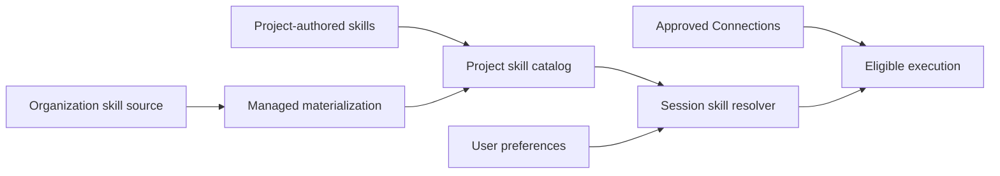

# Skills in Tower

Skills are reusable operating instructions that help an AI teammate perform a specific kind of work consistently. A skill can define when it should be used, required tools or credentials, an execution workflow, validation steps, and expected artifacts.

A skill is not a hidden prompt shortcut. It is a versioned work instruction that can be inspected, reviewed, and made available to selected Projects.

## How skills fit into Tower



Tower separates four concerns:

1. **Source** — where the reviewed skill body is authored.
2. **Availability** — which skills are present for a Project.
3. **Preference** — whether a user has enabled or disabled an available skill.
4. **Credentials** — which approved external accounts an eligible execution may use.

Changing one concern does not silently change the others.

## Skill sources

### Project-authored skills

A Project can own skills under its workspace:

```text
<project>/skills/<skill-name>/SKILL.md
```

Use this for instructions that belong to one team, client, workflow, or AI teammate. These files are normal Project assets and should be reviewed like other operational documentation.

### Organization-managed skills

A self-hosted organization can maintain a reviewed set of shared skills outside individual Projects. Tower materializes the selected set into each Project's managed runtime layer.

The Project-visible managed state is described by:

```text
<project>/.tower/skills/manifest.json
<project>/.tower/skills/<skill-name>/
```

The `.tower/skills` tree is generated runtime state, not the normal authoring location. Do not hand-edit generated managed copies and expect those edits to become the organization source.

### Compatibility imports

Tower may recognize legacy project-local skill folders during migration. Compatibility paths are import or fallback mechanisms, not recommended long-term sources for new skills.

## Skill structure

Every skill has a `SKILL.md` file. A well-formed skill normally explains:

- the job it performs;
- clear **Use when** triggers;
- clear **Not for** boundaries;
- required tools, data sources, and Connections;
- the execution sequence;
- approval points for protected actions;
- validation and artifact requirements.

A skill directory may also contain templates, scripts, examples, schemas, or reference material. If those assets materially affect the result, the AI should inspect them before claiming to have followed the skill.

Example:

```text
skills/
└── meeting-prep/
    ├── SKILL.md
    ├── templates/
    │   └── agenda.md
    └── references/
        └── checklist.md
```

## Discovery and activation

Tower does not need to inject the full body of every skill into every Session.

1. The Session receives the list of skills available to the current Project and user.
2. Skill names and descriptions are used only for routing.
3. When a skill matches the request, Tower reads the complete `SKILL.md`.
4. The AI follows the required workflow and relevant bundled assets.
5. If a required skill or credential is unavailable, the AI reports the concrete boundary instead of pretending the skill was used.

A slash command such as `/meeting-prep` can explicitly select a skill. Natural-language requests can also activate an available skill when the request clearly matches its documented triggers.

## Project availability and user preferences

A skill must be present in the Project's effective catalog before a user preference can enable it.

- The managed manifest defines organization-provided skills available in that Project runtime.
- Project-authored skills are discovered from the Project source folder.
- User preferences can enable or disable available skills for that user.
- A preference record does not install a missing skill.
- A stale directory that is not part of the effective manifest must not be treated as an active managed skill.

This distinction prevents old or partially copied skills from appearing as valid runtime capabilities.

## Credentials and Connections

Skills never own secret values.

A skill may declare that it needs a provider or environment variable name, but the actual credential is stored and authorized through Tower Connections and Credential Vault.

The execution path distinguishes three stages:

1. **Configured** — an allowed Connection exists for the current principal or Project.
2. **Materialized** — the eligible runtime command received the required secret without exposing its value.
3. **Accepted** — the external provider accepted the authentication.

A provider `401` or “not authenticated” response does not, by itself, prove that the Credential was deleted or never configured.

Never put API keys, passwords, OAuth tokens, private keys, or credential JSON in:

- `SKILL.md`;
- Project source files;
- `.env.example` values;
- examples or fixtures;
- chat messages or generated documentation.

## Permissions and approvals

A skill does not expand authority.

- Project and filesystem access still follow the current user and Project boundary.
- A Helper Agent does not inherit broader access merely because another agent delegated work to it.
- External writes, destructive actions, deployment, purchases, and other protected operations can require explicit approval.
- Tool availability and credential grants are evaluated separately from the skill body.

Skills should document approval points, but enforcement belongs to Tower's runtime and backend authorization layers.

## Managing skills in the UI

The Skills catalog shows the effective skills visible to the current user and Project. Depending on role and deployment policy, users can:

- inspect available skills;
- review descriptions and required Connections;
- enable or disable an available skill;
- open or create a Project-authored skill;
- identify whether a skill is Project-owned or organization-managed.

Organization-managed source changes should go through the organization's review and rollout process rather than editing a generated Project copy.

## Materialization for self-hosted installations

Tower includes a materialization command for applying the configured organization skill set to registered Projects:

```bash
npm run skills:materialize -- --all-projects
```

Useful narrower forms include:

```bash
npm run skills:materialize -- --project <project-id-or-name>
npm run skills:materialize -- --project-root /path/to/project
```

Materialization should be treated as a controlled synchronization step:

- validate the selected skill names and source;
- write an explicit manifest;
- avoid exposing host-global skill folders as a shortcut;
- refuse unsafe or incomplete managed state;
- verify the Project-visible manifest and skill files after the run.

Run `npm run skills:materialize -- --help` for the options supported by the installed version.

## Runtime guides are different

Runtime guides under `docs/tower-guide/resources/` are packaged tool-contract resources used by Tower itself. They cover shared behavior such as PDF analysis, PDF export, publishing, visualization, Git, spreadsheets, CAD, and agent orchestration.

They are not user-installed skills and do not appear in the Skills catalog. Their paths and names are application contracts because backend code resolves and packages them. Move or rename them only with the corresponding code and tests.

## Authoring guidance

When writing a new skill:

1. Start with one concrete job to be done.
2. Define positive triggers and explicit exclusions.
3. Name required data sources, tools, and Connections without embedding secrets.
4. Separate inspection and recommendation from mutation.
5. Require approval immediately before protected actions.
6. Define evidence-based validation.
7. Keep generated runtime copies out of the authoring workflow.
8. Test the skill in a Project with only the permissions it actually needs.

A good skill makes expert work more repeatable without hiding authority, data, or failure conditions.

## Related documentation

- [Tower architecture](./architecture.md)
- [Runtime visualization formats](./visual-formats.md)
- [Installation Guide](../../INSTALL.md)
