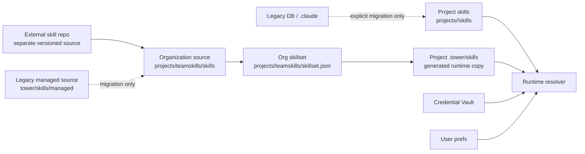

# 스킬 시스템

Tower 스킬 시스템은 이제 “중앙 레지스트리 하나가 스킬 본문과 런타임을 모두 통제”하는 구조가 아니다.

한 줄로 정리하면:

> **스킬 본문은 Tower product repo가 아니라 별도 스킬 소스가 정본이다.** 이 VM에서는 `teamskills/skills`가 운영 정본이고, 프로젝트는 generated `.tower/skills` 복사본을 읽는다.

## 1. 핵심 그림



## 2. SSOT — 무엇이 어디의 정본인가

| 영역 | 정본 | 설명 |
|---|---|---|
| 프로젝트 스킬 | `workspace/projects/<project>/skills/<skill>/SKILL.md` | 프로젝트 팀이 직접 만든 스킬 본문. Skill Browser 생성/복사의 기본 목적지. |
| Operator workbench 스킬 | `workspace/projects/project-2/skills/<skill>/SKILL.md` | `skill-registry`, `fleet`, `runtime-box-credentials` 같은 Tower 운영 스킬의 작성 정본. `tower/skills/<skill>`은 당분간 mirror/bootstrap 경로. |
| 조직 공용 스킬 본문 | `workspace/projects/teamskills/skills/<skill>/SKILL.md` | 해당 VM/조직의 여러 프로젝트에 materialize되는 스킬 원본. |
| 조직 기본 스킬셋 | `workspace/projects/teamskills/skillset.json` | 기본 materialize 목록. |
| External skill repo | 별도 skill repository → `teamskills` | 장기 정본. 별도 repo에서 version/review 후 VM에 sync한다. |
| Legacy managed source | `tower/skills/managed/<skill>/SKILL.md` | 과거 migration artifact. 정상 source/seed/fallback이 아니다. |
| Legacy managed catalog | `tower/config/skills/managed-skills.yaml` + migration 중 code config | 과거 metadata. 정상 편집 대상이 아니다. |
| 프로젝트 managed runtime copy | `workspace/projects/<project>/.tower/skills/manifest.json` + `.tower/skills/<skill>/` | materializer가 만든 generated output. Runtime Box와 Pi project session이 읽는 managed copy. |
| Credential binding | Credential Vault + provider/required-secret metadata | secret 값은 여기서 오며, 스킬 파일이나 `.env`가 아니다. |
| 사용자별 활성화 | `user_skill_prefs` | 있는 스킬을 켜고 끄는 preference. 스킬 존재 여부를 정의하지 않는다. |
| Legacy DB-backed skill | `skill_registry(scope='personal'|'project')`, `.tower-db-managed` | migration/audit 대상. 정상 user-facing runtime source가 아니다. |
| Legacy global | `~/.claude/skills/<skill>/` | compatibility/import 후보. project manifest가 있으면 정상 런타임 source가 아니다. |

## 3. 역할별 진입점

| 질문 / 작업 | 진입점 | 설명 |
|---|---|---|
| 새 스킬 body를 만들거나 고친다 | `/skill-architect` | JTBD, scaffold, validation, audit, refine. 기본 산출은 project skill. |
| 현재 프로젝트에 스킬을 만든다/복사한다 | Skill Browser / `/api/skills` | active project의 `skills/<skill>/SKILL.md`에 저장. API 이름은 compatibility로 유지 가능. |
| 스킬을 조직 공용으로 공유한다 | `/share-skill` | locate → compare → diff-first approve → copy/update `teamskills`. |
| 자체 호스팅 서버에 teamskills bundle을 반영한다 | `/managed-skill-rollout` | source transport → project materialize → slash-command/Credential Vault verify. |
| teamskills bundle을 project `.tower/skills`에 적용한다 | `/materialize-managed-skills` | 좁은 helper. governance/rollout skill이 아니다. |
| Runtime Box credential 주입을 본다 | `/runtime-box-credentials` | Credential Vault grant/injection 진단. |
| Tower 코드/서버/PM2/Runtime Box image를 운영한다 | `/fleet` | 서버 운영. 스킬 본문 정본은 별도 repo/teamskills다. |
| legacy catalog를 저수준 편집한다 | `/library` | compatibility/legacy only. 일반 lifecycle 진입점 아님. |
| 스킬 출처/노출 legacy 진단 | `/skill-registry` | deprecated diagnostic shim. 일반 공유/승격에는 쓰지 않는다. |

## 4. Project session discovery

정상 Pi project session은 다음을 우선한다.

```text
projects/<project>/.tower/skills/<name>/SKILL.md    # managed runtime copy, manifest-listed only
projects/<project>/skills/<name>/SKILL.md           # project-authored source
projects/<project>/.pi/skills/<name>/SKILL.md       # compatibility import
projects/<project>/.agents/skills/<name>/SKILL.md   # compatibility import
projects/<project>/.claude/skills/<name>/SKILL.md   # legacy project-local fallback/import only
```

제외되는 것:

- global `~/.claude/skills`
- DB-backed personal/project skill rows
- `.tower-db-managed` generated folders unless explicitly migrated
- `.tower/skills` 폴더는 있지만 manifest에 없는 stale managed copy

## 5. Teamskills bundle rollout

자체 호스팅 서버에 조직 스킬 기본셋을 반영할 때는 `/managed-skill-rollout`이 owner다. 이름은 historical이지만, source는 `teamskills`다.

```text
external skill repo / source review
→ source sync into teamskills
→ self-hosted server teamskills transport
→ project .tower/skills materialization
→ slash-command/runtime verification
→ Credential Vault readiness
```

Materialization 검증은 direct script가 기준이다.

```bash
ssh <target> 'cd ~/tower && npm run skills:materialize -- --all-projects'
ssh <target> 'cd ~/tower && npx tsx packages/backend/scripts/materialize-managed-skills.ts --all-projects --json'
```

`skill-registry`와 `skill-registry-orchestration`은 새 작업의 진입점이 아니다. 공유는 `/share-skill`, 자체 호스팅 서버 반영은 `/managed-skill-rollout` 또는 `/fleet skills`로 간다.

## 6. Credential Vault

스킬 실행에 필요한 비밀값은 `.env`가 아니라 Credential Vault에서 온다. 스킬 문서와 런타임 진단은 값이 아니라 이름만 다룬다.

예:

- `APIFY_TOKEN`
- `FIRECRAWL_API_KEY`
- `NAVER_CLIENT_ID`
- `NAVER_CLIENT_SECRET`
- `OPENAI_API_KEY`

## 7. Metadata axes

| Axis | 답하는 질문 |
|---|---|
| `teamskills/skillset.json` | 기본 teamskills bundle에 무엇을 넣나 |
| `DEFAULT_RUNTIME_BOX_MATERIALIZED_SKILLS` | teamskills skillset이 없을 때의 임시 compiled name-list fallback |
| `skill.yaml` / skill metadata | 어떤 스킬이고, 누구에게 안전하며, 어떤 secret이 필요한가 |
| `customer_safe` / operator-only | self-hosted server 기본 배포에 안전한가 |
| required secret/provider metadata | 어떤 Credential Vault 이름이 필요한가 |
| visibility/access | 설치된 뒤 UI/search/prompt 후보로 누가 보나 |
| `.tower/skills/manifest.json` | 이 프로젝트 런타임에 실제 materialize 되었나 |
| `user_skill_prefs` | 사용자가 해당 스킬을 켰나/껐나 |

`tags`는 검색/분류용이지 배포 정책의 정본이 아니다.

## 8. Update map

| 바꾸려는 것 | 봐야 할 곳 |
|---|---|
| Project skill body | `workspace/projects/<project>/skills/<skill>/SKILL.md` |
| Operator skill body | `workspace/projects/project-2/skills/<skill>/SKILL.md` |
| Operator skill mirror/bootstrap | `tower/skills/<skill>/SKILL.md` |
| Organization skill body | `workspace/projects/teamskills/skills/<skill>/SKILL.md` |
| Organization default set | `workspace/projects/teamskills/skillset.json` |
| External skill repo | 별도 skill repository |
| Legacy managed source | `tower/skills/managed/<skill>/SKILL.md` |
| Legacy metadata/name-list fallback | `tower/config/skills/managed-skills.yaml`, `packages/backend/config.ts` |
| Project runtime materializer | `packages/backend/scripts/materialize-managed-skills.ts`, `packages/backend/services/skill/project-skill-materializer.ts` |
| Runtime resolver / project skill paths | `packages/backend/services/skill/skill-registry.ts`, `packages/backend/engines/pi/session-resources.ts` |
| Credential Vault binding | `packages/backend/services/credential-vault/`, `packages/backend/services/skill/skill-credential.ts` |
| Self-hosted server teamskills rollout | `skills/managed-skill-rollout/SKILL.md`, `scripts/skills/deploy-managed-skills.sh` |
| Deploy/runtime health | `skills/fleet/SKILL.md`, `scripts/fleet/*` |

## 9. Related decisions

| 날짜 | 결정 | 요약 |
|---|---|---|
| 2026-06-09 | `project-scoped-managed-skill-materialization` | managed skills를 프로젝트 `.tower/skills`에 materialize |
| 2026-06-09 | `skill-location-paths-are-diagnostic-only` | prompt `<location>`은 진단 메타데이터, 읽기 지시 아님 |
| 2026-06-10 | `customer-default-managed-skills` | customer 기본 managed skill set |
| 2026-06-10 | `project-sessions-stop-injecting-global-claude-skills` | project manifest가 있으면 global `.claude` 주입 중단 |
| 2026-06-10 | `project-scoped-skills-as-user-facing-ssot` | user-facing skills는 project-scoped |
| 2026-06-10 | `tower-dev-local-ops-skills-ssot` | Superseded: 과거에는 Tower 개발 ops 스킬을 `~/tower/skills` 로컬 정본으로 둠 |
| 2026-06-19 | `skill-registry-is-promotion-workflow` | Superseded in practice: ordinary promotion moved to `share-skill`; registry name remains backend/legacy only |
| 2026-06-20 | `skill-management-project-ops-skills-ssot` | 운영 스킬 작성 정본은 `스킬 관리 프로젝트/skills`, `~/tower/skills`는 mirror/bootstrap |
| 2026-06-26 | `skills-external-repo-and-no-managed-seed` | 스킬은 별도 repo/teamskills가 정본, `tower/skills/managed` fallback 제거 |
