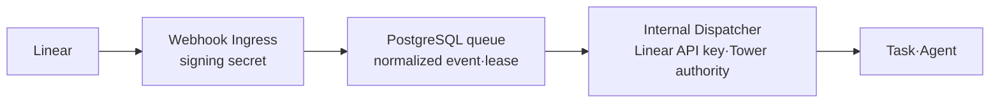

# Linear Webhook Connector

Linear 이슈 이벤트를 Tower의 Webhook Connector로 받는 첫 provider 구현이다. 공개 Ingress와 내부 Dispatcher가 서로 다른 capability를 갖는다.

## 공개 Ingress

`POST /api/webhooks/linear/:connectorId`

Ingress는 다음만 수행한다.

- raw body HMAC-SHA256 검증
- `webhookTimestamp` 60초 replay 방어
- `Linear-Delivery` 정규화와 중복 검사
- canonical event를 `queued` 상태로 저장
- 즉시 `202`, 중복이면 `200` 응답

Ingress 코드에는 Linear API 조회, Tower Project 접근, 사용자 권한 검사, Task·Agent 실행이 없다.

## 내부 Dispatcher

Dispatcher는 DB queue를 `FOR UPDATE SKIP LOCKED`로 claim하고 2분 lease를 설정한 뒤 다음을 수행한다.

- Linear API로 이슈 정본 재조회
- team·Linear project·label allowlist 평가
- Tower Project와 `run-as` 사용자 권한 재검증
- Task 생성과 Agent 실행
- 결과를 `ignored`, `task_created`, `needs_review`로 정산

만료된 `dispatching` lease는 자동 재실행하지 않고 `needs_review`로 보낸다. Task 생성 직후 장애가 난 불확실한 외부 효과를 중복 실행하지 않기 위한 보수적 at-most-once 정책이다.

## 설정

- `TOWER_WEBHOOK_CONNECTORS_ENABLED=true`
- `TOWER_LINEAR_WEBHOOK_CONNECTOR_ID`
- `TOWER_LINEAR_WEBHOOK_SIGNING_CREDENTIAL_ID`
- `TOWER_LINEAR_WEBHOOK_API_CREDENTIAL_ID`
- `TOWER_LINEAR_WEBHOOK_TOWER_PROJECT_ID`
- `TOWER_LINEAR_WEBHOOK_RUN_AS_USER_ID`
- `TOWER_LINEAR_WEBHOOK_TEAM_KEYS`
- `TOWER_LINEAR_WEBHOOK_LINEAR_PROJECT_IDS`

선택 label override:

- `TOWER_WEBHOOK_RESEARCH_LABEL`
- `TOWER_WEBHOOK_DRAFT_LABEL`
- `TOWER_WEBHOOK_IMPLEMENT_LABEL`
- `TOWER_WEBHOOK_APPROVAL_LABEL`

기본값은 비활성화다. 활성화하면서 필수 설정이 빠지면 fail-closed 한다. 설정에는 비밀값이 아니라 Credential Vault의 정확한 Credential ID만 기록한다.

서버는 `resolveProjectCredentialSecretValue()`를 통해 대상 Tower Project와 `run-as` 사용자를 기준으로 Credential을 해석하고 감사 이벤트를 남긴다. Ingress는 signing Credential만, Dispatcher는 Linear API Credential만 각각 해석한다. Credential이 비활성화됐거나 대상 Project에서 사용할 수 없거나 provider/kind가 일치하지 않으면 시작 또는 요청 처리를 fail-closed 하며, `.env`, 로그, Git에는 비밀값을 기록하지 않는다.

## 프로세스 경계

현재 기본 Tower 서버는 Ingress route와 Dispatcher lifecycle을 함께 시작하지만, 코드 capability는 `WebhookVerifier`와 `WebhookResolver`로 분리되어 있다. 운영 hardening 단계에서는 다음처럼 별도 entrypoint·OS 사용자·DB role로 실행할 수 있다.

- `tower-webhook-ingress`: signing secret과 connector event INSERT 권한만
- `tower-webhook-dispatcher`: Provider read credential, queue claim, Tower Task 생성 권한

이번 변경은 별도 프로세스 entrypoint와 제한 DB role의 배포까지 포함하지 않는다.

## MVP 경계

- Slack/GitHub adapter는 아직 구현하지 않았다.
- Linear 댓글·상태 업데이트는 하지 않는다.
- 실제 webhook 등록, secret 발급, migration 적용, 배포는 별도 운영 단계다.
