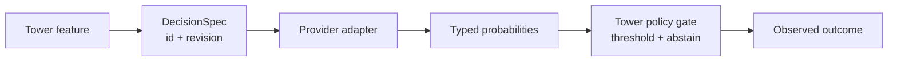

# Decision Plane contracts

## 책임

이 모듈은 Tower가 빠른 확률적 판단을 요청할 때 사용하는 provider-neutral 계약을 소유한다. Jev/OpenRouter는 첫 provider지만 제품 계약 자체는 특정 provider endpoint에 종속되지 않는다.

## Public API

- `parseDecisionSpec()` — versioned DecisionSpec을 strict validation한다.
- `decisionSpecSchema` / `decisionQuestionSchema` — registry·API 경계에서 재사용하는 Zod schema다.
- `DecisionRequest` / `DecisionResult` — provider adapter 전후의 Tower 계약이다.
- `encodeDecisionState()` — adapter가 state byte limit을 검사하기 전에 JSON-safe 값인지 확인한다.
- `TOWER_REQUEST_ROUTING_SPEC` — production에서 아직 활성화하지 않은 최초 shadow fixture다.
- `evaluateWithOpenRouterJev()` — Jev `/api/alpha/decisions` adapter다. 원시 provider schema를 `DecisionResult`로 변환하고 응답·state size·timeout·confidence abstain을 검증한다.
- `DecisionSpecRegistry` — process-local validated Spec을 `id@revision`으로 등록·조회하며, duplicate/non-increasing revision과 mutation을 차단한다.
- `publishDecisionSpec()` / `bindDecisionSpec()` — immutable revision을 저장하고 Project 또는 Agent principal에 명시적으로 binding한다.
- `requireBoundDecisionSpec()` — 현재 Project와 principal에 active binding이 있는 정확한 revision만 반환하며, binding이 없으면 fail-closed한다.
- `requireDecisionSpecAccess()` — 현재 서버의 Project 실행 권한을 먼저 확인한 뒤 active binding을 해석한다.
- `decision_evaluate` Pi tool — 모든 Pi Agent가 호출할 수 있는 최소 raw primitive다. `state + questions`를 받고, 선택적 context는 state에 직접 주입한다. 자동 파일·세션 조립과 목적별 workflow는 기본 도구에 포함하지 않는다.
- `../session-navigator/` — Decision Plane을 소비하는 첫 목적별 bounded workflow다. Assistant 응답 종료 후 한 번 호출하는 `tower.session-navigator.turn-end@1`, 예외 시 사용하는 `tower.session-navigator.continuity@1`, semantic state schema와 synthetic replay fixture를 소유하며 provider나 승인 정책은 소유하지 않는다.

## 계약

- 질문은 `choice`, `noul`, `score` 중 하나이며 한 가지 판단만 묻는다.
- spec은 immutable `id + revision`으로 추적한다.
- `shadow`는 실행에 영향을 주지 않고, `advisory`도 결정적 정책을 우회하지 않는다.
- low-confidence와 provider 실패에는 명시적인 abstain/fallback 동작이 필요하다.
- `confidenceQuestionIds`로 전체 disposition을 결정하는 핵심 질문만 지정한다. 부가 관측 질문의 낮은 confidence가 확신 높은 라우팅 판단을 무효화해서는 안 된다.
- ACL, Credential, 승인, 파괴적 작업 gate는 Platform Kernel의 책임이며 Decision 결과가 허가를 만들지 않는다.
- state에는 비밀값을 넣지 않는다. `allowedData`와 `prohibitedFields`는 provider 전송 전에 별도 runtime sanitizer가 집행해야 한다.

## 현재 단계

DecisionSpec, OpenRouter Jev adapter, process-local immutable registry, PostgreSQL revision persistence, Project/Agent binding repository와 현재 실행 권한 preflight를 결합한 access gate가 존재한다. `decision_evaluate`는 Pi custom tool로 등록되어 raw 판단을 제공한다. 자동 Context Assembly, 목적별 스킬·스크립트, outcome ledger와 production routing은 아직 연결하지 않았다. Live provider 호출은 Project Credential이 주입된 명시적 검증 명령에서만 수행한다.

### Instruction budget

Question `instructions` allow 1–32,000 trimmed characters; `rationale` and other short metadata remain capped at 500 and criterion descriptions at 1,000. State byte budgets are separate. This is a local validation bound, not a provider context guarantee; provider rejection/timeouts still follow fail-closed behavior. Large instructions increase request size and may increase latency/cost. `decision-spec.test.ts` covers the exact boundary and unchanged short-field restriction.
