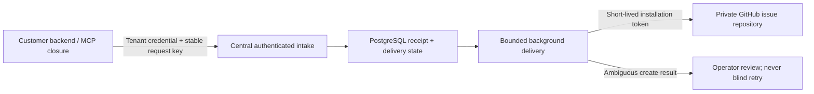

# Central feedback intake

Status: opt-in implementation, activation OFF by default. This source document is not evidence of any deployment's current configuration or usage; use the read-only diagnostic below before making a retirement decision.

## Ownership and design

Customer Tower backends submit feedback to a central durable PostgreSQL inbox. Only the central service owns the GitHub App private key and installation identity. Customer authentication selects the tenant; submitted `customerId`, repository, labels and delivery URLs are rejected. Reporter identity is asserted by the authenticated self-hosted instance from the existing MCP closure, not model arguments. This trusts that VM's backend administrator; it is not independent central authentication of the end user.

The existing transfer decision called for replacing VM PAT/repository coupling with internal feedback intake. This implementation is an opt-in transition, not removal of the legacy path. The public module uses generic deployment examples only.



## Security and delivery contract

- Dedicated high-entropy tenant tokens are SHA-256 hashed at rest. Never reuse publishing credentials or store plaintext credentials in this schema. Tenant rows are operator-managed, not browser-editable.
- Central endpoints have independent bearer authentication, strict JSON contracts, a 64 KiB body limit, IP pre-auth throttling and durable per-tenant admission throttling.
- Unique `(tenant_id, idempotency_key)` with request hash detects conflicting replays. Receipts and status queries are tenant/reporter-scoped. Accepted means committed centrally, not sent to GitHub.
- Background workers claim with `FOR UPDATE SKIP LOCKED`. Known pre-create failures have bounded retry. An expired claim, timeout during create, ambiguous HTTP response, or failed receipt persistence after a create is not blindly retried; it requires review.
- GitHub REST origin is fixed; redirects are refused. Installation tokens request only the configured repository ID and Issues write / Metadata read. Repository metadata must match the configured name/ID and be private before creation. No public override is supported.
- Customer title prefix and label come from central tenant configuration. The body has minimal server-authored reporter/session/project identity and a receipt marker; hostnames/CWD are not appended. User-written text remains untrusted and can itself contain identifying information.
- Central errors and logs use fixed codes, never raw provider response/error bodies or submitted feedback. Secret-pattern rejection is defense in depth, not a comprehensive DLP guarantee.
- Central `file_issue` advertises only title, body and idempotencyKey; repository/public override and legacy labels are omitted from its input schema. Legacy mode retains those fields. Server-side override rejection remains defense in depth.
- The Pi MCP adapter rejects execution on MCP `isError` or handler exceptions, preserving failure text instead of returning a successful tool result. This applies to all in-process MCP tools, not just feedback. Regression coverage: `pi-registration.test.ts` and `../../engines/pi-mcp-adapter.test.ts`; live deployment verification is separate.
- No fallback to PAT on central failure. Legacy `get_issue`/`comment_issue` are unavailable on opted-in customers; receipt status is supported, but GitHub discussion/readback is deferred to avoid cross-customer access.

## Activation and verification

Implementation/configuration details, test evidence and rollout prerequisites are completed below with the code. Database schema lives beside this module, outside the auto-migration scanner, to require a separate reviewed activation. Do not apply it to the live database during local development.

## Configuration (all flags default false)

| Location | Variable | Purpose |
| --- | --- | --- |
| Customer | `TOWER_FEEDBACK_CLIENT_ENABLED=true` | Route MCP `file_issue` to central intake; disables direct GitHub read/comment |
| Customer | `TOWER_FEEDBACK_INTAKE_ORIGIN=https://feedback.example.com` | Operator-controlled HTTPS origin only; no path/query/userinfo |
| Customer | `TOWER_FEEDBACK_CLIENT_TOKEN` | Dedicated customer bearer secret, at least 32 random bytes encoded as base64url; never given to the model |
| Central | `TOWER_FEEDBACK_INTAKE_ENABLED=true` | Mount authenticated intake; no App key needed just to accept feedback |
| Central | `TOWER_FEEDBACK_DELIVERY_ENABLED=true` | Explicitly authorize the background GitHub delivery pump |
| Central | `TOWER_FEEDBACK_GITHUB_APP_ID` | Numeric GitHub App ID |
| Central | `TOWER_FEEDBACK_GITHUB_INSTALLATION_ID` | Numeric installation ID |
| Central | `TOWER_FEEDBACK_GITHUB_REPOSITORY_ID` | Numeric, immutable repository ID |
| Central | `TOWER_FEEDBACK_GITHUB_REPOSITORY` | Exact `example-org/tower-issues`; only central needs it |
| Central | `TOWER_FEEDBACK_GITHUB_PRIVATE_KEY` | Legacy inline RSA PEM, at least 2048 bits; backend only, never Customer/Project Runtime |
| Central | `TOWER_FEEDBACK_GITHUB_KEY_FILE` | Preferred backend-only absolute canonical PEM path; overrides inline PEM with no fallback |
| Central | `DATABASE_URL` | Existing central PostgreSQL connection; not a customer database |

`TOWER_CANDIDATE_PASSIVE_MODE=true` blocks both central intake and delivery. Disabling delivery alone preserves intake and pending receipts. Do not enable customer mode until the central schema/auth/routes are verified. Changing configuration requires the normal separately approved backend restart; this implementation performs none.

### File-based App private key

`TOWER_FEEDBACK_GITHUB_KEY_FILE` is read only by `githubConfig` for a central backend with intake+delivery enabled, candidate passive mode off, and customer client mode off. If set, even to an empty/invalid value, it wins over `TOWER_FEEDBACK_GITHUB_PRIVATE_KEY`; invalid files fail closed with `feedback_github_not_configured`. There is no fallback to an older inline key or Vault value.

Use a backend-owned secret directory **outside Project/workspace/uploads, Git, and the Nix store**, mode `0700`. The immediate parent and file must be owned by root or the backend effective UID. The file must be a regular single-link file, mode `0400` or `0600`, 1–32768 bytes, containing an RSA private key of at least 2048 bits. Canonical absolute paths only: symlinks in any component, relative paths, hardlinks, special permission bits and group/other file access are rejected. Opening uses `O_NOFOLLOW` and a bounded descriptor read. Ancestor directories must remain under trusted operator control; this is not a defense against root, the backend UID, or an operator replacing ancestor directories concurrently. POSIX ACLs must not grant additional access.

Provision using the host's reviewed service-secret path. For PM2/Nix launchers, put **only the absolute file path** and non-secret App identity settings in the backend environment source. Do not use Project Credential materialization for this key and do not pass the key/path to self-hosted instances, Workers or agent tools. File permissions do not isolate processes that share the backend UID: deployment must separately enforce the Project/Worker execution boundary. A backend restart is required after rotating the file because delivery retains the key in process memory. Runtime errors must never print the path, file content, parser exception, inline key or provider token.

## Manual activation checklist

1. Review `schema.sql` and apply only to the chosen central database after backup and explicit approval. It is intentionally outside `db/migrations`, so no numbering collision or automatic production mutation occurs. Ship this source SQL separately if deploying from compiled artifacts.
2. Create an organization-owned GitHub App; repository permissions: **Issues write**, **Metadata read**, no Contents/Workflows permissions. Install on the one private issue repository, not all repositories. Disable webhooks unless another reviewed feature needs them. Store the private key only in the central backend secret source; never log or copy it to a customer.
3. Configure central numeric App/installation/repository IDs and exact repository name. Prepare labels `from:tower-feedback` and `customer:customer-a` in the issue repository. Label creation is deliberately not attempted. Missing labels/permission errors are fixed failures, not create-without-label retries.
4. Through an approved secret-management/provisioning path, mint a distinct random customer token. Store only `tokenDigest(token)` from `contract.ts` in `feedback_tenants.token_hash`, with generic customer slug, title prefix, label and active flag. Customer backend receives the plaintext secret via its backend secret source. There is no HTTP token-provisioning endpoint. Never use a user-chosen password as a tenant token.
5. Enable intake first, verify central commit/receipt retrieval, then separately approve/enable delivery. Validate private repository metadata and a synthetic issue in the selected repository under explicit authorization. A local mocked test is not evidence that the real App installation works.
6. Enable one customer's client flag. Verify receipt identity, customer prefix/label, reporter identity and delivered status before expanding. Do not keep advertising legacy PAT access to customers after opt-in.
7. Operators must monitor accepted/failed/needs_review counts and age. Define retention/backups for feedback bodies, reporter identity and receipts before rollout. Do not purge idempotency receipts while callers may replay old requests. This module does not add a dashboard, alert sink or retention deletion job.

The PostgreSQL service account should be restricted to the existing application's needs; tenant token hashes and feedback payloads must not be exposed to browser SQL/API paths. The existing backend trusts one proxy hop: ingress must overwrite forwarded IP headers and prevent untrusted direct backend access for pre-auth IP throttling to be effective. The per-tenant admission limit is durable and independent of forwarded headers. High-volume deployments should add upstream distributed/IP abuse protection.

## API / lifecycle

- `POST /api/feedback-intake/`: `Authorization: Bearer <customer secret>`, `Idempotency-Key`, strict JSON `{title, body, reporter: {userId, username, sessionId, projectId}}`. Unknown top-level/reporter fields are rejected. Labels passed to the old MCP tool are ignored by the central client.
- `202 {id, status:"accepted"}` means the central transaction committed. `200` is returned for replay of an already delivered receipt. Other nonterminal/attention states return the existing receipt with `202`, never claim GitHub delivery occurred.
- `GET /api/feedback-intake/:receiptId` requires the same customer credential and `X-Feedback-Reporter-Id` set from the VM backend closure; wrong tenant/reporter gets `404`. The MCP exposes `get_feedback_status` in opted-in mode.
- Client failures never fall back to PAT. A request timeout may have happened after commit: repeat the same key and exact payload. Default key hashes the normalized content and closure identity, so an unchanged submission in the same session remains one receipt even across a client restart. An intentionally distinct identical report needs a new explicit key; do not do this merely to retry a failure.
- Central delivery polls every 5 seconds, one in-flight request per process. Claims are exclusive across processes. A 2-minute lease exceeds three 15-second network budgets; claim expiration is conservative review, not automatic resend. Pre-create retry uses bounded exponential delay, at most 5 attempts. Explicit create auth/validation rejection is terminal; create timeout/5xx/malformed success is review.
- Repository visibility checks happen immediately before create. As with any remote API, an administrator changing repository visibility between the check and create cannot be made transactional; organization policy should prevent public conversion of this repository.
- App JWT uses RS256 with clock skew allowance and a lifetime within 10 minutes. Each delivery mints a new restricted installation token (GitHub normally expires these after 1 hour); tokens are held only in function-local memory and not cached/persisted. The REST API version is pinned to `2022-11-28`.

### Resolving `needs_review` / `failed`

No automatic retry endpoint or blind resubmission is shipped. A central operator must inspect the intended private repo for the exact `tower-feedback:<receipt UUID>` marker. If an issue exists, reconcile its validated issue number/URL into the matching central receipt under an audited action. If absence is conclusively established (including GitHub eventual visibility), separately approve requeue. Uncertain absence is not permission to resend. Never create another issue merely because the first call timed out. A future operator UI can encode this reviewed action; it must not weaken this safety rule.

## Read-only usage diagnostic

Run **one command in an operator-approved environment with the intended backend settings already injected**. The command never loads `.env`, reads a service process environment, opens an App private-key file, starts the backend, contacts GitHub, or changes schema/permissions/receipts. Do not place credentials in argv or paste them into chat.

```bash
node --import tsx packages/backend/services/feedback-intake/diagnostics-cli.ts
# Configuration only; explicitly skip database access:
node --import tsx packages/backend/services/feedback-intake/diagnostics-cli.ts --config-only
```

For compiled releases, invoke `diagnostics-cli.js` from the approved release's `dist/backend/packages/backend/services/feedback-intake/` directory with its Node runtime. This is an operator command, not a browser endpoint or MCP tool, and is not automatically called during startup, backups, migrations or deployment. Running it on an actual operational database still requires the normal operator authorization.

Output is a fixed-shape JSON snapshot of **this command's environment and connected database**, not introspection of the running backend or every self-hosted instance:

- Flags distinguish `default_off`, explicit `off`, `on`, and `invalid`. Effective intake and delivery gates preserve candidate-passive behavior. `clientRouting=legacy` only identifies the flag branch; it does not test direct GitHub authentication.
- Client configuration is checked in memory without returning values. GitHub metadata validity is separate from `signingMaterial=configured_unverified`; no key file is opened and no provider authentication is attempted. An empty explicit file setting stays invalid and does not fall back to inline material. A delivery gate being enabled does **not** prove the pump started.
- `database.tenants` and `database.receipts` report table presence, the connected role's table-level SELECT/INSERT/UPDATE/DELETE and schema-USAGE booleans, and active row-level-security filtering. No role names, database identities or connection URLs are output. These are the **diagnostic role's** permissions, not an attestation of a different application's role or backup role.
- With complete SELECT visibility, output includes only tenant active/inactive totals, receipt status counts, latest created/updated timestamps, and oldest pending timestamp. Payload, title, body, reporter, tenant identity, token/hash, receipt ID, issue number and URL are never queried or returned. Unknown statuses are counted as `other`, not printed.
- `activity.pending` counts `accepted + delivering`, while `attention` counts `needs_review + failed + other`. `deliveryOffWithPending=true` distinguishes a disabled pump with retained work from an empty inbox. It never requeues or retries anything.
- Missing configuration/tables, disabled flags and unavailable/permission-limited observations are normal JSON responses (exit 0). Use fields, not exit 0, to judge observability. Invalid CLI arguments or an unexpected outer failure return only `feedback_diagnostics_failed` (exit 1).

| Observation | Interpretation |
| --- | --- |
| Flags off, counts unavailable | Off in this command, usage unknown; not permission to delete. |
| Tables missing | Schema absent in this database; no claim about other deployments or historical use. |
| `access_denied` / `row_security_limited` | Complete counts unavailable; never interpret as zero. Use an already authorized diagnostic role rather than broadening the application role. |
| `no_receipts_observed` | No rows visible in the complete current snapshot; not proof of lifetime nonuse. |
| Pending or attention count above zero | Preserve receipts/idempotency history and use the existing reviewed reconciliation policy. |
| `receipts_observed` | Historical intake evidence; does not prove current traffic, GitHub success beyond stored status, or ongoing service health. |

The connector only uses an explicitly injected `DATABASE_URL` with protocol `postgres`/`postgresql`, hostname, user and database. It does not discover a database from PG defaults or `.pgpass`. Only `sslmode` is accepted as a URL query option; secret-file options, host overrides and arbitrary startup options are rejected before connecting. Non-loopback connections require verified TLS (including `sslmode=require`); it never downgrades certificate validation. Unix socket/file-certificate URLs need a separately reviewed connector rather than implicit file reads. The intended URL and settings must be verified out of band because the report intentionally omits target identity.

Queries use a new connection, read-only startup defaults and a repeatable-read **READ ONLY** transaction, fixed `pg_catalog` search path, statement/lock/idle timeouts and a final rollback. Aggregates are schema-qualified; views/foreign relations and RLS-limited results are refused. Table failures are isolated with savepoints so another table can still be diagnosed. No persistent DB writes are issued, although normal server connection/audit logs and access statistics can change. Large-table aggregation may time out and report `query_failed`; it must not be silently approximated as zero. This is not a full schema, backup, ACL or provider audit.

Do not retire the central or legacy route from a single snapshot. First combine the intended support-path decision with observed flags/retained receipts, validate the replacement path, settle retention obligations and obtain separate approval for deletion or cutover. This diagnostic changes none of the existing routes or security boundaries.

## Local validation

Tests use only synthetic credentials, fake GitHub HTTP responses and an explicitly disposable PostgreSQL cluster. They never read `DATABASE_URL`, initialize the actual backend or call GitHub.

```bash
# Unit, wiring, and MCP tests. The PG e2e is skipped unless explicitly opted in.
npx vitest run packages/backend/services/feedback-intake packages/backend/mcp/issue-server.feedback.test.ts packages/backend/index.candidate-passive.source.test.ts --maxWorkers=2

# Real SQL transaction/HTTP tests in a new work/feedback-pg-* cluster (cleaned by the test).
# Requires non-root and existing PostgreSQL binaries; no packages or host configuration are changed.
FEEDBACK_DISPOSABLE_PG_TEST=1 npx vitest run packages/backend/services/feedback-intake packages/backend/mcp/issue-server.feedback.test.ts packages/backend/index.candidate-passive.source.test.ts --maxWorkers=2
# Optional FEEDBACK_TEST_PG_BIN selects an existing local PostgreSQL bin directory.
npx tsc --noEmit -p tsconfig.backend.json
```

Coverage also includes real Claude SDK → Pi MCP registration/schema conversion/execution, `idempotencyKey`, closure-bound `get_feedback_status`, category/assembly wiring, and synthetic file-key tests (central gating, file precedence, invalid-file no fallback, permissions, symlinks, hardlinks and bounded size).

Coverage: default-off/candidate guards, strict tenant/reporter/URL boundaries, hash-only tenant auth, secret rejection, payload limits, concurrent idempotency, conflicting replay, tenant+reporter isolation, durable rate limits/revocation, exclusive claims, persistence across store recreation, expired-claim review, bounded retry, GitHub JWT/permissions/private metadata, ambiguous creates, failed post-create persistence, no PAT fallback, minimal footer and receipt status language.

Remaining production gates: real App creation/install/private-key provisioning, per-customer enrollment, approved central schema application, deployment/restart, operator reconciliation tooling, retention/monitoring policy and one authorized end-to-end real GitHub smoke test. None was performed by this local implementation.

Official contract consulted: https://docs.github.com/en/apps/creating-github-apps/authenticating-with-a-github-app/generating-an-installation-access-token-for-a-github-app (repository_ids/permissions narrowing and one-hour installation-token lifetime).

Validation result (2026-09-09 local session): **5 test files / 45 tests passed**, including the isolated PostgreSQL + HTTP suite; backend TypeScript no-emit check and touched-file `git diff --check` passed. No live database migration, remote write, credential access, commit, push, restart or deployment was performed.
