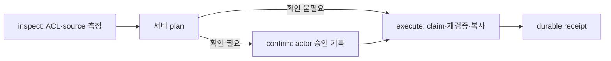

# File Exchange

Personal, Session, Channel, Project 사이의 독립 파일 사본 전달을 계획·확인·실행하고 durable receipt를 남긴다. 저장소 자체를 합치지 않는다. 전체 경계는 [권한과 파일 저장 경계](../../../../docs/architecture/authority-and-storage.md)를 따른다.

## Public API

`file-exchange-service.ts`의 좁은 호출 계약은 다음과 같다.

- `inspectFileTransfer(actor, intent)`: 양쪽 provider 권한과 source bytes를 검사하고 서버에 만료되는 plan을 만든다.
- `confirmFileTransferPlan(actor, planId)`: 현재 사용자가 소유한 미만료 pending plan에 확인을 기록한다.
- `executeFileTransfer(actor, planId)`: 서버에 기록된 확인을 검사하고 plan을 claim한 뒤 재검증·복사·receipt 기록을 수행한다. **`confirmed` 인자는 없다.**
- `getFileTransferReceipt(actor, receiptId)`: 현재 actor 소유 receipt를 읽는다.
- `recoverStaleFileTransfer(actor, planId)`: 오래된 executing plan을 재실행하지 않고 `UNCERTAIN_EXECUTION` 실패 영수증으로 닫는다. 수동 검토가 필요한 결과다.

HTTP boundary는 [file-exchange-api.ts](../../routes/file-exchange-api.ts)다. `/api/file-exchange` 아래 `POST /inspect`, `POST /confirm`, `POST /execute`, `GET /receipts/:id`를 제공한다. confirm과 execute는 `planId`를 받으며 route가 인증된 actor를 구성한다. Public reference와 receipt는 typed scope/URI/상대경로를 사용하고 내부 host 절대경로를 API로 전달하지 않는다.



## 책임과 실패 의미

- `file-exchange-policy.ts`는 mode와 확인 필요성을 판정할 뿐 ACL을 판정하지 않는다. Project 목적지는 `workspace_copy`, 그 외는 `snapshot`이다. Personal/Channel/Project 목적지는 확인을 요구한다.
- `file-exchange-providers.ts`는 source/destination의 현재 ACL과 bytes 위치를 해석한다. Session source는 audience 검사에 더해 owner-bound attachment resolver를 사용하므로 공유 본문 읽기만으로 타인 첨부를 전달하지 못한다.
- service는 inspect 시 source version/hash를 저장하고 execute 시 version, 복사 stream의 hash, destination 권한을 다시 확인한다. plan은 actor 소유이며 원본을 이동·삭제하지 않는다.
- 기존 destination 파일은 exclusive reservation과 충돌 suffix로 덮어쓰지 않는다. receipt 저장 실패 뒤에는 만든 사본을 보상 처리하고, 보상 실패는 receipt의 orphan detail에 남긴다. filesystem과 DB의 완전한 transaction을 가정하지 않는다.
- 재시도는 기존 durable receipt를 반환한다. 불확실한 오래된 실행은 부작용을 재생하지 않는다. 모든 실패에서 항상 receipt 기록까지 성공한다고 보장하지 않는다.

저장소 내부 rename/delete, 범용 파일 탐색, live reference, 양방향 동기화는 이 모듈의 책임이 아니다. Session attachment의 전용 promote API와 File Exchange는 별도 호출 경로다. 한 경로의 Worker 지원을 다른 경로의 완료 근거로 삼지 않는다.

## 알려진 Project storage 격차 — 미해결

2026-09-13 소스 검사 기준으로 다음 두 경로는 **Worker-authoritative storage를 사용하지 않는다.**

- `file-exchange-providers.ts` L103–123: Project source를 `project.rootPath` 아래 host 경로로 구성하고 `fs.stat`/digest/stream으로 읽는다.
- `file-exchange-service.ts` L296–310: Project destination의 host `targetDir`에 임시 복사하고 rename한다.

`workbench-project-file-authority.ts`를 사용하는 파일 API·명시적 첨부 Project 저장과 달리 여기에는 Worker storage seam이 연결되지 않았다. 따라서 host mirror가 오래되거나 파일이 Worker에만 있을 때 최신 원본 전달·Worker 목적지 저장을 보장할 수 없다. **별도 행동 재현 및 provider 리팩토링이 필요하며 이 문서 변경으로 해결되지 않았다.**

후속 완료 기준은 Worker-only source, 서로 다른 host/Worker bytes, Worker destination 성공과 실패 시 host fallback 금지를 테스트로 고정하고 전달 receipt의 결과가 authoritative storage와 일치함을 확인하는 것이다.

## 검증 진입점과 범위

저장소 루트에서 다음과 같이 실행한다.

```bash
npx vitest run packages/backend/services/file-exchange/file-exchange-policy.test.ts packages/backend/services/file-exchange/file-exchange-providers.test.ts packages/backend/services/file-exchange/file-exchange-service.test.ts
```

- policy tests: 확인 필요성·mode·동일 저장소 내 지원하지 않는 전달을 검사한다.
- provider tests: destination Session 권한과 host exclusive name reservation/동시 충돌을 검사한다.
- service tests: 확인 기록, 확인 전 claim 거부, stale source, destination 권한 회수, receipt 실패 보상, 안전 재시도와 uncertain recovery를 검사한다.

이 테스트들은 Worker-authoritative Project 전달의 종단 검증이 아니며 운영 배포·실제 저장소 상태도 증명하지 않는다. `_DECISIONS.md`는 모듈의 설계 의도를 보존하고 이 README는 현행 API와 남은 격차를 설명한다.
