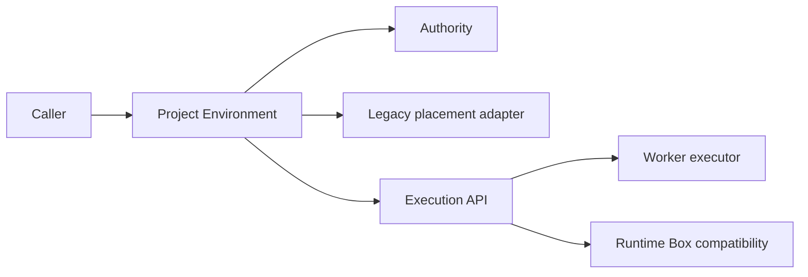

# Project Environment

Project Environment는 일반 Project 실행과 workspace authority의 현재 Backend 정본입니다.

## 소유 책임

- 현재 사용자·Agent의 Project 실행 접근 확인
- Project lifecycle과 canonical root 확인
- workspace authority와 readiness 해석
- `canonical-project-workspace` / `legacy-worker-workspace` mode 결정
- 신규 Project의 canonical host workspace provisioning
- executor가 필요로 하는 capability와 legacy pin 전달

Project Environment는 Worker health·capacity, 명령 실행, Job·Service process lifecycle 자체를 소유하지 않습니다. 이 책임은 `services/execution/`과 executor 구현에 있습니다.

## Public API

| 파일 | API | 역할 |
|---|---|---|
| `project-execution-context.ts` | `resolveProjectExecutionContext()` | executor 선택 전에 권한·root·mode·capability를 확정합니다. |
| `project-workspace-authority.ts` | `provisionCanonicalProjectWorkspace()` | 신규 Project에 explicit canonical host workspace를 기록합니다. |
| `project-workspace-authority.ts` | `resolveProjectWorkspaceTarget()` | explicit workspace authority를 우선하고 필요한 경우에만 legacy placement를 읽습니다. |
| `project-environment-deployment.ts` | `resolveProjectEnvironmentDeploymentId()` | deployment identity를 현재 도메인 이름으로 제공합니다. |
| `adapters/legacy-project-compute-adapter.ts` | `readLegacyProjectComputePlacement()` | historical compute tables와 Workbench 구현을 격리합니다. |

## Mode

### `canonical-project-workspace`

신규 Project의 기본입니다. canonical Project root가 파일 정본이며 Worker ID나 static Worker scope가 Project 권한을 정의하지 않습니다. executor는 실행 시점의 capability·health·capacity에 따라 선택될 수 있습니다.

### `legacy-worker-workspace`

기존 Worker-local authoritative storage를 보존하는 mode입니다. storage Worker와 historical placement가 일치해야 하며, 다른 Worker·host·Runtime Box로 조용히 fallback하지 않습니다. 자동 migration은 이 모듈의 책임이 아닙니다.

## 의존 방향



### 허용

- authority와 Project repository 사용
- `services/execution/`의 domain-facing API 사용
- `adapters/` 내부에서 historical compute implementation 사용

### 금지

- 정본 파일에서 `runtime-box/workbench-*`를 직접 import
- Worker heartbeat `projectIds`를 사용자 권한 또는 canonical storage authority로 사용
- Worker unavailable을 host 또는 Runtime Box fallback으로 변환
- 신규 Project에 automatic Worker assignment나 static scope를 요구
- legacy workspace를 명시적 migration 없이 canonical로 추정

## Compatibility

다음 legacy 파일은 기존 import를 위한 deprecated re-export입니다.

- `services/runtime-box/project-file-storage-binding.ts`
- `services/runtime-box/workbench-project-execution-admission.ts`
- `services/runtime-box/workbench-effective-binding.ts`

새 production 코드는 이 경로가 아니라 Project Environment API를 직접 사용합니다.

DB의 `project_file_storage_bindings`, `project_compute_settings`, `project_compute_deployment_bindings` 이름은 별도 migration 없이는 변경하지 않습니다.

## 테스트

- `project-execution-context.test.ts`: ACL 선행, lifecycle, canonical/legacy mode, root mismatch와 fail-closed
- `project-workspace-authority.test.ts`: canonical provisioning, explicit storage 우선, legacy fallback과 malformed state
- `services/pm/project-manager.worker-lite.source.test.ts`: 신규 Project canonical provisioning과 automatic Worker assignment 제거
- `services/runtime-box/workbench-execution-provider-selector.test.ts`: canonical scheduler 선택과 legacy pin

테스트 통과는 운영 Worker revision, 실제 OS identity, 모든 파일 제품 표면 또는 배포 완료를 뜻하지 않습니다.

## 남은 통합 범위

- Project file API·Viewer/download
- 첨부의 명시적 Project 저장
- File Exchange와 검색/index
- Git와 Job artifact
- Job·Service lifecycle
- Credential materialization/cleanup
- 신규 Project 생성부터 파일·bash까지 E2E/canary

현재 계약과 용어는 [`docs/architecture/execution-terminology.md`](../../../../docs/architecture/execution-terminology.md), 채택 이유는 [`docs/decisions/2026-09-17-worker-lite-project-environment.md`](../../../../docs/decisions/2026-09-17-worker-lite-project-environment.md)를 확인합니다.

### Storage dispatch and live read authorization

The façade owns live Project access checks; storage adapters own host/Worker
operation dispatch. Presentation content reads delegate to the ordinary byte-read
entrypoint so rendering cannot bypass the live access gate. Existence checks are
adapter operations rather than a second host/Worker implementation in the façade.
This consolidation does not migrate canonical host storage to Worker ownership,
change OS identities, or automatically publish private files.

Regression: `project-workspace-files.test.ts` covers revoked presentation reads.

### Project identity at a reused root

Project-scoped file resolution passes its exact Project ID and registered root
through to Worker file-authority selection. It must not rediscover a different
Project from a host-shaped path before checking Worker scope. Archived/retired
aliases at the same root are historical records, not identities to resurrect.

`project-root-selection.ts` first finds the deepest registered path boundary,
including inactive Projects. For explicit identity calls it requires that exact
active ID/root at this boundary; a deeper Project (including inactive) blocks a
parent operation. Path-only callers require exactly one active identity at that
boundary; no active identity or multiple active identities fail closed. Legacy
null lifecycle and active/ready are eligible, but archived always blocks. A
mismatch never falls back to host or broadens a Worker's advertised Project scope.
Normal session/Project ACL, deployment and Worker availability checks still apply.

This fixes same-root active/retired registration selection without deleting old
records, changing storage bindings, grants, or automatic migration. Regression:
`project-root-selection.test.ts`, `workbench-project-file-authority.test.ts`,
`project-workspace-files.test.ts`, and `project-workspace-identity.http.test.ts`.
The HTTP test imports a synthetic attachment-like source through the real Worker
file routes, verifies its hash, CAS-edits it, leaves the controller file absent,
and checks revocation before further I/O. It is not a deployed browser or real
session promotion test.

Upload import uses adapter `importExclusive`: the adapter owns storage-specific
exclusive creation and compensation, while the façade owns live access checks
and collision-safe naming. Host copies and Worker uploads preserve their existing
semantics; this refactor does not grant OS access or migrate storage. Regression
coverage checks that compensation removes the new collision-renamed file without
changing the original.

### Atomic replacement preserves access, not private-to-shared promotion

Canonical UTF-8 CAS stages an inode at mode 0600, copies the original numeric
access ACL including its mask. If the staged inode's group differs, the original
owning-group grant becomes a named-group entry; the new owning group receives
only its previously named grant or bounded other access. No privileged chown is
required. Conflicting original owning/named entries for the same group fail before
publication rather than merge privileges. The stage remains owned by the writer,
so CAS does not promise to preserve owner identity. Deliberately private modes and
ACL masks remain private; CAS never repairs an externally produced 0600 file
by widening it. Ordinary new files/directories still depend on validated parent
default ACLs. Default ACL migration and explicit artifact publication are separate
responsibilities, not per-document silent repair.

Both `getfacl` and `setfacl` are resolved from trusted installation-owned paths
using the existing ACL executable validator, never Project PATH. The access ACL
is read and applied through inherited fd 3; no pathname reopening is added.
Regression: `adapters/canonical-host-file-adapter.acl.test.ts` and
`../pm/new-project-acl-executable.test.ts` cover private masks, file-only named
read grants, alternate group-access preservation, ambiguous group rejection, stale CAS, stage
cleanup, and untrusted executable rejection. These tests do not prove deployed
cross-account attachment/Viewer E2E.

### Representation metadata and prefix probes

`readProbe` is an adapter prefix-read operation, not an entire-file download with
an artificially small file-size limit. Canonical host reads use an opened file
handle and bounded prefix buffer; Worker reads require a validated HTTP 206 Range
response, with response bytes bounded independently of total file size. Probe
budgets are integers from one byte to 1 MiB. Empty Worker files return an empty
probe. Invalid/ignored ranges and truncated bodies fail closed without full-read
fallback. Ordinary `readFile` retains its whole-file size cap.

Worker `stat` uses HEAD on the authenticated, allowlisted content endpoint and
requires byte length plus a metadata version header. It never downloads the file
to compute size or a content hash. The version is a metadata change token, not a
cryptographic content digest. Backend and Worker must both include this protocol;
older Workers report unsupported metadata instead of silently downloading.

Regression: `project-workspace-files.test.ts`,
`../runtime-box/workbench-project-file-authority.stream.test.ts`, and
`../runtime-box/remote-workbench-worker-server.upload.test.ts` cover prefix reads,
a 3 MiB PDF fixture, HEAD with no body, invalid responses, and authenticated
Project boundaries. These are local fixtures, not deployed Worker verification.

### Worker UTF-8 writes are file data, not execution commands

Worker text writes and CAS use the existing authenticated, Project-allowlisted
`PUT /v1/files/:project/content` endpoint with `text-mode=exclusive|replace|cas`.
The body is UTF-8 bytes; expected CAS contents are represented by a SHA-256 header,
not Base64 inside `/v1/run` JSON. The 64,000-byte execution-body bound is unchanged.
Before any write, the client requires `x-tower-text-write: v1` from HEAD: older
Workers ignore unknown upload parameters, so falling back would risk overwriting
on a CAS request. Backend and Worker therefore require coordinated updates.

The Worker bounds raw text writes at 100 MiB and CAS at 1 MiB (the canonical CAS
bound). Private staging is removed on success and failure. Complete UTF-8 data is
validated before mutation; exclusive collisions and stale CAS return HTTP 409.
Publication reuses canonical fd-anchored text/CAS routines, including existing
ACL preservation on replacement, containment and hardlink/symlink rejection.
Ordinary binary upload/import remains a separate existing publication contract.

Regression: `../runtime-box/worker-project-text-write.test.ts`,
`../runtime-box/workbench-project-file-authority.text.test.ts`,
`../runtime-box/remote-workbench-worker-server.upload.test.ts`, and
`../../engines/pi-document-parse-tool.worker-output.test.ts` cover large Unicode
writes, snapshot conflicts, ACL preservation, cleanup, old-Worker rejection and
converted Markdown output through real local Worker HTTP (parser response mocked).
This is local verification, not proof of deployed provider/rendering success.


### Pi file-tool path and partial-search contract

For Project `read/write/edit/find/grep/ls`, the Pi guard wrapper resolves relative
paths against the registered Project root and maps `/workspace/...` to the same
root **before both access checking and execution**. Explicit host paths retain
their identity; attachment URIs and Bash command strings are not rewritten.
Traversal and symlink escapes still pass through current ACL/authority checks.
This does not grant extra filesystem or Project permissions.

Project `find` preserves readable matches when a directory or entry fails with
`EACCES`, `EPERM`, or a concurrent `ENOENT`. The result includes `skippedPaths`
with relative paths and error codes, `partial`, and `limitReached`; the text also
warns about skipped paths. Current access revocation, storage-authority errors,
unexpected errors, and cancellation still fail closed. Worker directory listing
retains inaccessible `lstat` entries as `traversalError` rows for find to report.
No generated-directory default exclusion or ACL relaxation is introduced.

Local evidence: `project-access.test.ts`, `pi-project-query-tools.test.ts`, and
`pi/tool-assembly.storage-characterization.test.ts` cover path parity, attachment
preservation, traversal rejection, partial results, and actual localhost Worker
HTTP write/edit/read/Bash parity and permission-denied search. These tests do not
prove deployment or live customer-session resolution.


### Markdown save failures and audience separation

Worker `exists` treats only an absent parent (`ENOENT`) as a normal missing-file
result, so `create_markdown_artifact` can create nested parent directories before
its exclusive write. Permission failures and authority failures still propagate;
existing-file protection and update CAS are unchanged.

Markdown operation failures return bounded AI receipts (`ok`, `code`,
`recoverable`, `suggestedAction`, `userMessage`), not arbitrary filesystem stderr
or Node stacks. AI guidelines scope failures to the individual operation and
require reporting final save status rather than generalizing to Project-wide
write unavailability. These hints never authorize a permission bypass.
The document projection displays only `userMessage`, never legacy raw `error`
fields or machine codes, and failed saves use a restrained status rather than a
large warning card. Unsaved content remains visible without a saved-file link.

Evidence: `pi-markdown-artifact-tool.test.ts`,
`pi/tool-assembly.storage-characterization.test.ts` (real localhost Worker HTTP
creation in missing nested folders), `markdown-artifact-projection.test.ts`, and
`MessageBubble.test.tsx`. Local coverage is not live deployment evidence.

### Shared-local peer-write verification

Canonical migration readiness includes a real Worker-created inode that the
backend opens and edits in place, followed by Worker reread. Worker-only creation
and same-account read are not evidence of backend interoperability. The synthetic
probe is removed after verification; no user document is rewritten as a probe.

Legacy reviewed default-ACL operations require explicit `worker-and-backend`
approval with stable backend identity. Worker-only historical manifests are not
valid authorization to widen backend access. Defaults must explicitly grant both
service users; existing unrelated grants must not be unmasked. Existing files
still require an approved bounded migration. Project ACL/actor checks remain
independent from OS service-account access. Restrictive explicit chmod/creation
modes can still mask inherited ACLs and are not silently overridden.

### Administrator Agent environment display

The administrator Agent list uses `classifyProjectEnvironment`, the same storage-authority classification as execution admission, for the current deployment. Canonical host storage overrides legacy Worker settings; Worker storage or legacy placement without explicit storage authority is shown as legacy Worker workspace. Absence of a legacy Worker binding is not evidence of Runtime Box execution. Historical Runtime Box counts remain separate from the current environment. Pending/blocked storage is shown as requiring verification, not as a ready environment.

Code: `project-execution-context.ts`, `../pm/agent-purge-preview.ts`, frontend `components/admin/AdminPanel.tsx`. Regression coverage: `project-environment-classification.test.ts`.

### Single peer-ACL encoding owner

`../pm/project-peer-acl.ts` owns service-identity ACL encoding for fresh Project
roots and canonical migration. Fresh roots retain private group/other entries;
existing-tree migration adds peers without replacing unrelated ACL principals.
The migration preflight remains responsible for dormant-grant/mask review.
This is not application membership, cross-Project delegation, or an authorization
to give a platform-only host Project a writable Worker.

File-creation and replacement adapters remain separate callers of filesystem
policy: inherited ACL masks and explicit creation modes matter. In particular,
`worker-project-file-upload.ts` publishes a new inode: new uploads inherit the
parent ACL, while Linux replacements preserve the existing access ACL subject
to upload execute/world-write restrictions. Peer encoding alone does not
migrate managed credential namespaces.
Full structure completion still requires supported-executor-aware audit,
replacement roundtrip verification and separately approved internal-state
relocation. The current refactor must not be described as completing all three.

단일 authority는 모든 파일 I/O의 Worker 종속이나 OS 계정 병합이 아닙니다. canonical 접근의 Worker 가용성 독립과 legacy fail-closed를 유지합니다.

Canonical exclusive file creation auto-creates ancestors with requested `0770`
rather than `0755`, so existing parent default named-peer write ACLs are not
masked. This does not invent an ACL for a parent without one or chmod existing
directories. No-ACL creation still uses the normal process umask. Regression:
`canonical-host-file-adapter.acl.test.ts` covers auto-created ancestors, final
file and upload replacement under a peer default ACL. Actual service-account
synthetic create/edit/read is separate evidence, not authenticated HTTP/browser
or whole-Project completion.

Expanded peer-ACL coverage includes exclusive/nonexclusive nested mkdir, rename
into auto-created parents, shared directory copies, upload-created parents and
upload replacement. Explicit `0600` copies and replacements remain private;
access preservation is not an instruction to undo intentional restrictions.
Per-file publication ACLs and authenticated browser/download end-to-end checks
remain separate from this inherited-peer-ACL regression coverage.

Linux Worker upload replacement now preserves the existing explicit access ACL
using the canonical replacement group-remapping helper. New uploads still use
parent default ACL inheritance. Uploads continue removing executable/special bits
and world-write; private sources do not gain inherited peer grants. ACL tooling
failure or observed target identity/content metadata change aborts publication
and cleans staging. Ownership is not preserved and upload is not snapshot CAS;
concurrent mutation after the final metadata check remains outside an atomic
compare-and-swap guarantee. Per-user publication/owner changes require separate
review; this change is not a new app-user sharing mechanism.

`project-workspace-identity.http.test.ts` additionally covers actual Worker bearer
transport rejection, upload replacement, download SHA-256 parity (including
UTF-8), gateway reread, and membership-revoked read/CAS rejection before Worker
requests. Project/auth repository fixtures remain mocks. This is not end-user
login, read-only membership, Viewer/browser, or deployed E2E evidence.

The file façade additionally rejects viewer/guest or unknown platform-role
mutations immediately before adapter publication, even if a caller omitted its
write guard. Read access remains membership/owner scoped. This is defense in
depth, not replacement of Project/channel/specific path write policy at request
boundaries. Fixture-based HTTP coverage verifies viewer reading and CAS rejection
without a Worker mutation request; deployed user authentication remains untested.

Read-only actors are blocked at current Agent execution admission as well as file
mutation publication. Pi assembly regressions downgrade a previously writable
requester to viewer/guest with owner membership and verify bash is rejected
before Worker HTTP requests. Existing session-content and execution policy tests
cover read-only contribution/Agent-use denial. This is fixture-backed regression,
not an authenticated deployed browser result.

Replacement ACL conversion now explicitly retains the former inode owner's
permissions as a named-user grant when publication changes ownership. Before
raising the mask, unrelated group-class entries are clamped to their prior
effective permissions. CAS and Linux upload share this conversion; upload still
removes execute/world-write. Linux upload reads source ACL from a verified open
file descriptor rather than a re-resolved pathname. Ancestor/publication races
and atomic snapshot CAS remain separate limitations; this is not a full race-free
upload rewrite. Existing unreadable sources fail closed rather than bypass ACLs.

Linux upload now traverses parent components with O_DIRECTORY/O_NOFOLLOW and
pins staging/publication/cleanup to the opened parent via /proc/self/fd. Ancestor
symlinks are rejected. Before publication the original parent path is reopened without creating missing
components and compared to the pinned inode. A detected swap or move aborts
publication; cleanup remains anchored to the original directory. Source ACL reads
and staging ACL writes use inherited descriptors in subprocesses. This anchoring and recheck
do not eliminate a move occurring after the final recheck or final target races; caller authority/confinement and full publication
CAS remain separate requirements. Non-Linux retains the legacy path behaviour.
Tests: worker-project-file-upload.test.ts ancestor link rejection and parent swap.

Linux canonical read/CAS and upload directory traversal use the common
`linux-path-descriptor.ts` O_PATH flags. Intermediate ancestors need search
permission, not directory-list read permission. Final file opens still enforce
ordinary read/write rights; directory enumeration retains its read requirement.
O_DIRECTORY/O_NOFOLLOW preserves symlink rejection and /proc/self/fd anchoring.
The numeric Linux UAPI O_PATH flag is gated to Linux and never used elsewhere.
Regression includes execute-only ancestors; actual synthetic backend/Worker
read/CAS/upload passes below a 0711 home while home enumeration remains denied.
This does not broaden OS ACLs or prove live VM/browser execution.

### Deterministic publication boundary characterization

Upload tests use an async-iterator barrier (no sleeps) to pause after content is
staged but before iterator completion/publication. A parent swap preserves the
old and unrelated new pathname contents and removes staging. This is storage
integration, not authenticated browser E2E.

Two `it.fails` tests expose known gaps, not passing safety guarantees: changing
the target after final validation but before rename loses that concurrent update;
and a mocked in-flight Worker import can publish after Project membership is
revoked because the current adapter interface has no publication-time actor
callback. The latter is a façade/adapter contract test with mocked identity and
transport, NOT proof about an authenticated deployed Worker. These tests assert
the desired safety outcome and are expected to fail until the contract is fixed.
Do not count their runner acceptance as successful security verification.

Canonical file import now stages through the bounded upload receiver with
exclusive publication, validates length, and invokes a trusted in-process
`beforePublish` actor-access refresh after staging. Revoked access aborts before
linking the final filename and removes staging. The callback is never accepted
from a request body. The legacy Worker import still lacks a remote publication
admission protocol, so its expected-failure characterization remains. Neither
callback nor final metadata check constitutes an atomic transaction with DB
revocation; policy changes after the refresh and uncoordinated writers remain
outside the current guarantee. Canonical imports now use project inherited ACLs
instead of copying external source modes; explicit per-file policy import is not
inferred from arbitrary source permissions.

### Direct versus delegated file access

`project-workspace-files.ts` retains the direct caller's current Project access
policy. Internal `agent-workspaces` reads and text replacement instead use their
current FileRef/grant policy and the common storage adapter directly. The adapter
owns byte I/O and expected-storage comparison, not membership decisions. There is
no public skip-membership switch and no route activation. See the
[Agent workspace contract](../agent-workspaces/README.md#delegated-access-and-storage-execution)
for local regression evidence and remaining mount/revocation limitations.

Retired organization scope is rejected with `EXECUTION_SCOPE_UNSUPPORTED` before
current-access or storage lookup. Unknown scope remains invalid. Team admission
is separate and does not reuse the retired organization-wide user allowlist.
Existing Project callers keep their original access checks; this change does
not activate team execution.

### Canonical text write delegation — current opt-in contract

Direction: [write availability decision](../../../../docs/decisions/2026-10-11-canonical-write-worker-availability.md).
Canonical storage stays host-authoritative; only the selected write performer
changes. Host reads remain independent of Worker availability. No retry or local
write fallback occurs after a selected target fails.

| Responsibility | Owner | Current state |
|---|---|---|
| Direct-user admission | `resolveCurrentProjectWorkspaceWrite()` and `canonical-text-delegation.ts` | Current writable membership, registered root/storage and existing protected-path rules are reused before dispatch and Backend recheck. |
| Explicit local target | `canonical-write-target.ts` | Trusted deployment config selects a bounded Project set and an exact healthy Worker in the current deployment at a literal loopback endpoint. Registry endpoint mismatch/drain fails closed. This list is rollout selection, not file permission. |
| Backend signing | Secret Store plus `canonical-file-write-grant.ts` | Ed25519 private key remains Backend-only; strict signed scope binds Worker, actor, Project/root/path, mode, bytes/hash and CAS precondition. Transport bearer cannot mint approvals. |
| Transport | `canonical-file-write-transport.ts` | One-shot request; redirects denied; exact bounded receipt required. Lost response means NOT_CONFIRMED, not absence of mutation. |
| Receiver | Worker `/v1/canonical-files/:id/content` | Disabled without installation callbacks/public key. Existing text publication is reused; no static Project scope is used as authority. |
| Current callback | Worker recheck client and Backend `/api/workbench-workers/canonical-write/recheck` | Existing active Worker JWT middleware, signature and Worker-ID match precede current policy checks. No DB/Vault is loaded into Worker. |
| Replay | `canonical-write-replay-store.ts` | Pre-existing 0700 runtime directory, nofollow descriptors, O_EXCL record and fsync. Dedicated deployment protection and retention remain required. |
| Text publication | canonical host adapter | Shared staged normal/CAS publication; old file mode/ACL is retained. Arbitrary concurrent writer races are not fully serialized. |
| UI-facing error | project-files router write/create | 503 temporary unavailable, 403 denied, 409 unknown outcome; no automatic retry and no private provider diagnostics. |

#### Installation settings (not installed by this work)

Backend `TOWER_CANONICAL_WRITE_TARGET` is a strict JSON object with `workerId`,
`deploymentId`, exact loopback `baseUrl`, a nonempty `projectIds` array (maximum
256, unique), and `signingSecretName` pointing to an existing Backend Secret Store
Ed25519 PKCS8 private key. Unset preserves legacy behavior. An explicit malformed
config fails, and unavailable selected targets do not fall back. The existing
Worker transport Secret Store binding supplies authentication, not signing.

Backend `TOWER_CANONICAL_WRITE_PUBLIC_KEY_FILE` loads the corresponding trusted
public key for rechecks; unset keeps that route closed. Worker file configuration
option `canonicalFileWrites` supplies `backendUrl`, `verificationKeyFile` and
`replayRoot`; `TOWER_WORKER_IDENTITY_TOKEN` supplies the existing Worker JWT.
Missing or invalid explicit startup settings fail before listening. Key readers
reject private material on the verifier, symlinks, unsafe modes and oversized
files. No key, identity, runtime directory or permission is created automatically.

#### Scope and limitations

Only direct-user canonical text create/replace through `writeProjectWorkspaceText`
is opt-in connected. Team FileRef, binary upload, mkdir, copy, rename, delete and
CAS routing have not all converged to the same work identity. This is not complete
team execution or the entire PRD outcome. Existing team executor guards remain.

Literal loopback and deployment metadata do not prove shared mount/OS identity.
Installation must verify actual same-host canonical bytes, work UID, root/control
exclusions and isolation from hostile same-UID native processes. Replay placement
checks cover configured roots, not all future Projects. Expired receipt cleanup
is not automatic. Authority rechecks/root identity comparisons are not an atomic
DB-to-filesystem lease; power loss and final writer races remain explicit limits.
A Worker restart may interrupt writes; after an unknown result reconcile actual
bytes before a new operation.

#### Verification owners

- `canonical-write-target.test.ts`: explicit/off configuration, current Worker,
  endpoint/deployment mismatch, unavailable state, credential failure.
- `canonical-text-delegation.integration.test.ts`: actual gateway, sender,
  two localhost servers, signature/JWT middleware, disk replay and publication;
  DB identity/membership/storage/path facts remain fixtures.
- `project-workspace-files.test.ts`: stale root/storage, current write role and
  selected-target failures without local fallback.
- Runtime-box canonical write/grant/client/key/replay tests and Worker startup
  configuration tests cover narrow boundaries; `canonical-text-publication.test.ts`
  covers staged write failure preservation.
- `project-files-canonical-write.test.ts`: user-facing denial/unavailability/
  unknown-outcome response and no fallback.

No operational key provisioning, separate-UID validation, browser canary or
production deployment is implied by local tests. Run logs live in work records,
not cumulative success counts in the current contract.

### Canonical read independence characterization

`canonical-read-worker-independence.test.ts` exercises the actual storage authority,
gateway and host file adapter with synthetic DB facts. An explicit host/ready
binding permits listing, presentation and byte reads without Worker lookup,
transport-token resolution or legacy compute discovery. Explicit Worker storage
with an offline Worker still fails closed despite readable host bytes. Blocked
storage and current user revocation remain denied. This characterizes existing
behavior; it does not migrate live bindings or prove browser/customer recovery.

## Execution → File API roundtrip canary

`file-roundtrip-canary.ts` owns a bounded create/read/update/read/cleanup protocol.
`../../scripts/project-file-roundtrip-canary.ts` binds it to current execution
admission, persisted executor selection, the Agent execution broker and authenticated
`/api/files/read`. It is an operator CLI, not a new public execution endpoint.

Run from the target server's matching installed code/configuration with an existing
owner user token injected as `TOWER_CANARY_USER_TOKEN`. Only loopback API origins
are accepted; the supplied session must match the API and local DB and belong to
that user and Project. Use a dedicated idle canary session. Never mint a token,
read a signing key, or impersonate an owner for this check.

```sh
npx tsx packages/backend/scripts/project-file-roundtrip-canary.ts \
  http://127.0.0.1:32355 PROJECT_UUID OWNED_SESSION_UUID EXPECTED_WORKER_ID \
  --approved-scratch-write
```

The flag records an execution prerequisite, not human approval by itself. Obtain
approval for the exact Project and scratch creation/removal first. No binding,
credential, service or ACL changes are performed. Each command rechecks admission;
canonical mode, the expected preferred executor and remote-worker execution are
required. HTTP redirects are rejected. Provider details are not emitted.

The uniquely named scratch directory is exclusively created. Cleanup removes only
the two known files after owner-marker/link checks, then uses non-recursive rmdir.
Response loss on creation is ambiguous: do not retry or automatically delete.
Cleanup conflicts fail closed and leave a scratch path for review. This is a
cooperative canary, not an atomic defense against concurrent malicious filesystem
replacement; run in an idle trusted Project, not an adversarial shared directory.

Exit 0 = PASS for **execution-file-api only**; 1 = FAIL (including cleanup);
2 = BLOCKED preflight. A PASS is not a release GO or complete business validation.
Browser, download, CLI, negative ACL, model/session and failure-injection checks
remain explicitly unverified. No credential-selection parity or model execution
is claimed by this broker probe.

Validation:
- `file-roundtrip-canary.test.ts`: protocol, stale/mismatched bytes, errors,
  ambiguous response, cleanup ownership and unexpected children (synthetic port).
- `file-roundtrip-worker.canary.test.ts`: real authenticated HTTP Worker process
  plus canonical byte reader; **not** authenticated user File API coverage.
- Live adapter requires a separately approved authenticated run. Local tests do
  not prove the production auth/session/API response contracts end-to-end.

## Internal alias file reads (candidate implementation)

Canonical byte/probe reads now resolve file and ancestor-directory symlinks only
within the same lexical registered root. `adapters/internal-read-alias.ts` walks
from an O_PATH/O_NOFOLLOW pinned root, inspects each hop and bounds chains to 40.
External hops are denied even if they later return inside. Protected path segments
(including credentials/env and the file API denylist) are denied before and after
resolution. Broken/looping aliases fail closed. No link or data is rewritten.

Resolution returns a candidate, not a capability. The existing fd-anchored reader
reopens all components with O_NOFOLLOW and still rejects hardlinks, directories
and special files. A changed final/ancestor symlink therefore fails closed rather
than escaping via the newly installed link. This is not inode snapshot consistency:
a concurrently replaced ordinary internal file may be read, and existing mount/
directory-rename trust assumptions remain. Project/user ACL admission still belongs
to callers. Internal aliases do not grant cross-Project authorization.

Writes/CAS publication, rename, delete and copy remain strict. This change supports
reading a file underneath a directory alias; it does not introduce an alias-aware
folder listing UI, resolved-path banners or new directory traversal permissions.
Those need separate contracts. Canonical download paths using this byte reader
inherit the same internal-alias checks.

Validation: `adapters/internal-read-alias.test.ts` covers chains, absolute/relative
internal targets, forbidden hops, protected targets, loop/broken links, hardlinks,
strict writes, and injected final/ancestor symlink replacement. Existing adapter
and worker-parity tests remain required. Synthetic tests plus local candidate
read-only probes are not deployment or authenticated browser verification.
