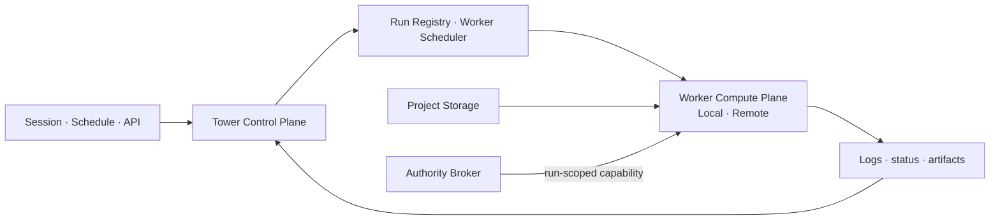

# services/runtime-box — Project Compute Control Plane

**책임**: Project 실행 계약, Worker scheduling, Durable Job/Service lifecycle, workspace·authority 경계 관리.

**현재 문서 정본:** `workspace/decisions/2026-08-12-agent-workbench-worker-first-decisions-index.md`, `workspace/projects/tower/work/2026-08-12-agent-workbench-worker-first-progress-index.md`.

> 과거의 동일-host Docker Runtime Box가 출발점이지만 최종 목표는 Tower control-plane-only 구조다. 정상 Project compute는 deployment-scoped Project Worker에서 실행하고, Runtime Box는 명시적 격리·clean environment·비상 실행 경로로 남긴다. 근거: `workspace/decisions/2026-08-10-tower-control-plane-only-project-compute.md`, `workspace/decisions/2026-08-14-workstation-worker-stability-and-explicit-runtime-box.md`.

## 목표 구조와 현재 전환 단계



현재 구현은 두 층이 공존한다.

- **구현층**: PostgreSQL Worker registry, signed identity, deployment-scoped binding, atomic transient slots, foreground·Durable Job·Service, Worker-local file authority.
- **운영 전환층**: development Local/Operator Worker는 등록돼 있으며 production-scoped Worker 설치·canary binding·장애 훈련이 남았다.
- **migration층**: binding 없는 deployment의 Docker Runtime Box compatibility, 단일 Worker env binding, SSH tunnel, bootstrap/restore rsync.

`local-runtime | remote-worker`는 최종 제품 선택지가 아니다. 최종 scheduler는 **이 Project의 기본 작업 컴퓨터가 어느 Worker이고, 이 workload를 그 Worker에서 처리할 수 있는가**를 결정한다.

Worker는 매 run마다 갈아끼우는 provider가 아니라, 사용자가 연결해 오래 쓰는 **지속형 작업 컴퓨터**다. Compute binding은 `(project_id, deployment_id)` 단위 `project_compute_deployment_bindings`에 저장한다. preference는 실행 권한이 아니므로 선택 Worker는 deployment, Project allowlist, capability, heartbeat, drain, atomic capacity slot, transport authentication을 모두 통과해야 한다.

Per-job full-project rsync는 migration bridge일 뿐 Workstation-first runtime 정책이 아니다. Workstation Project의 기본 실행은 Worker-local persistent Project workspace에서 바로 일어난다. rsync/restore는 초기 bootstrap, Worker 교체, backup/restore, sandbox 전달 같은 운영 도구로만 남긴다.

Workstation Project의 file API는 Tower에서 Project ACL을 먼저 검사한 뒤 Worker-local authoritative storage에서 tree/read/exists/write/mkdir/delete/rename/copy, binary read/write, multipart upload를 수행한다. Tower host mirror는 Search·Notes Index·Knowledge Graph 같은 legacy derived read model을 위한 cache이며 정본이 아니다. Worker mutation 뒤 derived mirror를 갱신하고 bounded reconcile은 cache repair로만 사용한다.

역사적 remote PoC로 `tower_project_dev`를 `iwinv-01:/worker-project`에 bootstrap해 read smoke를 통과했다. 현재 development plane에는 일반 Project Worker `tower-local-01`과 명시적 Operator Plane Worker `tower-operator-01`이 등록돼 있다. production deployment binding은 별도 canary rollout 대상이며, DB binding이 없는 deployment는 migration compatibility 경로를 유지한다.

AI 모델 관점:

```
Tower file tools (read/grep/find/edit/write) = IDE
project_shell                                 = Terminal
service_start / service_list / service_logs / service_stop = Running process panel
```

## Pi Native Tool Surface

Runtime Box 도구는 MCP 서버가 아니라 Pi `customTools`(ToolDefinition)로 마운트됩니다.
Claude Code 하네스보다 Pi coding agent를 주 실행 경로로 쓰는 구조입니다.

```
engines/pi-runtime-box-tools.ts  ← 도구 정의
engines/pi/tool-assembly.ts      ← Pi 세션 시작 시 마운트 조건 처리
```

### 도구 목록

| 도구 | 역할 |
|---|---|
| `bash` | AI-facing 단일 Project shell. deployment binding·authority에 따라 persistent Worker 또는 compatibility Project executor에서 foreground·Job·Service 실행 |
| Sandbox executor | 일반 도구 목록에는 미노출. clean/untrusted/release 작업을 별도 execution mode로 라우팅하는 후속 경계 |
| `service_start` | 기본 Worker에서 장기 Service 시작 + PID/log/preview metadata 기록 |
| `service_list` | 프로젝트 서비스 목록 확인. 0개여도 Box warm 슬롯은 별개로 남을 수 있음을 안내 |
| `service_logs` | 서비스 로그 tail 확인 |
| `service_stop` | 서비스 프로세스 중지 |

### 마운트 조건

```ts
config.runtimeBox.enabled          // ENABLE_PROJECT_RUNTIME_BOX=true
&& !!opts.userId
&& !!opts.projectId
&& !isProjectExcluded(opts.projectId, projectName)
// RUNTIME_BOX_EXCLUDED_PROJECTS=tower,_team 기본 제외
```

## Remote Worker control plane

### Project 실행 선택 순서

1. AI는 `bash` 하나만 호출하고 Tower가 foreground·Job·Service lifecycle과 Project execution authority를 분류한다.
2. `(project_id, deployment_id)` binding에서 기본 Worker와 workstation mode·authority mode를 확인한다. binding이 없는 deployment만 migration 기간 동안 Runtime Box compatibility를 사용한다.
3. `workstation_mode=true`인 Project는 per-job rsync를 우회하고 Worker-local persistent workspace에서 바로 실행하며 Worker unavailable·capacity full·transport auth unavailable 시 fail-closed한다.
4. PostgreSQL registry에서 deployment·Project·필요 capability가 맞는 healthy Worker를 찾고 Workstation은 sticky default Worker만 허용한다.
5. transient foreground·Job은 `active_runs < max_runs`를 DB에서 원자적으로 예약·반환한다. Service 자원 예산은 별도 후속 계약이다.
6. 선택 Worker의 transport 인증 material을 해석할 수 있을 때만 Worker provider를 만든다.
7. 활성 Workstation은 silent Runtime Box fallback을 금지한다. emergency fallback은 Project별 preview/apply와 audit를 거친다.
8. Runtime Box는 일반 AI-selectable shell에서 제거한다. 격리 실행은 별도 Sandbox execution mode로만 다시 노출한다.

### Worker 상태와 인증은 별도다

- DB registry에는 endpoint, scope, capability, capacity, heartbeat, drain 같은 **비민감 scheduling metadata**만 저장한다.
- Worker identity JWT는 Worker가 Tower에 register/heartbeat할 권한이다.
- Remote execution transport token은 Tower가 Worker의 `/v1/runs`를 호출할 권한이다.
- 두 token을 하나로 간주하거나 DB registry에 평문 저장하지 않는다.
- heartbeat는 capacity와 liveness만 갱신한다. endpoint, Project scope, capability, drain은 바꾸지 못한다.

### 핵심 파일

| 파일 | 책임 |
|---|---|
| `workbench-worker-registry.ts` | 메모리 기반 migration scheduler seam |
| `workbench-worker-repository.ts` | PostgreSQL Worker registry와 scheduling query |
| `workbench-worker-identity.ts` | signed register/heartbeat identity |
| `routes/workbench-worker-api.ts` | Worker register/heartbeat, admin list/drain |
| `workbench-execution-provider-selector.ts` | DB pool 우선 provider binding과 legacy fallback |
| `workbench-remote-job-runner.ts` | Durable Job claim·heartbeat·로그·terminal result |
| `workbench-remote-http-transport.ts` | Tower→Worker NDJSON execution channel |
| `workbench-remote-rsync-bridge.ts` | 전환기 per-Job workspace 전달 |
| `workbench-remote-run-credentials.ts` | run-scoped one-time Credential envelope; GWS pilot 완료, 범용 required-key·crash acceptance는 미완료 |
| `workbench-project-file-authority.ts` | Worker-local authoritative Project file read/write/mutation |
| `workbench-remote-service-registry.ts` | Worker Service start/logs/stop과 persisted metadata |

### 단기 호환성 acceptance

Worker-first 전환은 새 기능 수보다 기존 Runtime Box dependency contract 보존이 중요하다.

- Node: `node`, `npm`/`pnpm`, `node_modules`, Vite/tsx/build scripts
- Python: `python`, `pip`/`uv`, `.venv`, pandas/PDF/Excel/image 라이브러리
- System tools: chromium, pandoc, libreoffice, imagemagick, poppler, ffmpeg, fonts
- Managed skill assets: `.tower/skills`, scripts, templates, references
- Credential: env 이름·materialization·provider auth가 기존 Runtime Box와 동등하게 동작
- Path contract: `/workspace`, uploads/final/work, artifact/present_file 경로
- Long-running process: dev server/service 상태와 로그가 Tower에 보임

### 구현됐지만 운영 acceptance가 남은 것

- production-scoped Local Worker 설치와 Project binding 없는 health 검증
- canary Project의 deployment binding 활성화
- foreground·Job·file·Credential 정상 acceptance와 `maxRuns=1` capacity acceptance
- Worker·heartbeat·transport token 장애 훈련과 Project emergency fallback smoke

### 후속 설계가 남은 것

- 일반화된 Credential required-key 계약과 crash/kill cleanup black-box acceptance
- Worker Service 전용 persistent resource budget·desired-state recovery
- queue·lease expiry·Worker-loss slot reconcile
- Worker workspace backup/bootstrap과 multi-Agent write lease
- Project binding·emergency fallback의 사용자/운영 UI

## Local Docker Backend — migration/runtime fallback

```
project_shell 호출
  └─ getOrCreateBox()          ← project_runtime_boxes row 생성/조회
  └─ ensureRunning(boxId, userId)
       ├─ global → 사용자별 advisory lock으로 동시 start/reclaim 직렬화
       ├─ Box activity lock 안에서 후보 재확인 (새 exec와 reclaim 상호 배제)
       ├─ per-user 한도 도달 시 안전한 LRU 회수 시도
       │    ├─ 같은 created_by 사용자 + running + target 제외
       │    ├─ pending/running 서비스 0개
       │    └─ last_active_at + idle_stop_minutes가 이미 지난 Box만 idle_stopped
       ├─ 회수 불가 시 프로젝트명·마지막 활동·남은 idle 시간·해결 방법 오류
       ├─ assertGlobalBoxBudget()   ← RUNTIME_BOX_MAX_RUNNING=8
       ├─ UPDATE status='starting'
       ├─ docker rm -f tower-box-N  (stale 정리)
       └─ docker run -d
            --name tower-box-N
            --memory Nm --memory-swap Nm
            --cpus N --pids-limit 512
            --security-opt no-new-privileges
            -v project_root:/workspace:rw
            -w /workspace
            tower-runtime-box:node22-python313
            sleep infinity
  └─ execDockerCommand(box, req, cwd)
       └─ docker exec [-u project_uid:project_gid | root for apt/dpkg] -w /workspace [env...] tower-box-N sh -c <cmd>
            ├─ 일반 프로젝트 작업: host 프로젝트 폴더 소유자 uid/gid로 실행 → 산출물 권한 정상 유지
            ├─ apt/apt-get/dpkg 같은 OS 패키지 관리: 컨테이너 root로 실행 → 필요한 utility 설치 허용
            ├─ root 명령이 프로젝트 작업 디렉토리에 새로 만든 root-owned 파일만 marker 기반 best-effort chown
            ├─ 사용자는 host 우회 없이 Runtime Box 안에서 변환/설치/분석을 끝낼 수 있음
            ├─ stdout/stderr 실시간 콜백 + 1MB truncate
            ├─ timeout → SIGKILL, exit_code=124, timed_out=true (default 60s, max 900s/15m)
            └─ exit_code=137 + not timed_out → oom_killed=true
  └─ UPDATE last_active_at=now()

service_start 호출
  └─ getOrCreateBox() + ensureRunning()
  └─ cwd 지정 가능: 예) cwd=/workspace/apps/web, command="npm run dev"
  └─ registerService()              ← runtime_box_services status='pending'
       ├─ internal_port 있으면 preview_token 생성
       └─ external_url=/api/runtime-box/preview/<token>/ 저장
  └─ startServiceProcess(serviceId)
       ├─ docker exec -w /workspace tower-box-N sh -lc <supervisor script>
       ├─ nohup sh -lc <command> >> .runtime-box/logs/service-ID-name.log 2>&1 &
       ├─ process_pid / log_path 저장
       └─ status='running'

service_logs 호출
  └─ docker exec tower-box-N tail -n <N> .runtime-box/logs/service-ID-name.log

service_stop 호출
  └─ docker exec tower-box-N kill -TERM <process_pid> (+ SIGKILL fallback)
  └─ UPDATE status='stopped', process_pid=NULL

preview URL 호출 (로그인 필요, same-origin path)
  └─ GET /api/runtime-box/preview/<preview_token>/...
       ├─ authMiddleware + project membership 확인
       ├─ docker inspect tower-box-N 로 container IP 확인
       └─ http://<container-ip>:<internal_port>/api/runtime-box/preview/<token>/... 로 reverse proxy
          (service_start 가 TOWER_RUNTIME_BOX_PREVIEW_BASE 를 주입하므로 Vite 등은 base 로 사용)

preview WebSocket/HMR 호출
  └─ Upgrade /api/runtime-box/preview/<preview_token>/...
       ├─ tower_token cookie / Authorization / token query 확인
       ├─ project membership 확인
       └─ ws://<container-ip>:<internal_port>/api/runtime-box/preview/<token>/... 로 upgrade proxy

idle-stop-cron 60s tick (feature flag on일 때만 시작)
  ├─ reconcileRuntimeBoxes()        ← DB box 상태와 Docker container 상태 동기화
  ├─ reconcileRuntimeBoxServices()  ← DB service 상태와 실제 process 상태 동기화
  ├─ expireStaleServices()          ← TTL 지난 서비스 stop + expired
  └─ stopBox(id, 'idle_stopped')
       ├─ docker stop --time 10 + docker rm -f
       └─ UPDATE status='idle_stopped', container_id=NULL
```

## Docker Image 빌드

```bash
# Tower repo 루트에서
docker build -t tower-runtime-box:node22-python313 \
  packages/backend/sandbox-images/runtime-box-node22-python313/

docker build --build-arg BASE_IMAGE=tower-runtime-box:node22-python313 \
  -t tower-runtime-box:operator-tools \
  packages/backend/sandbox-images/runtime-box-operator-tools/
```

기본 이미지 포함 내용: node22, npm, pnpm, python3, pip, uv, git, curl, wget, jq, build-essential,
PDF/도면/이미지 기본 도구(poppler-utils/pdftoppm, qpdf, ghostscript, imagemagick),
Playwright browser automation API(`playwright-core`) + system Chromium(`/usr/bin/chromium`),
Python PDF 라이브러리(pypdf, pdfplumber, PyMuPDF/fitz, Pillow), 한글 폰트(Noto CJK)

`operator-tools` profile image는 기본 이미지 위에 `postgresql-client`와 `gh`를 추가한다. 이는 client tool 추가일 뿐 authority/secret을 부여하지 않는다. `pm2`는 host PM2와 혼동을 만들기 때문에 의도적으로 제외한다.

### Browser capture baseline

Runtime Box web capture uses `playwright-core + system Chromium`. Do not download Playwright browser bundles into the base image. Reasons: image size, duplicate browser installs, network fragility, and version drift. If Playwright video recording needs a Playwright-managed ffmpeg artifact, add that artifact explicitly after smoke testing; do not use broad `npx playwright install chromium`.

PDF/도면 처리 원칙: 프로젝트 안의 큰 PDF, 스캔 시방서, 설비 도면은 sandbox `workspace_path`
복사 실행 대신 Runtime Box `/workspace`에서 직접 처리한다. Runtime Box는 프로젝트 폴더를 rw mount하므로
sandbox tar 크기 제한에 걸리지 않고, `pdftoppm`/`PyMuPDF`로 페이지를 PNG/JPEG로 렌더링한 뒤 Tower `read`
도구로 대표 페이지를 비전 분석할 수 있다.

## 설정 (`.env`)

```
ENABLE_PROJECT_RUNTIME_BOX=false          # 기본 off. true로 설정해야 도구 마운트
RUNTIME_BOX_IMAGE=tower-runtime-box:node22-python313
RUNTIME_BOX_DOCKER_BIN=docker             # 절대경로 지정 가능
RUNTIME_BOX_EXCLUDED_PROJECTS=tower,_team # 제외할 project ID/name (콤마 구분)
RUNTIME_BOX_DEFAULT_MEMORY_MB=3072        # Box 기본 메모리 제한 (3GB)
RUNTIME_BOX_MAX_MEMORY_MB=3072            # Box 최대 메모리 hard cap (3GB)
RUNTIME_BOX_MAX_RUNNING=8                 # 서버 전체 동시 running box 수 상한
RUNTIME_BOX_MAX_RUNNING_PER_USER=3        # 사용자당 running box 수 상한
```

## External Worker v1 operations

Use the read-only doctor before manual repair:

```bash
./start.sh worker-doctor <worker-id>
./start.sh worker-doctor <worker-id> --json
./start.sh worker-repair iwinv-01 --tunnel|--heartbeat|--worker
```

`worker-repair` restarts only the named component and then reruns Doctor. It intentionally has no `--all`, Job replay, identity rotation, or Credential mutation path.

It summarizes persisted heartbeat/drain/capability/Project scope, active identity metadata, transport credential binding presence, endpoint reachability, and recent remote Jobs as `HEALTHY`, `DEGRADED`, or `OFFLINE`. It never resolves or prints Credential values. External Worker v1 intentionally favors one dedicated Worker and operator-readable failures over automatic replay or failover.

## Public API

### `runtime-box-manager.ts`
- `getOrCreateBox(projectId, userId)` — 프로젝트 Box 조회 또는 생성
- `ensureRunning(boxId, userId?)` — stopped 이면 on-demand Docker start. 사용자 한도 도달 시 이미 idle 기준을 넘긴 서비스 없는 동일 사용자 LRU Box를 안전하게 회수
- `execInBox(req)` — docker exec 실행, ExecResult 반환
- `stopBox(boxId, targetStatus?)` — Docker stop + DB 상태 갱신
- `destroyBox(boxId)` — 완전 삭제 (DB row 포함)
- `countRunningBoxes()` — 전체 running count (cron / budget용)
- `countRunningBoxesByUser(userId)` — 사용자별 running count
- `reconcileRuntimeBoxes()` — DB box 상태와 Docker container 상태 동기화

### `runtime-box-reclamation.ts`
- `listUserRuntimeBoxOccupancy(userId, targetBoxId)` — 동일 사용자의 running/starting 점유를 프로젝트명·활동·서비스 상태와 함께 조회
- `selectReclaimableRuntimeBox(occupancy)` — 서비스 없고 기존 idle-stop 시각을 지난 가장 오래된 running Box 선택
- `formatUserRuntimeBoxBudgetError(...)` — 회수 불가 시 점유 프로젝트와 남은 idle 시간, 해결 방법을 사용자 언어로 설명

### `service-registry.ts`
- `registerService(req)` — 장기 실행 서비스 metadata 등록 (`pending`)
- `startServiceProcess(serviceId)` — Runtime Box 안에서 실제 장기 프로세스 시작 + PID/log 저장
- `readServiceLogs(serviceId, tail?)` — 서비스 로그 tail
- `listServices(projectId)` — 프로젝트 서비스 목록
- `stopService(serviceId)` — 개별 서비스 프로세스 stop + DB 상태 갱신
- `expireStaleServices()` — TTL 만료 서비스 stop + expired 마킹
- `reconcileRuntimeBoxServices()` — DB service 상태와 실제 process 상태 동기화

### `command-classifier.ts`
- `classifyCommand(cmd)` — 'light' | 'heavy' | 'long-running' | 'risky'
- `extractPortFromCommand(cmd)` — 명령에서 포트 감지

### `idle-stop-cron.ts`
- `startRuntimeBoxCron()` — 60s tick (reconcile + idle stop + service TTL)
- `stopRuntimeBoxCron()` — 서버 종료 시

### `policy.ts`
- `isRuntimeBoxEnabled()` — feature flag 확인
- `isProjectExcluded(projectId, projectName?)` — 제외 프로젝트 확인

## 명시적 Runtime Box compatibility에 들어오기 전 알아야 할 것

아래 항목은 binding 없는 deployment의 compatibility backend에만 해당한다. AI-facing 이름은 동일하게 `bash`지만 persistent Worker 계약으로 일반화하지 않는다.

1. **rw mount는 동일 host Docker**다. Worker-local authoritative workspace와 다른 격리 환경이다.
2. **프로젝트 경계 강제**: `project_root`는 `workspace/projects/<slug>/` 안.
   상위 경로 절대 mount 금지.
3. **리소스 기본선**: Box 메모리는 기본 3GB / 최대 3GB hard cap.
   한 Box OOM은 해당 컨테이너/프로세스에 국한되지만, 디스크·I/O·Docker daemon은 host 공유 자원.
4. **기본 Worker와 분리**: compatibility backend는 Box `/workspace` 기준이며 persistent Worker 환경과 다르다. 이 차이는 AI 도구 선택이 아니라 Tower 내부 migration 상태다.
5. **권한 모델**: Runtime Box 명령은 프로젝트 폴더 소유자 uid/gid로 실행한다.
   사용성 원칙은 "로컬 devbox처럼 필요한 utility를 직접 설치할 수 있어야 하지만, 프로젝트 산출물은 잠기면 안 된다"이다.
   `apt-get install`, `apt install`, `dpkg`, `add-apt-repository` 같은 OS 패키지 관리는 컨테이너 root로 실행한다.
   root 명령이 프로젝트 작업 디렉토리에 새로 만든 root-owned 파일이 있으면 marker 이후 변경분만 best-effort `chown` 한다.
   이렇게 하면 `apt-get install ...` 도 가능하고, `analysis/`·`node_modules/`·생성 이미지가 host/Tower UI에서 잠기지 않는다.
6. **Docker socket 금지**: Box 컨테이너에 Docker socket mount 절대 안 함.
7. **Tower host secrets 금지**: `.env`, DB 크레덴셜을 Box에 주입하지 않음.
8. **컨테이너 layer는 ephemeral**: stop/idle stop은 Docker container를 stop+rm한다. `/workspace` 파일만 persistent하고, live container 내부 `apt-get install`/global npm/pip 설치는 다음 recreate 때 사라질 수 있다. 중요한 툴은 profile Dockerfile 또는 `/workspace/.runtime-box/bootstrap.sh`로 재현 가능하게 기록한다.
9. **feature flag 기본 off**: `ENABLE_PROJECT_RUNTIME_BOX=false`. 운영자가 명시 설정 필요.
10. **사용자 슬롯 회수는 idle-stop의 조기 실행일 뿐**: 최근 사용 Box, `starting` Box, `pending`/`running` 서비스가 있는 Box는 자동 종료하지 않는다. 프로젝트 파일은 bind mount에 남고 컨테이너만 `idle_stopped` 된다.

## 현재 운영·후속 TODO

| 항목 | 우선순위 | 메모 |
|---|---|---|
| production Local Worker canary | P0 | 설치·identity·transport·unbound health 후 Project binding |
| Worker capacity acceptance | P0 | `maxRuns=1`, full 오류, 성공·실패·취소 slot release |
| Worker 장애 훈련 | P0 | process·heartbeat·transport token·emergency fallback |
| Credential 범용 최소 선택 | P0 | explicit required-key + crash/kill cleanup |
| Worker Service resource budget | P1 | transient slot과 분리, desired-state recovery |
| Worker-loss reconcile | P1 | queue·lease expiry·slot leak 복구 |
| Workspace 운영 | P1 | backup·Worker 교체·multi-Agent write lease |
| Runtime Box compatibility 축소 | 후속 | production canary 안정화 뒤 binding 없는 deployment·명시 도구에 한정 |

## 관련 결정문서

- `workspace/decisions/2026-08-10-tower-control-plane-only-project-compute.md` — 현재 최종 목표와 migration 경계
- `workspace/decisions/2026-08-12-trust-based-project-worker-authority.md` — Project·Operator Plane·Sandbox 권한 모드
- `workspace/decisions/2026-08-14-workstation-worker-stability-and-explicit-runtime-box.md` — deployment binding·sticky Worker·explicit Runtime Box
- `workspace/projects/tower/work/2026-08-10-remote-worker-run-scoped-credential-design.md` — authority seam과 안전 게이트
- `workspace/decisions/2026-06-02-project-runtime-box-product-framing.md` — 초기 제품 목표
- `workspace/decisions/2026-06-02-project-runtime-box-pi-native-tools.md` — Pi native tool 설계 원칙
- `workspace/decisions/2026-06-01-project-runtime-plane-devbox-services.md` — 전체 설계
- `workspace/decisions/2026-06-01-project-runtime-plane-stress-test.md` — 위험 시나리오

## _DECISIONS.md

이 구조가 `services/deploy/` 아래 직접 붙지 않고 별도 폴더를 쓰는 이유:
- `deploy/` 는 코드 배포(Cloudflare/Azure) + 일회성 sandbox run에 집중.
- Runtime Box는 "프로젝트 개발 환경 lifecycle" — 다른 책임 영역.
- v2+에서 sibling VM / overlay / microVM으로 backend 교체 시
  이 폴더의 interface만 유지하면 MCP tool / API / DB schema는 바꾸지 않아도 됨.
