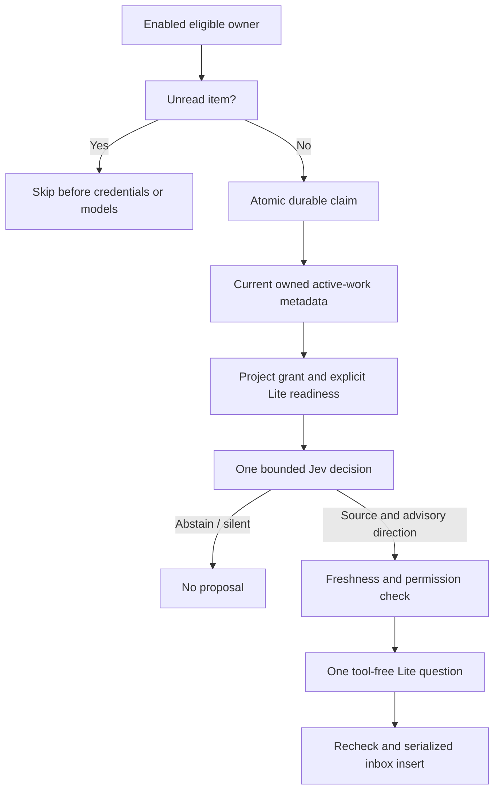

# Secretariat — personal proactive proposal inbox

## Current contract

The Secretariat offers one specific question about the authenticated person's own active work. It does not execute the suggested action. The approved direction is recorded in [the product decision](../../../../docs/decisions/secretariat-proactive-assistant-direction.md).

- `GET /api/secretariat` returns `{ enabled, pausedReason, proposals }`. Proposal fields are `id`, `title`, `body`, `createdAt`, `readAt`, `sessionId`, and `projectId`. `pausedReason` is `unread_proposal` while an accessible unread proposal exists.
- `PATCH /api/secretariat` accepts only `{ enabled: boolean }`; the default is **off**. Changing the preference invalidates in-flight work through a generation counter; OFF does not release an active worker lease.
- `POST /api/secretariat/proposals/:id/read` is owner-scoped and idempotent. Another owner's ID returns 404, including for administrators.
- Responses are `Cache-Control: no-store`. Current active admin/operator/member accounts are eligible. Viewer/guest/disabled/pending accounts are denied. Operators require current Project membership, not blanket data access.
- Inbox reads recheck current source ownership, Project lifecycle/membership, and Session/team audience access. Inaccessible content and links are never returned; an inaccessible unread item is withdrawn by acknowledging it when the owner fetches the inbox. This provides a recovery path without retaining an unread permanent blocker.
- Delivery is exclusively this database-backed app inbox. There is no `notification-hub`, web push, email, Slack, proactive session creation, Session mutation, tool execution, or automatic action.

## Candidate, decision, and generation pipeline

`store.ts` selects at most eight owner-only `work_ledger_records` in `running` status, updated in the last seven days. The source Session must belong to that same person and active Project, and contain a user message within fourteen days. Shared-project work owned by someone else is not a candidate. Completed, archived, dormant, already-proposed, inaccessible, or credential-shaped sources are excluded. The source key is calculated once by SQL and is carried unchanged into the proposal; timestamp serialization does not break dedup.

A current claim/consent and source freshness/access check runs before each provider stage and again before insertion. Only candidates from the first current Project are sent under that Project's Gateway grant. State consists of bounded title/outcome metadata, not raw messages, files, arbitrary environment data, or secrets.

`provider.ts` calls the existing Gateway Profile resolver and `evaluateWithOpenRouterJev` adapter. A single decision request chooses both a supplied source and one advisory direction. `offer_resume`, `offer_next_step`, and `ask_to_unblock` may lead to Lite. `stay_silent`, abstention, unknown values, and `flag_change` are silent; comparative evidence is not available in this version, so change claims are not supported. Decision confidence must be at least 0.7 for both questions. Jev never grants authority.

The physical model is explicitly resolved from `preset/lite` using the existing model preset/VM readiness contracts, not the background/Core policy. Both the Project-bound Jev connection and registered Lite VM inference connection must be available before a billable request. Lite uses Pi's existing `quickReply` path with no tools or Session, a 15-second cancellation signal, and 500 output tokens. Both supported Router Responses and OpenRouter transports honor that signal and token limit. Missing credentials, provider errors, insufficient evidence, invalid output, changed work, or revoked consent fail closed with no placeholder proposal or automatic retry. Lite produces a specific Korean question; generated external links, markup, long content, and credential-shaped content are rejected. The only source link is the server-derived `sessionId`.

## Scheduler, persistence, and bounds

- `index.ts` starts/stops `scheduler.ts` alongside the backend lifecycle. `scheduledExecutionEnabled()` preserves production/development ownership. The loop scans at most three due users per minute and never overlaps its own ticks.
- Defaults are conservative reversible implementation choices: one attempt per person per one hour, a two-minute lease, one Jev call (3-second adapter deadline), and at most one Lite call (500 tokens / 15 seconds) per claimed attempt. This is an invocation/token ceiling, **not a measured currency budget**. No cost-in-dollars ledger or user-configurable cadence/budget exists yet.
- Unread owners are excluded from the bounded due queue, so they cannot starve later users. Other skipped users are deferred one hour. User-message recency prevents continued generation for long-dormant work. A read acknowledgement allows the next normally due attempt; it does not bypass cooldown.
- A single PostgreSQL CTE claims the due user and inserts a durable occurrence run. Multiple replicas compete on the same settings row; a unique `(user_id, occurrence)` constraint survives process restart. No Automation scheduler advisory-lock key is reused or nested.
- Unique `(user_id, source_key)` and the partial one-unread index prevent duplicate delivery. `insert()` locks the settings row within the existing `transaction()`/`withClient()` helper before testing consent and writing. If OFF commits first, stale delivery is prevented; OFF/ON also invalidates the old generation. Final SQL also rechecks current work/version, activity, membership, source ownership, and active Project.
- `238_secretariat.sql` is an additive migration file. This implementation does **not** apply it to the operational database. An un-migrated backend responds 503 to API operations and scheduler polling fails closed without model calls.

## Verification and limits

Behavior tests are adjacent to their owning modules:

- `service.test.ts`: opt-in, unread zero-model skip, authorization, revoked source, changed/completed source before Lite, provider failure, silence, same-Project grant, no fallback proposal.
- `provider.test.ts`: real adapter contract parsing, direction and confidence policy, explicit Lite selection, connection readiness, tool-free execution contract, output validation.
- `store.test.ts`: durable claim/dedup/source keys, queue fairness, owner filters, settings serialization, current-source insertion gates.
- `store.postgres.test.ts`: starts its own synthetic temporary PostgreSQL cluster (never Tower/production PG), applies only the synthetic schema and this migration, executes actual store SQL, concurrent replica claims, OFF-before-insert lock race, OFF/ON generation, source dedup, unread pause, fairness, and inactive/revoked-source checks. It skips when PostgreSQL server binaries are unavailable or the process is root; `TOWER_TEST_POSTGRES_BIN` can specify an installed binary directory. Temporary cluster cleanup belongs solely to this test's self-created directory.
- `scheduler.test.ts`: scheduling ownership, loop lifecycle, no overlapping ticks, bounded sequence, missing migration fail closed.
- `../../routes/secretariat-api.test.ts`: HTTP contract, owner closure, current role, strict settings and UUID validation.
- `../../engines/pi/quick-reply.bounded.test.ts`: mocked Router/OpenRouter transport confirms cancellation and output caps, with no tools.

Verified locally: seven Secretariat/bounded-provider test files, 63 passing tests including the isolated PostgreSQL execution/race tests, and backend TypeScript. Nearby utility, proactive authority, preset alias, scheduler-ownership, and DecisionSpec/adapter regression tests also passed (120 tests across thirteen files). No operational migration, paid live Jev/Lite call, deployed UI, actual notification, or production multi-replica runtime has been verified. In-flight provider work may finish after opt-out, but subsequent stages and delivery are stopped; an already-started billed provider request cannot be undone.

## Deferred capabilities

Completed-work chaining, real change detection, broader conversation summarization, user-defined cadence/budgets, persistent currency metering, and external delivery are outside this version's scope. Adding them requires a separate product decision and verification rather than widening this opt-in inbox implicitly.

## Hourly popup follow-up

The opt-in check interval is now one hour. A large app-level popup is shown only while the page is visible, no other semantic dialog or legacy full-screen overlay exists, no input is focused, and no session is streaming. The UI polls stored proposals once per minute; polling never invokes a model. Other dialogs take priority.

Migration 239 adds `shown_at`, separate from `read_at`. An owner-scoped atomic `POST /api/secretariat/proposals/:id/respond` with `show` claims automatic presentation once across tabs. Closing never acknowledges; unread continues blocking generation. `skip` acknowledges and enforces at least an hour before another attempt. `today` acknowledges and defers for 24 hours, explicitly labelled “24시간 쉬기” rather than an ambiguous midnight boundary. No external delivery or automatic work execution is added. Reloading between a presentation claim and rendering can suppress that popup, but the proposal remains in the inbox (at-most-once presentation).

Local follow-up verification includes popup component tests, owner/parallel presentation claims in temporary PostgreSQL, and TypeScript checks. Production migration/provider calls/deployment have not been performed.

Follow-up verification: 135 targeted Vitest tests and four desktop/mobile Chromium fixture tests passed. An earlier whole-repository typecheck passed, but the final rerun was blocked by unrelated concurrent errors in `dictation-api.ts`, `DictationButton.tsx`, `InputBox.tsx`, and `AgentDirectory.tsx`; final whole-repository typecheck is not reported as passing.

## Contextual notes follow-up

Lite now reads up to 12 recent active user/assistant messages from the selected owner-scoped source session (up to 1,000 characters each). Tool results, thinking and hidden blocks are excluded; malformed truncated structured content is omitted. Source access and work freshness are checked before and after loading context. Secret-pattern messages are withheld from the model. Conversation is untrusted evidence, not executable instructions.

The note may be an observation, options, a briefing or a question. No mandatory question ending or 2–4 sentence template remains. Output is capped at 1,500 tokens / 4,000 body characters, not a target length. Jev still selects a bounded candidate/direction without receiving the transcript. Popup notes above 600 characters initially show a short opening excerpt and expand on demand. Close and rest controls remain outside the scrollable detail area. No additional model call is used to summarize.

Verification: context privacy extraction, extended note parsing, message forwarding and long-note expansion unit tests; provider live quality remains unverified. No deployment or paid inference was performed.

## Navigation and live readiness correction

Desktop Secretariat navigation now preserves the sidebar; mobile closes only its drawer. The existing selected session is retained. Model readiness forwards the current LiteLLM catalog timestamp rather than rejecting catalog-backed models. Hourly occurrence deduplication uses 3,600 seconds (not the previous 21,600), and an existing occurrence prevents a claim from advancing settings without recording a run.

A user-authorized single-account manual check on the corrected local service returned `skipped`, and bounded Jev selection returned no accepted candidate. No proposal was fabricated, no unread/rate/access protection was bypassed, and these source changes are not a production deployment.

## Investigation-first Jev selection (revision 2)

Jev now chooses a single candidate/opportunity pair, not independent source and direction answers. Directions are `prepare_something`, `make_next_step_smaller`, `clarify_one_decision`, `connect_existing_work`, and `review_before_commitment`. `none` remains available. Confidence 0.7 now concerns the value of inspecting context, not readiness to notify; its numeric threshold is unchanged.

The shared decision schema now permits up to 32,000 characters per question instruction, independently of short metadata fields. Revision 3 includes a detailed attention-director brief, opportunity definitions, abstention calibration, examples and trust boundaries. The limit is a Tower validation budget, not a verified provider context guarantee. It favors reduced user effort and concrete plausible help, permits investigation despite incomplete context, and rejects generic nudges, invented facts and repeated resolved work. Lite independently reads the selected conversation and may return null. Jev selection is not an observation of fact or approval to notify/execute.

Regression coverage validates all five directions bound to the selected candidate, unsupported results, abstention, empty inputs without a Jev call, and Lite abstention. No live provider evaluation or notification was performed for this prompt revision; behavioral quality is not established by mocked tests.

## Revision 4: independent inspection and delivery judgment

Supersedes revision 3 pair competition. Each candidate receives an independent Noul question in one Jev request. The top value >=0.7 is inspected; the number is a model judgment, not a calibrated success probability. No direction is committed before context reading. Lite receives current work metadata, up to twelve recent visible messages and up to three accessible same-session prior proposals (acknowledged does not imply accepted). It returns null or a structured note with benefit, evidence, whyNow, userBurden and delivery (popup/inbox). Internal justification fields are validated but not persisted as conversation/log content. Inbox-only proposals remain unread and block further generation until reviewed; they never automatically pop up.

Migration 241 adds delivery and run diagnostic fields. Claimed executions persist stage, bounded reason, candidate count, selected score, provider disposition, call-attempt count and elapsed milliseconds—no transcript, output, credentials or raw errors. Pre-claim gates remain represented by settings and existing unread state rather than emitting a database run on every scheduler tick. Failed calls are counted as attempts, not proof of billing. Supplied evidence is not mechanically fact-checked by JSON validation.

Live A/B comparison and paid provider validation have not been executed. Fixtures test independent ranking, abstention, structured delivery, privacy guards and inbox suppression; this does not demonstrate live proposal usefulness. No deployment or production migration is included.

## Participating sessions scope

Candidate discovery now starts from at most ten recently active sessions across Projects where the user is currently a member, rather than running Work Ledger items. Participation means session ownership or a server-attributed user message matching the current account username. Username changes may exclude historical participation; no inference from display names or mere viewing is made. Shared/channel sessions still pass the current session ACL before any content is read. Administrator read exceptions alone do not admit candidates. Archived Projects/sessions, child sessions and registered helper backing sessions are excluded. Order is latest active top-level user/assistant message time, not metadata modification time. Already-proposed unchanged sources are excluded; subsequent ACL rejection can yield fewer than ten candidates.

Each Project connection must pass readiness before its bounded two-message preview enters selection. Lite uses the selected Project's connection. Source freshness uses the conversation timestamp, not a Work Ledger status. The current inbox and automatic checks use this scope. The requested manual “비서 브리핑” button is not implemented by this change.

Validation includes isolated PostgreSQL participation, helper exclusion, membership revocation, ten-candidate cap and ordering tests. No live inference, notification, production schema changes or deployment were performed.

## On-demand briefing and workspace-preserving dialog

The menu opens an overlay without changing activeView, selected session, sidebar or URL. Close, Escape and backdrop dismiss it and restore focus. Explicit source navigation closes the overlay. Legacy page links remain compatible.

`POST /api/secretariat/briefing` accepts no scope arguments and uses authenticated identity. It returns an existing unread proposal first; otherwise it runs one manual inspection without changing opt-in or the scheduled due time. Manual claims share the existing lease, require active identity, enforce a rolling one-minute retry guard and unread/access checks, and use separate occurrence keys. Manual output is inbox-only and expanded in the requesting UI, not automatically popped up. Closing cancels the UI request; a server call already underway may finish and save to the inbox. No automatic work execution occurs. Busy/no-proposal outcomes currently share a cautious UI status rather than claiming there is certainly no useful work.

Local tests cover manual execution while OFF, unchanged opt-in, shared lease and repeat suppression, API identity binding, dialog close/focus, and desktop/mobile browser navigation. Production/provider verification has not been performed.

## Personal conversational prototype

Migration 245 adds account-owned chat rows with source Project/session provenance and a per-user inference lease. /chat GET/POST uses authenticated ownership, current Project membership and source-session access checks. The tool-less Lite responder reads authorized recent private dialogue and proposals from the selected Project; it cannot delegate, execute work or change schedules. Project-derived replies become hidden after source access revocation. No chat exists until a usable authorized source and provider connection exist. Replies are bounded non-streaming completions. Closing does not cancel already-started provider work.

The UI shows incoming proposals beside personal dialogue and refreshes proposals while visible. This is a first conversational prototype, not the complete coordinator: no delegated execution, natural-language scheduling/completion extraction, streaming or semantic proposal deduplication. Explicit existing pause/read controls remain authoritative. Live provider checks and migration application are not performed.

## Stable conversation subject

Migration 246 allows an owner-only general conversation with no source binding. Requests optionally select a current authorized proposal ID, explicitly select general via null, or continue the last visible conversation by omission. New proposals do not automatically change the subject. Histories passed to the model are restricted to the selected source session, not simply any conversation in its Project. General chat uses Lite readiness without requiring a Jev gateway connection. Source-bound history remains filtered by current access; access revocation can remove previous context. Same-transaction user/assistant rows sort user first for continuity.

This change addresses subject continuity only. Natural-language deferral/completion persistence and live end-to-end paid inference remain outstanding; no false claim of scheduling or work execution is permitted. Backend regression tests pass; repository typecheck is blocked by an unrelated FileTabBar.tsx prop typing error in the current shared worktree.

## Secretary conversation as proposal evidence

After choosing a task and rechecking access, automatic and manual briefing read up to eight recent private secretary messages (1,000 characters each), strictly matched by authenticated owner, Project and source session. Lite receives these after source messages and previous proposals within a 23-message bound. Access/freshness is checked again before inference. User completion/deferral remarks are contextual evidence, not external status mutations; later requests may supersede them. Unbound general conversation is deliberately excluded because a bare “done” cannot safely be attributed to a task. No extra model call is introduced. Tests verify owner/source SQL bounds and propagation to the selected-task writer; real-model interpretation remains unverified.

## Personal session entry and modal (migration 247)

A unique owner-private `personal_secretary` session provides a stable identity in Recent Sessions. Menu and Recent Sessions open the same overlay without replacing the underlying workspace. The session is created on authorized first chat access or first automatic proposal, and activity advances on replies/proposals. Header face shortcut remains removed. This is not an unrestricted ordinary tool-using session: generic send is denied and chat uses the dedicated bounded Lite endpoint.

Messages remain in source-aware secretary storage; standard getMessages/getMessagesPaginated use an authorized read-time projection for this session label rather than duplicating source-protected content. Current Project membership and source-session ACL are applied; private session reads reject nonowners including admin read exceptions. Fix: chat now inspects accessResult.allowed (a denied result object is truthy). Existing chat rows remain owner/source-bound even if their new conversation_id is unset. General/session content is not migrated destructively.

Limitations: projection currently covers the bounded chat/inbox window, not full historical pagination; broad search/export paths that query raw messages do not automatically gain this projection. Ordinary execution tools and automatic full session-context compaction are not enabled. Legacy proposal controls remain in the panel as well as the chronological chat feed. Recent-session live unread push is not added; normal list refresh discovers activity.

Validated by secretary tests, common message-store/access regression tests, full typecheck, and desktop/mobile existing browser flows. Recent-session routing has a source regression test; full live database/browser routing requires deployment plus migration 247 and has not been verified here. No production migration, paid call, commit or deployment was performed.

## Continuous Core conversation correction

Chat now uses preset/core (automatic proposal writing remains Lite). Topic selection is removed: all currently authorized history/proposals form one chronological context, bounded to forty items/60,000 characters without per-message slicing. Standard MessageBubble renders the feed. Legacy read/source controls are collapsed. This remains a bounded quickReply path, NOT the standard persistent engine runtime: no full-history compaction, streaming, or tools yet. Long-term recall beyond the bounded window is not promised.

Migration 248 stores transitive source_refs for mixed-source replies so membership/session revocation hides derived content too. Current sources are rechecked before saving. Existing rows retain their previous direct source protection. No production migration, paid inference or deployment performed.

## Native conversation runtime (migration 249)

Secretary reply execution now calls the existing Pi engine.run with preset/core and an engine session path persisted per owner. First use or an external-source fingerprint change rehydrates authorized transcript into the native session file; unchanged evidence reuses that file and its SDK-native compaction. A dedicated server-only secretaryConversation flag disables tool assembly without abusing interview mode or granting host access. Failed engine turns invalidate the resume pointer. A five-minute inference lease replaces the old short quickReply lease.

Important remaining integration gaps: HTTP currently returns a completed reply (native streaming events are not forwarded to the popup); callback metrics/compact boundaries are not yet persisted through standard message callbacks; full generic WebSocket stop/steer is not wired to this UI. Engine execution/compaction is reused, but the normal ws-handler turn lifecycle is not wholly reused. Do not report this as complete standard-session parity. Live paid compaction/restart behavior remains unverified. Sources are rechecked before saving; no deployment, migration application or commit performed.

### Native streaming follow-up

POST /chat/stream forwards native assistant snapshots and compact phases over NDJSON and emits done only after authorized persistence. The UI renders streaming content with MessageBubble, supports Stop via request cancellation, and aborts when unmounted. Disconnect aborts the native engine; failed/stopped turns invalidate resume state. A token-checked heartbeat extends the inference lease during long runs. No steering endpoint or shared ws-handler turn telemetry is claimed. SDK compaction uses the native session path; actual paid long-context/restart testing remains outstanding.

### Durable secretary turn audit (migration 250)

Running/completed/stopped/failed/interrupted turns now record compact counts and native turn usage (input/output tokens and reported cost). After acquiring a new owner lease, abandoned running rows are marked interrupted; no blind retry is performed. Engine exceptions invalidate resume pointers. A streaming UI test exposed an initial-history response race overwriting a freshly completed answer; initial hydration is now ignored after a send begins. Tests cover completion rendering and preserving input on failed persistence. These audit rows do not replace all standard ws-handler turn/recovery records. Full restart/long-context live inference remains unverified.

### Terminal completion and atomic save

A streamed text snapshot is not proof of completion. Native execution must report a completed terminal verdict; EOF without it invalidates resume state and is not persisted as a finished answer. User/assistant rows, session activity and completed turn accounting are now written in a single data-modifying CTE statement. Source authorization still precedes persistence and is not a substitute for database-level ACL locking. Mid-turn steering remains unwired: introducing a second prompt path without persisted steer delivery semantics would cause divergence. Existing generic ws-handler lifecycle integration is still outstanding.

### Lease fencing

Heartbeat renewal now requires the same unexpired owner token; a failed renewal aborts the native execution rather than silently continuing. Atomic message/turn persistence locks and checks the live token. A stale process cannot save its answer after lease takeover. Failure cleanup deletes resume state only while its token still owns the lease. This is local unit coverage, not a multi-replica live verification; native file writes still require review before claiming cross-process fencing parity.

### Native resume-state ownership

Runtime checks the current owner lease before touching history and on each yielded event. Native path upserts and invalidation are token-conditional so stale cleanup cannot remove another run's pointer. This does not make SDK filesystem writes atomic across processes; a lease can change between check and file access. Full shared ws-handler recovery/steering integration remains required before claiming ordinary session parity. Tests cover stale rejection before engine entry and token-conditional state cleanup.

### Missing native file recovery

Before resuming a persisted engine path, file availability is checked. Missing or inaccessible files trigger rehydration from currently authorized database history rather than an attempt to resume an absent context. Unit coverage simulates restart with a missing path. This does not replace multi-process SDK file locking or a live restart test. Generic WebSocket send remains intentionally blocked until canonical message persistence and source-aware callbacks are integrated; removing the gate alone would enable tools or lose source protection.

### Stable rehydration identities

Native rebuilds now retain original chat/proposal IDs rather than assigning positional IDs; a shared bounded-role converter removes duplicate identities and excludes non-conversational roles. Tests exercise 100 complete messages without the former forty-message truncation. This is still not canonical messages-table/ws-handler integration. Replacing that path requires a deliberate source-reference persistence contract across standard callbacks, search/export and recovery; the current generic send gate remains in force rather than weakening access boundaries.

### Native admission fix and keyboard send

Observed production turn failure occurred before inference: native Pi requires rootTurnId backed by a messages row, absent from the original secretary adapter. The adapter now persists a root user record before engine.run, forwards rootTurnId, and persists native callback message identities so agent_turns foreign keys can reference them. These internal runtime records carry contextState=secretary_internal; visible secretary history continues using source-aware projection. Broad raw-message search/export requires review before claiming complete source isolation. Tests assert admission ordering and required options; no real provider verification is claimed.

Enter sends, Shift+Enter inserts a newline, IME composition Enter does not send. Pending user messages appear immediately, disappear on failure while preserving input, and are replaced by persisted history only on done.

### Live admission validation correction

A real owner-authorized diagnostic reproduced durable claim `missing` even with rootTurnId: registerAgentTurn must create the agent_turns row after the root message. Resuming a rehydrated file also requires getOrPinSessionHarnessSnapshot before native resume, and sessions.pi_session_file must track the path for standard recovery. These steps are now explicit. A short real Core turn completed with zero tools and saved private dialogue; this was a diagnostic against the current source, not a production deployment or UI-stream validation. Long-context/restart testing remains outstanding.

### Request identity and transport recovery (migration 251)

Stream sends carry an optional UUID request identity, unique per owner at durable turn registration. A repeated identity never calls the model again. Owner-only GET /chat/requests/:id reports turn state with a currently authorized snapshot. After transport failure the client checks saved completion before offering more action; it does not automatically replay inference. Unknown/unavailable status preserves input and warns against duplicate sends. Request status is not public or cross-account queryable. Full explicit retry affordance and resume-after-browser-reload persistence remain outstanding.

### Unknown-request resolution

Owner-only POST /chat/requests/:id/resolve inserts an interrupted tombstone for an unregistered request UUID. Registration uses the same owner/request unique key, so a delayed original request cannot execute after resolution wins. Existing running/completed states are returned unchanged rather than cancelled or erased. UI releases its send block only for server-confirmed terminal status. Tombstone row IDs are random and independent of request IDs to avoid cross-owner primary-key collisions. Browser storage denial falls back to in-memory blocking. No live race test is claimed; concurrent PostgreSQL integration coverage remains to be added before production assurance.

### Request-local source checks

chatHistory memoizes membership/session decisions by Project+session within one invocation only. Repeated transitive references no longer cause one database access chain per message. Denied results are cached as well. The pre-save chatHistory invocation and subsequent reads start fresh, so revocation is not hidden by a global or cross-request cache. Regression coverage checks twelve same-source messages and revocation on the next read. This optimization does not resolve the separate raw internal-message/search/export source-protection audit.

### Runtime record content minimization

Generic messages rows needed by agent_turns now contain fixed neutral placeholders, not copies of the private prompt/reply or arbitrary engine metadata. Actual authorized dialogue remains in the source-aware store and native file. Native context is rehydrated through the protected projection, not placeholders. This prevents new generic search/export copies but does not sanitize historical rows or prove native-file isolation. Historical redaction is destructive and requires separately approved exact scope; no production data was rewritten. Tests assert private prompt/reply/metadata are absent from generic save callbacks.

### Resource isolation at the shared engine boundary

For secretaryConversation, the common Pi resource loader disables cwd AGENTS discovery, skills/materialized skill paths, extensions and project/session memory injection even when the pinned Harness enables them for ordinary sessions. The existing common engine is reused; no new resource loader or Project is introduced. Tool blocking remains independent. Tests cover a permissive Harness and assert empty discovered instructions/skills and no memory context. Provider credential selection and existing native-file contents require separate review; this does not erase historical context.

### Read-only recent-session evidence in direct conversation

Direct chat now reuses existing participating candidate discovery (maximum ten) including unchanged previously proposed sessions. It passes up to six bounded visible messages per currently authorized source as transient read-only evidence. Membership/session ACL is checked before reading and again before persistence; all inspected sources are recorded in source_refs for derived answer revocation. Evidence updates change the native context fingerprint. No arbitrary file browsing, execution tools, new Project, or provider call is introduced by collection itself. Older/nonparticipating sessions remain outside scope and lack of supplied evidence must not be presented as a verified project status. This snapshot injection is not an interactive search tool; user-specified Project name matching outside the latest ten is not implemented.

### Restricted interactive conversation reading

Native secretary tool assembly now allows only conversation_search and session_transcript_read when the server provides a provenance collector. Existing workspace search and visible transcript reader are reused, under member-equivalent scope plus a stricter ownership/direct-participation check. Each native turn has four combined read calls, eight search hits and thirty transcript messages per read. Only full session IDs are accepted for reading. No filesystem, shell, external-service or delegation tool is enabled. Tool-inspected sources join persisted source_refs and receive pre-save access checks. Tools remain absent if no provenance callback exists. Live provider tool-choice behavior is not yet verified; local tests cover filtering, provenance and call budget.
