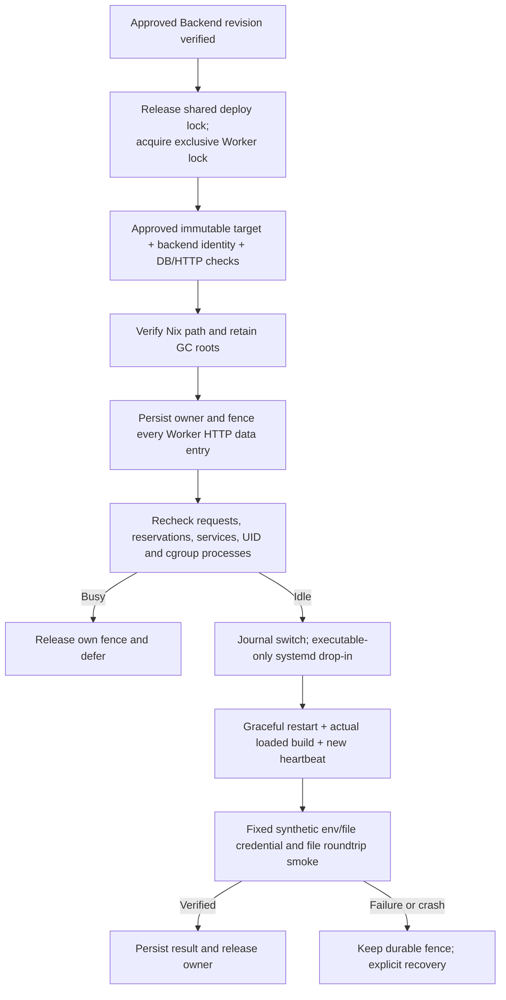

# Deployment-triggered Worker maintenance

Status: locally implemented and tested. Scheduled mutation is retired; installation and fleet rollout remain explicit, approved operations.
New OSS installation reuses its existing root-owned systemd DB input automatically.
Other deployments enroll only when a trusted existing DB input is available; old live
Workers still require their first approved idle activation. This is not blanket fleet
readiness merely from shipping files.

## Supported rollout boundary

- Root-managed systemd Worker with a dedicated non-root execution account, local
  HTTP transport and Linux cgroup v2. Development and user-systemd Workers are excluded.
- OSS bootstrap automatically supplies its already-owned `tower.env` path, without
  copying values. An existing OSS activation marker no longer skips enrollment on
  upgrade; the upgrade starts the bootstrap service to install maintenance without
  rotating identity or restarting the Worker.
- Other normal approved installers receive `TOWER_WORKER_MAINTENANCE_DATABASE_ENV_FILE`
  pointing to an existing root-owned **0600** environment file containing the same
  backend `DATABASE_URL`. Neither the installer nor the Worker copies this value.
  Alternatively, an explicitly supplied `TOWER_ASSIGNMENT_ENVIRONMENT_FILE` is
  reused only if it already meets the same protection checks; unsuitable inputs are
  not copied, chmodded or silently accepted.
  Parents must be root-owned and not group/other writable. Transport env retains
  its existing read permission for the Worker account.
- Missing enrollment input prints `not-enrolled`; it does not create a maintenance service or
  claim the Worker participates in deploy-time updates. Do not point this at an operator-owned
  mutable `.env`. Provide a separately approved root-only systemd environment input.
- `install-system-workbench-worker-units` calls `install-worker-maintenance` for new
  installs and normal approved reinstalls. Existing enrollment retains its DB input.
  First enrollment needs the **normal explicitly approved Worker activation** so
  the running process picks up its file-backed gate and non-killing stop policy.
  An old process without maintenance protocol blocks safely rather than restarting.
- An approved Backend/Operator deployment calls `deploy-installed` for **already
  enrolled same-VM Workers only** after Backend identity verification. It publishes
  the exact immutable target, waits up to 10 minutes for idle, transitions each Worker,
  and requires command/file smoke before deployment success. The wait is a hard deadline:
  each maintenance attempt receives only the remaining budget, so a nested systemd call
  cannot extend the Fleet run beyond the approved drain window. It does not enumerate a
  fleet or follow Git HEAD. Busy timeout, recovery state, build mismatch, or smoke
  failure fails/defer the deployment without SIGKILL. Alternative/custom deployment
  tools must use the same lock and synchronous command.

## Installation readiness and missing-enrollment detection

`worker-maintenance-readiness.py` inventories every installed local system Worker,
not only the primary assignment Worker. It returns `not-enrolled`, blocked with a
specific reason, or `ready`. Missing inventory is a warning, not vacuous success.
`--require-ready` exits nonzero for any missing enrollment, enabled/active legacy timer,
missing deployment service, unsafe stop policy, owned recovery state, or old running
process without the loaded
file fence. The audit checks protected file metadata without reading DB credentials;
process environment is reduced internally to the nonsecret fence path and is never
printed. Configured unit state alone is insufficient: live argv/protocol and PID
stability are also checked.

OSS Doctor invokes this gate for an activated Worker. Fleet `promote-verify` invokes
it unconditionally before reporting functional success, even when signed primary
assignment is disabled. Missing or unsuitable DB input includes a concrete installer
`nextAction`; old processes report `first-safe-activation-required`. The read-only
Worker version audit also includes per-Worker maintenance state and a separate
`maintenanceReady` flag, without confusing build match with installed maintenance.

This deliberately surfaces a rollout blocker for legacy VMs rather than relabeling
an opt-in implementation as automatic installation everywhere. Where an existing
customer DB environment belongs to the application user instead of root, implicit
reuse violates the ownership contract; explicit enrollment input and the first safe
activation remain necessary.

## Executed lifecycle

`tower-worker-maintenance` is the concrete Python runner, not an adapter interface.
It invokes `systemctl`, `nix-store`, a compiled read-only PostgreSQL observer, the
live Worker HTTP protocol, `/proc` and cgroup v2. The earlier
`worker-maintenance-policy.py` remains a small policy model, not the executable.

No systemd timer is installed or enabled. Reinstall disables and removes a legacy
maintenance timer. The oneshot service remains for audited/manual recovery, while
normal mutation is synchronously invoked by the approved deployment as
`deploy-installed STORE --wait-seconds 600`. `state.json` reports
updated/unchanged/deferred/blocked; `nextAttempt` remains `null` for schema compatibility.
A blocked invocation exits nonzero and does not schedule a retry. If the hard deadline
expires, the deployment terminates as `WORKER_DEPLOY_IDLE_TIMEOUT`; it does not kill the
existing Worker workload or silently continue an application cutover. Fleet also wraps
its complete remote `deploy-worker` SSH phase in a 630-second hard timeout with a short
TERM grace, preventing a disconnected `systemd-run` pipe from leaving the durable run in
`cutting-over` after remote maintenance has already returned to idle.

Legacy Workers that cannot advertise `scopeProbeProtocol` require one unchanged-store
restart to load the maintenance environment. That enrollment is journaled as
`gateActivatedStore` for the exact live Nix store, so retries proceed to normal drain
instead of repeatedly restarting and returning `deferred-existing-maintenance`. A new
live store requires its own enrollment marker; the marker never authorizes a target
change or bypasses idle checks. For older Worker builds that report `draining=true` from
an installed state-file projection, maintenance accepts the projection only when the
root-owned durable fence is clear, active requests are zero, and database activity is
zero; an owned or unreadable fence remains fail-closed.

## Safety and authority

The root-owned `/var/lib/tower-worker-maintenance/<worker-id>/state.json` stores
version, owner, phase, old target, new target, switch time, result and next attempt.
Writes use atomic rename and fsync. Ownership has **no TTL**. Missing, malformed or
unreadable configured state fails closed across process restarts. The Worker cannot
write its maintenance owner file, and transport bearer access cannot clear it.

Authenticated `/v1/runs`, file reads/uploads/manifests and service proxy paths enter
the synchronous gate **before their first await**. Existing work finishes; active
operations remain counted through asynchronous response completion. Health/readiness
and authenticated maintenance status remain available. The DB registry's independent
boolean drain is not overwritten: a foreign registry drain defers maintenance. The
HTTP gate, not a best-effort registry flag, is the admission authority here. A pending
backend reservation may receive maintenance 503; retry UX is the existing caller's
responsibility, and is not hidden as a successful run.

Idle requires no live capacity reservation (even expired-but-unreleased rows defer),
no nonterminal remote service row (`expired` is terminal and does not block), no active request, no extra cgroup process, and no
other process under the dedicated execution UID. Long-lived services and unknown
processes defer rather than being terminated. Other Workers sharing that UID can
conservatively defer this Worker; the approved deployment fails/defer after its
10-minute wait rather than forcing completion. No `kill`, pkill, PID guessing or group-stop is used by maintenance.

The stop-policy drop-in uses `KillMode=process`, `SendSIGKILL=no` and
`TimeoutStopSec=infinity`. A stuck graceful stop remains blocked with the fence
owned instead of escalating to SIGKILL. Executable selection is a separate drop-in;
identity, config, credentials, resource limits and filesystem rules are not rewritten
by the deployment-triggered runner. Approved and previous immutable closures remain GC-rooted.

Deployment tools acquire a **shared** lock at
`/var/lib/tower-worker-maintenance/deployment.lock`; maintenance owns it exclusively.
Integration covers detached upgrade/cutover and pinned restart (including rollback),
Operator migration orchestration and Fleet migration, the
Worker unit installer, assignment reconciler, OSS Worker bootstrap and Fleet Worker
apply wrappers. Lock availability is checked by the actual mutation process, not only
its planning parent. Arbitrary manual `systemctl` or unrelated custom deploy tools are
not magically fenced; operators must use this contract. Shared deploy tools retain
existing mutual exclusion among themselves; the new lock only excludes maintenance.

## Verification and recovery

Readiness provenance now comes from the **loaded immutable entrypoint path and its
release manifest**, not mutable JSON `runtimeProvenance`. Verification also checks
systemd MainPID and `/proc/<pid>/cmdline`, Worker-reported PID/store, readiness, and
DB heartbeat newer than switch initiation. The observer imports only `pg`, reads
normal `DATABASE_URL`, and emits counts/public identity; DB errors are redacted.

The owner probe at `/v1/maintenance/smoke` accepts **no caller command, path, service
or credential**. It runs a fixed command in an isolated maintenance scratch directory
using the same job environment/file Credential materializer and cleanup as normal
runs. It checks env-to-file content equality and a file write/read/delete roundtrip;
only an OK marker is reported. The runner verifies cleanup and no outstanding request.
This is synthetic transport/materialization evidence, **not Google OAuth or any
external provider authentication test**, and does not use customer credentials.

`status CONFIG` reads durable state. `recover CONFIG` is an explicit root action
requiring the same protected env injection as the oneshot service. Recovery never restarts or
rolls back automatically: it verifies the approved already-running target and smoke
before releasing. If the crash occurred while merely draining, it may verify the
recorded unchanged old build instead. Interrupted/failed switches with a different
live build require a separately approved operator repair; ordinary deploy attempts keep
the fence. Malformed state is not automatically overwritten or released.

## Code and local evidence

- `tower-worker-maintenance`: concrete lifecycle, shared lock, journal, process
  inspection, approval publication and explicit recovery.
- `install-worker-maintenance`: enrollment, GC pinning, systemd units, safe stop policy.
- `packages/backend/scripts/worker-maintenance-observe.ts`: read-only DB observer.
- `worker-maintenance-gate.ts` and Worker server/entrypoint: durable HTTP admission,
  derived live provenance and real synthetic probe execution.
- `flake.nix` and `scripts/oss/public-allowlist.txt`: packaged/public runtime helpers.

Local checks: 14 Python lifecycle/installer/deploy/lock tests, 5 maintenance readiness tests,
7 policy tests, 5 existing
installer permission tests; Worker HTTP/transport/GWS/upload/entrypoint suite plus
Python-controller-to-real-HTTP recovery test. `tsc --noEmit -p tsconfig.backend.json`,
Bash syntax, Nix expression parse and `git diff --check` were also run. Enrollment
follow-up also passed 56 tests across 7 version-audit, Nix/Fleet and Operator upgrade
source/behavior suites; these remain local, not installed-system evidence.

These checks use synthetic DB/systemd/Nix boundaries where appropriate. They do not
prove a built Nix closure, actual root installation, real PostgreSQL lifecycle, live
systemd restart/cgroup behavior, provider acceptance or fleet scheduling. Those are
explicit rollout gates; no production installation or restart was performed here.
