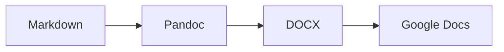
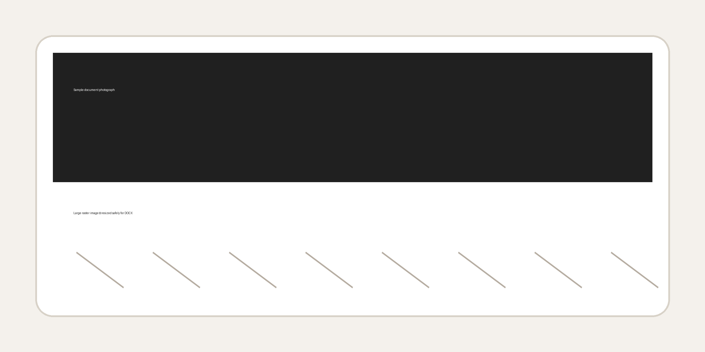

# 샘플 보고서

## 핵심 요약

Markdown 원문을 Google Docs에 올려도 무너지지 않는 DOCX로 변환하는 샘플입니다.

- 제목은 Word heading style로 변환됩니다.
- 표는 헤더 색상과 얇은 테두리를 갖습니다.
- Mermaid는 가능하면 PNG로 렌더링됩니다.

## 표 예시

| 항목 | 설명 | 상태 |
|---|---|---|
| Pandoc | Markdown 구조를 DOCX로 변환 | 채택 |
| python-docx | 표와 문단을 후처리 | 채택 |
| Quarto | 필요 시 고급 publishing layer | 보류 |

## 다이어그램



## 사진 예시



## ASCII 보존 예시

```ascii
+-------------+      +--------+
| raw note.md | ---> |  DOCX  |
+-------------+      +--------+
       |                 |
       v                 v
   stable text       safe import
```

> 문서는 복잡한 장식보다 안정적인 구조가 먼저입니다.
