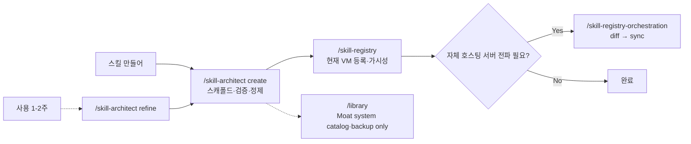

# Skill Architect — Lifecycle of a Skill on this VM

The lifecycle entry point — author, validate, audit, distill, refine. This skill's responsibility ends at "skill is good and on disk". From there the handoff depends on the role: `/skill-registry` for current-VM registration/visibility, `/skill-registry-orchestration` for self-hosted server diff/sync, and `/library` only for Moat system catalog/external backup.

> "한 번에 잘 만든다는 건 환상이다. **첫 시도에 잘 만들어지고, 반복으로 다듬어진다.**"

## When this triggers

- "스킬 만들어", "new skill", "create skill" → `/skill-architect create`
- "이 스킬 검증", "validate skill" → `/skill-architect validate`
- "전체 스킬 점검", "audit skills" → `/skill-architect audit`
- "스킬 본문 너무 두꺼움", "distill" → `/skill-architect distill`
- "이 스킬 좀 이상해", "스킬 개선", "refine" → `/skill-architect refine`
- "validate FAIL fix" → `/skill-architect fix` (validate 결과 자동 수정)

명령 명시 호출도 OK: `/skill-architect <mode> <args>`.

## Modes

| Mode | Cookbook | Purpose |
|---|---|---|
| `create` | [cookbook/create.md](cookbook/create.md) | **신규 command/skill 5-phase 워크플로우** — 먼저 code command / AI skill command 중 무엇인지 분류한 뒤, AI skill command면 Genesis → Scaffold → Smoke test → Validate → Register |
| `validate` | [cookbook/validate.md](cookbook/validate.md) | 단일 스킬 frontmatter + 구조 + best practice 검증 (+ 자동 fix) |
| `audit` | [cookbook/audit.md](cookbook/audit.md) | 디렉토리 일괄 검증 + 카탈로그 mismatch 체크 |
| `distill` | [cookbook/distill.md](cookbook/distill.md) | 본문 의미 분석 + reference 분리 (사용 1-2주 후 압축) |
| `refine` | [cookbook/refine.md](cookbook/refine.md) | 실 사용 경험 반영 4-phase (Observe → Diagnose → Apply → Verify) |
| `fix` | (validate cookbook 의 `--fix` 분기) | 자동 fix 가능 항목 즉시 수정 |

각 cookbook 은 단계별 가이드. **명령 호출 시 해당 cookbook 을 먼저 읽고 단계대로 실행**한다.

## Progress during authoring

스킬 생성·수정·검증은 반복 루프가 핵심이므로, 진행 관리는 `TodoWrite`와 최종 handoff 중심으로 한다. `ProcessMapWrite`와 채팅 옆 Process Map side panel은 기본 runtime surface에서 제거되어 legacy/실험용으로 남아 있다.

권장 큰 흐름:

```text
의도/JTBD 확인 → 기존 맥락·충돌 확인 → 스캐폴드/수정 → smoke/validate → 인계
```

규칙:
- TodoWrite는 현재 실행에 필요한 operational checklist로 사용한다.
- 최종 handoff에는 스킬 목적, trigger boundary, workflow, output contract, validation 상태를 짧게 요약한다.
- 사용자 입력·승인 대기 지점은 일반 답변 또는 TodoWrite 상태로 명확히 드러낸다.
- chain-of-thought, full prompt, secret, raw payload는 노출하지 않는다.
- 향후 run-level phase view가 필요하면 hierarchical Run Graph / 자동 roll-up 방향에서 재검토한다.

## Command kind 분류

사용자-facing 실행 단위는 **Command**다. `create` 시작 시 먼저 다음 중 하나로 분류한다.

| Kind | 생성물 | 기준 |
|---|---|---|
| `code` | backend/frontend command handler | AI 판단 없이 deterministic하게 실행되는 좁은 앱 제어 |
| `ai` | `SKILL.md` package + slash command entry | AI가 절차·판단·문서/도구 사용을 수행 |

별도 `workflow` command kind는 제품/빌더-facing 분류로 두지 않는다. 여러 단계가 필요한 작업은 `ai` command 내부의 skill process/spec으로 표현한다. Agent 호출 모델은 이 결정의 범위에서 제외한다.

기존 skill type 분류는 `ai` command 내부에서 사용한다.

## Skill type 분류

`reference / task / file-writing / multi-agent` — 자세한 분류 가이드는 [classification.md](classification.md). Scaffold 시 type 별 템플릿은 [templates.md](templates.md).

## Reference

| File | Content |
|---|---|
| [spec.md](spec.md) | Frontmatter spec, structure, allowed-tools, MCP integration |
| [templates.md](templates.md) | Type별 (reference/task/file-writing/multi-agent) 본문 템플릿 |
| [validation.md](validation.md) | 검증 체크리스트 (ERROR/WARN/INFO 분류) |
| [testing-guide.md](testing-guide.md) | TDD-style trigger probes + JTBD test pack 패턴 |
| [classification.md](classification.md) | Type 분류 결정 가이드 |

## 라이프사이클 핸드오프 — role split



**책임 경계**:

| 영역 | 책임 |
|---|---|
| **`/skill-architect`** | 스킬 body를 만들고 좋게 유지한다. |
| **`/skill-registry`** | current VM 등록, visibility, default/public/private/hidden, local/customer catalog. |
| **`/skill-registry-orchestration`** | operator-only self-hosted server diff/sync/checklist. |
| **`/library`** | Moat system `library.yaml`, external source/GitHub backup, legacy wrapper. |

`create` cookbook 의 마지막 단계는 host context 별로 다르다. Customer/company-local 등록은 `/skill-registry`로 넘기고, operator host에서 Moat system skill로 승격할 때만 `/library`를 쓴다. Self-hosted server 전파는 `/skill-registry-orchestration diff/sync`가 canonical path다.

## Host context

이 스킬은 **모든 호스트** (full / managed / standalone) 에서 동일하게 작동:
- 본 서버: 우리 source-of-truth 만들 때
- self-hosted deployment VM: 고객이 자기 VM 안 자체 스킬 만들 때 (`local-` prefix 권장 — `cookbook/create.md` Phase 1.4 참조)
- standalone self-hosted server: 자체 운영

다른 VM 으로 보내는 건 `/skill-registry-orchestration diff/sync` (operator host 전용). 이 스킬 책임 아님.

## Related

- 결정: `~/workspace/decisions/2026-05-01-skill-lifecycle-mandatory-entry-point.md` (라이프사이클 단일 진입점 정책)
- Distribution: [/library](../library/SKILL.md)
- Self-hosted server 운영: [/fleet](../fleet/SKILL.md)
