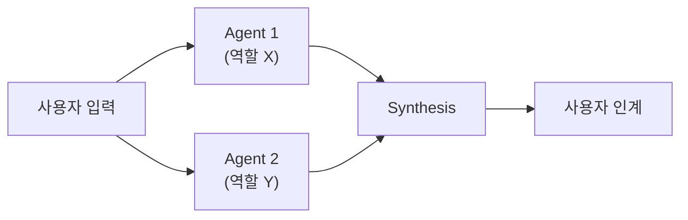

# Template: Multi-Agent

여러 sub-agent / 외부 CLI / 도구를 조율하는 스킬. 단일 단계로 안 끝나는 워크플로우.

## 언제 쓰나

- 같은 입력을 여러 모델로 돌려 비교 (예: `/best-of-n`, `/research`)
- 여러 외부 CLI 합주 (예: `/codex` + `/gemini` + 본 모델)
- Stage A → Stage B → Stage C 파이프라인 (예: `/skill-architect create` 의 5-phase)

## 형식

```markdown
---
name: my-orchestrator
description: <한 문장 — 어떤 합주인지>. Use when comparing/synthesizing across <X>, "<phrase 1>", "/my-orchestrator". NOT for: single-shot tasks (→ <task-skill>).
version: 0.1.0
tags: [task, multi-agent]
allowed-tools: Agent, Bash, Read, Write
---

# Orchestrator Title

## Overview



## Stages

### Stage 1 — Fan-out
- Agent 1: <역할, prompt 형식>
- Agent 2: <역할, prompt 형식>
- (병렬 실행 — 단일 메시지에 multiple Agent calls)

### Stage 2 — Synthesis
- 각 agent 산출 비교
- 충돌 resolution 규칙

### Stage 3 — 사용자 인계
- 합성 결과 + 각 agent 의 강·약점 요약
- 절대경로 인계 (필요 시)

## Agent Briefing 패턴

각 sub-agent 는 *문맥 없이* 시작. 따라서 prompt 에 모두 포함:
- **목표** — 무엇을 / 왜
- **이미 한 것** — 중복 작업 방지
- **출력 형식** — 정해두면 synthesis 쉬움
- **분량 cap** — "200 단어 이하" 같은 명시

## Synthesis 규칙

- 모든 agent 가 합의 → 그대로 채택
- 충돌 → <어떤 기준으로 결정?>
- 하나만 답 → <fallback?>

## Edge cases

- 일부 agent 실패 → 나머지로 진행 + 보고
- 모든 agent 실패 → 사용자에게 빠른 fallback (수동 가이드)
- 시간 초과 → 부분 결과 + 진행 상태 보고
